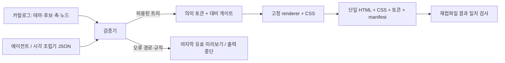

# 조립 규약과 강제 범위

## 입력 트리

`src/catalog.mjs`가 문법 정본이다. `blueprintSchema()`가 JSON Schema 2020-12를 생성한다. 이 스키마는 에디터의 입력 안내용이며, 테마와 팔레트의 관계·첫 페이지 제목·표 너비·ID 중복·링크 등은 **런타임 validator를 반드시 호출**해야 검증된다.

- page: 첫 노드는 page-header 한 개. 이후 section/grid/card/table/list/form/prose/hero/notice/actions.
- section: 제목과 1~8 자식. 하위 section 허용, hero는 금지. 깊이 상한으로 과도한 중첩 차단.
- grid: 2/3열. 2~6개 card/metric/list/notice만 허용. grid 안 grid·본문·form 금지.
- leaf: 자기 속성만 받는다. 이름이 비슷한 속성도 무시하지 않고 실패한다.
- 문서: 128KiB, 100노드, 깊이6. 문자열/행/열/폼 길이도 제한. URL은 HTTPS 또는 #main만 허용.

## 토큰

원본 팔레트 → 라이트/다크 표면 → 역할색 → 컴포넌트 CSS. 원색을 UI에 직접 칠하지 않는다. 동작색은 모든 실제 배경에서 4.5:1이 될 때까지 검정/흰색 방향으로 sRGB 보간한다. 색상 방향을 보존하려는 실용 알고리즘이며, 지각적으로 균등한 OKLCH 램프를 구현했다고 주장하지 않는다. 보정 전후 값을 manifest에서 확인한다.

각 팔레트/모드에서 실제 쓰는 25쌍(본문·보조·링크·상태·포커스·구조선·버튼 hover 포함)을 검사한다. 노드 간 간격, 패딩, 타이포 역할, 컨트롤 높이는 renderer 토큰으로 제한한다. 소비 입력은 토큰 값을 덮어쓸 수 없다.

## 상태와 상호작용

list/table은 ready/loading/empty/error/partial/forbidden을 갖는다. 데이터 없는 ready는 빈 목록을 그릴 수 있으므로 자동 상태는 state를 생략했을 때 적용한다. UI의 로컬 저장 실패/구문 오류/규약 오류/초기 로딩을 표시한다. 폼은 **입력 검증 데모**로 명시하고 브라우저에서만 유효성을 검사한다. 저장 API나 실제 조회 데이터를 붙였다고 오인시키지 않는다.

## 안전성과 수정 감지

텍스트를 escape하고 input에서 HTML/CSS/JS를 받지 않는다. 고정 form runtime만 포함한다. 생성 HTML의 CSP는 외부 연결·폼 전송·기본 URL 변경을 막고, 신뢰한 고정 inline 스타일/스크립트만 사용한다. CSP 자체를 임의 HTML 허용에 대한 대안으로 쓰지 않는다. 미리보기 iframe에는 allow-scripts와 네이티브 폼 유효성 검사에 필요한 allow-forms만 주고, allow-same-origin을 주지 않는다. 폼 네트워크 전송은 생성 문서의 CSP form-action none으로 차단한다.

`kit check`는 manifest만 믿지 않고 blueprint를 현재 카탈로그로 다시 컴파일한다. 모든 managed file을 비교하고 추가·누락·symlink도 거부한다. manifest SHA256은 재현/수정 감지용이고 서명 또는 공급망 보증은 아니다. **검사기를 같이 고칠 수 있는 권한을 막는 것은 저장소 관리 정책의 몫**이다.

생성 코드 밖 CSS로 감싸거나 상위 앱이 전역 스타일을 덮는 소비 방식은 이 검사로 차단되지 않는다. standalone HTML 또는 격리된 iframe으로 소비하고 통합 프로젝트의 자체 CI를 연결한다. 기존 arbitrary JSX/CSS를 자동 규약화하거나 전 제품 화면의 미감을 보증하는 기능은 없다.
