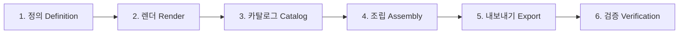

# 디자인 조립 플랫폼 공통 계약 명세서 (CONTRACTS.md)

- 상태: 채택 (Phase 0 전수 감사 및 기준선 수립)
- 버전: 1.2.0 (TASK-TRE-04 §9.3~§9.7 재료 범위 반영, 개정 내용은 §9)
- 적용 대상: Track A ~ Track G 전체 작업 트랙
- 관련 문서: `REQUEST.md`, `AGENTS.md`, `docs/architecture.md`, `docs/governance.md`, `docs/adr/0012-assembly-platform.md`, `docs/platform/wbs.md`

---

## 1. 개요 및 원칙

본 문서는 `winterholic/design-system-static-kit`의 대규모 고도화 작업에 참여하는 모든 작업자(사람 및 AI 에이전트)가 반드시 준수해야 하는 공통 계약이다.
각 트랙(Track A~G)은 독립적으로 병렬 작업을 수행하되, 본 문서에 규정된 ID 명명 규칙, 수명주기 계약, 인덱스 및 캐시 규격, Core 불변 조건을 위배해서는 안 된다.

### 1.1 핵심 불변 조건
1. **결정론적 출력 보장**: 동일 Blueprint, 동일 재료 버전, 동일 입력은 바이트 단위까지 동일한 HTML·CSS·Tokens를 생성해야 한다.
2. **LLM 런타임 배제**: 디자인 선택, 토큰 바인딩, 컴파일 런타임에 LLM을 필수 의존성으로 두지 않는다.
3. **기존 고정 출력·해시 보존**: 카탈로그 2.1.0 ~ 2.6.0 버전의 컴파일 출력, 고정 해시(`docs/evidence/context/legacy-hashes.json`), `site/v1/catalog.json`의 바이트를 변경하지 않는다.
   - `site/`는 git이 추적하는 생성물이다. `npm run build`(`scripts/build.mjs`)가 `src/` 전체를 `site/src/`로 복사하고, `npm run verify`의 `scripts/check-generated.mjs`가 새로 빌드한 결과와 바이트 비교한다. 따라서 `src/**`를 바꾼 트랙은 `npm run build`로 `site/`를 다시 만들어 같은 커밋에 넣는다. 이것은 허용되는 변경이다.
   - 허용되지 않는 변경은 `site/v1/catalog.json`과 legacy-hashes 대상 출력의 바이트 변화다. 이것이 달라지면 신규 재료가 2.1~2.6 경로로 새어 들어간 것이므로 되돌린다.
4. **신규 플랫폼 opt-in 격리**: 플랫폼 조립 및 신규 재료는 Blueprint 2.7.0 opt-in (`materials` 필드) 뒤에 격리하며, 기본 컴파일 버전(`CATALOG_VERSION = 2.4.0`)을 임의로 승격하지 않는다.
5. **실질적 완성도 원칙**: enum 추가, 이름 변경, 미사용 CSS 변수, 렌더러 미연결 정의는 구현으로 인정하지 않는다.

---

## 2. 재료 ID 및 버전 관리 정책

### 2.1 재료 고유 식별자 (Material ID) 규격
모든 재료는 `<네임스페이스>:<이름>` 식별자를 가진다. 형식의 단일 출처는 `src/materials/contract.mjs`의 `ID_PATTERN`(`^([a-z][a-z0-9-]*):([a-z0-9][a-z0-9.-]*)$`)이다.

```text
<namespace>:<name>[.<subname>]
```

네임스페이스와 재료 종류(`kind`)는 항상 같지 않다. 목적 패밀리는 kind가 `purpose-family`이고 id 네임스페이스는 `purpose`다(`purpose:card.kpi`). 기반 컴포넌트 `base-component:button-control`은 같은 구현·계약을 쓰는 구형 계약 `component:button-control`과 한 쌍이다. Manifest는 둘을 별개 기록으로 두고 `legacyDuplicateRelation`(`shares-contract`)으로 잇는다.

| 재료 종류 (`kind`) | 식별자 형식 예시 | 담당 소유 | 비고 |
|---|---|---|---|
| 원색 팔레트 (`palette`) | `palette:slate-neutral` | Track B | 원색 시드만 소유 (배경/글자 역할 미지정) |
| 서브토큰 세트 (`subtoken-set`) | `subtoken-set:tinted` | Track B | 23개 색상 역할 분배 규칙 (RoleRule) |
| 타이포 시스템 (`type-system`) | `type-system:tech-erp` | Track C | 서체 짝 × 역할 스케일의 조합 |
| 기반 컴포넌트 (`base-component`) | `base-component:button-control` | Track D | 동작, 구조, 상태, 기본 렌더러, CSS 조각 |
| 목적 패밀리 (`purpose-family`) | `purpose:card.kpi` | Track D | 특정 목적의 완성형 UI 레시피 |
| 시각 패밀리 (`family`) | `family:soft` | Track E | 모서리·그림자·표면 계층 등 형태 언어 |
| 차트 프리셋 (`chart-preset`) | `chart-preset:erp-quarterly-revenue` | Track E | SVG 차트 렌더러 및 데이터 스키마 |
| 레이아웃 패턴 (`layout-primitive`) | `layout-primitive:bento` | Track E | 슬롯 및 배치 규칙. 요구 24종(§9.2)은 이 종류만이 아니라 `pattern:*`, 구형 `component:*` 변형으로도 충족될 수 있다(Manifest `requirements[].coverage`) |
| 스타일 맥락 (`style-context`) | `style-context:enterprise` | Track E | 구형 테마의 맥락화. 순위/차단만 소유 |
| 표면/배경/모션/상태 | `surface:soft-layered`, `motion:calm`, `state-pattern:empty-inline` | Track E | 부가 시각 재료 |

### 2.2 버전 관리 정책
- **플랫폼 계약 버전**: `PLATFORM_CONTRACT_VERSION = 0.9.0`. 내부 모듈 변경 시 minor를 올리고 `docs/adr/0012-assembly-platform.md` 개정 기록에 남긴다.
- **서비스 계약 버전**: `CONTRACT_VERSION = 1.3.0`. 공개 API 변경 시 semver 원칙을 적용한다.
- **재료 버전**: 재료 기록은 semver `version` 필드를 포함한다. 기존 출력 해시를 깨뜨리는 수정은 금지되며, 수정이 필요한 경우 신규 ID 또는 새 재료 버전을 등록한다.

---

## 3. 신규 재료 등록 수명주기 경로 (6단계)

모든 신규 재료는 다음 6단계를 완결해야 정식 재료(Implemented/Verified)로 승격된다. 어느 한 단계라도 누락되면 `MATERIAL-COVERAGE.json`에서 `missing` 또는 `metadata-only`로 분류된다.



### 단계 1: 정의 (Definition)
- 대상 파일: `src/platform/data/<kind>.mjs` 또는 `src/materials/<name>.mjs`
- 공통 필수 필드:
  - `id`: 고유 ID
  - `kind`: 재료 종류
  - `version`: 계약 버전
  - `label`: UI 표시명
  - `contexts`: 허용 맥락. `any` 또는 페이지 유형 id다(`src/materials/contract.mjs`의 `CONTEXTS`; 예: `dashboard`, `landing`, `article`, `docs`, `commerce`, `listing`). 조립 목적 id(`work-dashboard`, `saas-landing` 등)가 아니다.
  - `tags`: 검색 태그
  - `relations`: 관계 선언 (`requires`, `forbids`, `prefers`, `avoids`; `src/platform/contract.mjs`)
  - `quality`: `{ status: "implemented" | "verified", evidence: string[] }`. `evidence`는 `tests/<파일>:<줄>` 참조의 배열이다. Manifest 생성기가 파일과 줄이 실제로 있는지 확인하고, 없는 참조가 하나라도 있으면 그 근거로는 `verified`를 부여하지 않는다.
  - `source`: `{ license: "internal" | "MIT" | "facts-only", origin?: string }`. `unverified`는 platform 레지스트리에 등록할 수 없다. 현재 `unverified`는 design(카탈로그) 레지스트리의 Coolors 427 팔레트뿐이다(§7).
  - `reuses`: 재사용하는 구형 재료 ID

### 단계 2: 렌더 (Render)
- 대상 파일: `src/materials/<name>.mjs` 또는 `src/platform/render.mjs`
- 원칙:
  - 순수 함수: `render(props, context) -> string (HTML/SVG)`
  - 전역 오염 금지: `[data-family="<name>"]` 등의 격리 범위 사용
  - 토큰 의존성: CSS 변수는 기존 컴파일 CSS가 소비하는 정규 변수(`--kit-*`)를 사용한다.

### 단계 3: 카탈로그 노출 (Catalog)
- 대상 파일: 경량 카탈로그 인덱스 및 웹 카탈로그 라우트
- 원칙(목표 상태):
  - 수작업 라우트 생성 없이 레지스트리 등록만으로 카탈로그 목록 및 검색 인덱스에 자동 노출되어야 한다.
  - 카테고리 탭 및 상세 페이지에서 변형·상태를 확인할 수 있어야 한다.
- 현재 상태: 경량 인덱스와 검색은 아직 없다(TASK-TRA-03). `chart-preset`, `type-preset`, `page-type`, `pattern`, `profile`은 어느 웹 라우트도 렌더하지 않는다(Manifest `blockedBy: not-in-web-catalog`).
- 판정 규칙(구속력 있음): 웹 노출은 `scripts/generate-material-coverage.mjs`의 `buildSurfaces()`에 등록된 라우트만 인정한다. 새 라우트나 화면을 만든 트랙은 같은 커밋에서 그 항목(라우트 파일, 파일 안에 있어야 할 증명 토큰, 재료 id를 계산하는 서비스 질의)을 추가해 달라고 Track G에 요청한다. 등록하지 않으면 Manifest는 그 재료를 `catalog-visible`로 올리지 않는다.

### 단계 4: 조립 파이프라인 연결 (Assembly)
- 대상 파일: `src/platform/registry.mjs`, `src/platform/relations.mjs`, `src/platform/page.mjs`
- 원칙:
  - `createPlatformRegistry()`에 등록되고, 관계 그래프에 등록된다.
  - `assemblePlatform` 및 `assemblePage` 파이프라인에서 추천 및 명시적 선택을 통해 정상 조립되어야 한다.

### 단계 5: 내보내기 반영 (Export)
- 대상 파일: `src/service/assemble-design.mjs`, `src/service/platform-components.mjs`(`assembleComponents`)
- 원칙:
  - 조립 결과의 HTML, CSS, Tokens, Manifest, Standalone 번들에 선택된 재료가 정확히 반영되어야 한다.
  - 전시용 코드와 실제 내보내기 코드가 불일치해서는 안 된다.

### 단계 6: 품질 검증 (Verification)
- 대상 파일: `tests/platform-<주제>-*.test.mjs`(기존 파일은 `platform-color-*`, `platform-type-*`, `platform-family-*`, `platform-pipeline-*`, `platform-service-*` 접두사를 쓴다. 새 파일도 같은 접두사를 따른다)
- 원칙:
  - RED-GREEN 검증: 결함을 주입했을 때 실패하는 단위 계약 테스트를 반드시 확보한다.
  - 접근성(WCAG 2.1 AA) 및 뷰포트(320px~1440px) 반응형 검증을 통과해야 `quality.status: verified`를 부여한다.
  - 기존 테스트 파일은 삭제·완화하지 않는다. `tests/material-coverage.test.mjs`는 이미 `scripts/materials/coverage.mjs` 보고서 검사에 쓰이므로 건드리지 않고, Manifest 검사는 `tests/material-coverage-manifest.test.mjs`로 만든다.
  - Manifest의 `verified`는 사다리 마지막 단계다: 웹 카탈로그 노출 + Studio 선택지 + (유효한 테스트 참조 또는 실제 조립 품질 검사 통과)가 모두 있어야 한다(§8).

---

## 4. 경량 카탈로그 인덱스 스키마 규격

클라이언트 브라우저가 첫 로딩 시 전체 카탈로그(`site/v1/catalog.json` 788,034바이트, 2026-11-28 실측)를 다운로드하거나 수천 개의 DOM 요소를 생성하는 것을 금지한다.
빌드 시점에 사전 생성되는 경량 카탈로그 인덱스는 다음 스키마를 따른다.

```typescript
interface LightCatalogIndex {
  schemaVersion: "catalog-index/1.0";
  catalogVersion: string;
  contentHash: string; // 본문의 sha256 앞 32자. 시각을 싣지 않는다(바이트 재현성, §1.1.1)
  categories: {
    id: string;
    label: string;
    itemCount: number;
  }[];
  materials: LightMaterialSummary[];
}

interface LightMaterialSummary {
  id: string;
  kind: string;
  category: string;
  label: string;
  contexts: string[];
  tags: string[];
  previewUrl: string; // 정적 대표 미리보기 SVG/WebP 경로(위치는 §5.3)
  variantsCount: number;
  statesCount: number;
  qualityStatus: "implemented" | "verified";
  license: "internal" | "MIT" | "facts-only";
}
```

- 목록 페이지에서는 `LightMaterialSummary`만 로딩하고, 상세 페이지 진입 시에만 전체 명세(`getComponentSpec` 또는 `getPlatformMaterial`)를 온디맨드로 조회한다.

---

## 5. 미리보기 사전 생성 계약 및 캐시 키 구성

### 5.1 미리보기 iframe 제거 정책
- 일반 카탈로그 목록 및 카드 그리드에서 활성 `iframe` 사용은 전면 금지한다 (목표: iframe 0개).
- 목록 카드는 빌드 시점에 사전 생성된 정적 SVG 또는 컴파일된 경량 HTML 스니펫을 인라인 렌더링한다.
- 인터랙티브 Playground가 포함된 상세 페이지에서만 격리된 iframe을 허용한다.

### 5.2 결정론적 캐시 키 규격
미리보기 생성 및 조립 결과 캐싱은 다음 요소로 SHA-256 해시를 만든다.

```text
engineVersion    = PLATFORM_CONTRACT_VERSION + "/" + CONTRACT_VERSION     // 현재 0.8.0/1.3.0 (`compilerVersion`이라는 상수는 코드에 없다)
materialIds      = 요청이 고른 모든 재료의 "id@version"을 사전순 정렬해 ","로 이은 문자열
canonicalRequest = 객체 키를 재귀적으로 사전순 정렬한 JSON(공백 없음). 문자열 값은 trim하지 않는다(콘텐츠가 바뀌므로)

CacheKey = SHA256(
  engineVersion + ":" +
  catalogVersion + ":" +
  materialIds + ":" +
  canonicalRequest + ":" +
  mode + ":" +
  (viewportWidth ?? "default")
).slice(0, 32)
```

`PLATFORM_CONTRACT_VERSION`은 `src/platform/index.mjs`, `CONTRACT_VERSION`은 `src/service/index.mjs`에서 가져온다. 둘 중 하나가 바뀌면 모든 캐시 키가 바뀌는 것이 맞다.

### 5.3 캐시 계층 및 만료 정책
1. **공개 고정 전시용 미리보기**:
   - 빌드 시점 생성 -> 정적 파일 `apps/web/public/previews/<CacheKey>.svg`(웹 빌드 산출물. git에 넣지 않고 빌드마다 다시 만든다). 파일명에 캐시 키가 들어 있어 내용이 바뀌면 이름이 바뀐다.
   - `site/`에는 쓰지 않는다. `site/`는 추적되는 생성물이고 `check-generated`가 `scripts/build.mjs`가 만든 파일 집합과 정확히 같을 것을 요구하므로(파일이 늘면 `Generated site file set mismatch`), 이 경로를 쓰려면 `scripts/build.mjs`가 같은 파일을 만들어야 한다. 위치를 바꾸려면 TASK-TRA-02에서 정하고 DECISIONS.md에 기록한다.
   - HTTP 헤더: `Cache-Control: public, max-age=31536000, immutable`.
2. **동적 요청 (Studio / API)**:
   - 서버 메모리 LRU 캐시 (최대 1,000 엔트리).
   - TTL: 무제한 (버전 해시가 키에 포함되므로 불변).
   - 프로세스 메모리 상한 초과 시 LRU 제거.

---

## 6. 트랙별 파일 소유 영역 및 공통 진입점

충돌 방지를 위해 각 파일은 오직 하나의 트랙만 수정할 수 있다. 소유하지 않은 파일을 수정해야 하는 경우 해당 트랙의 담당자에게 요청한다.

```text
┌────────────────────────────────────────────────────────┐
│                      Track G (통합)                     │
│  scripts/generate-material-coverage.mjs, docs/dev/**   │
└────────────────────────────────────────────────────────┘
     │            │            │            │
     ▼            ▼            ▼            ▼
┌──────────┐ ┌──────────┐ ┌──────────┐ ┌──────────┐
│ Track A  │ │ Track B  │ │ Track C  │ │ Track D  │
│ 성능/엔진│ │   색상   │ │ 타이포   │ │컴포넌트  │
└──────────┘ └──────────┘ └──────────┘ └──────────┘
     │            │            │            │
     ▼            ▼            ▼            ▼
┌──────────┐ ┌────────────────────────────────────┐
│ Track E  │ │             Track F                │
│ 패밀리/기초│ │          웹 제품 경험            │
└──────────┘ └────────────────────────────────────┘
```

| 트랙 | 전담 소유 파일 및 디렉터리 | 역할 |
|---|---|---|
| **Track A** (성능/플랫폼 기반) | `src/platform/{contract,registry,relations,recommend,pipeline,page,page-content,axes,render,compile,index}.mjs`, `src/service/**`, `apps/web/lib/api/**`, `apps/web/app/api/**`, `apps/web/scripts/**`, `scripts/platform/**`, `tests/platform-{service,pipeline,contract}-*.test.mjs` | 플랫폼 코어 엔진, 단일 서비스 진입점, REST/MCP, 사전 생성 파이프라인 |
| **Track B** (색상) | `src/platform/color.mjs`, `src/platform/data/palettes.mjs`, `src/platform/data/subtoken-sets.mjs`, `src/color-tokens.mjs`, `tests/platform-color*.test.mjs`, `tests/color-tokens.test.mjs`, `docs/platform/color.md` | 팔레트 200종, 서브토큰 세트 25종, 토큰 매핑 |
| **Track C** (타이포그래피) | `src/platform/type.mjs`, `src/platform/data/type-systems.mjs`, `src/platform/data/type-materials.mjs`, `src/materials/typography.mjs`, `tests/platform-type*.test.mjs`, `tests/material-type.test.mjs`, `docs/platform/typography.md` | 타이포 시스템 40종, 서체 짝 × 역할 스케일(역할 27종, REQUEST §5.3) |
| **Track D** (컴포넌트) | `src/platform/data/base-components.mjs`, `src/platform/families/**`(단 `visual.mjs`와 `legacy-map.mjs`는 제외), `src/materials/**`(단 `chart-presets.mjs`와 `typography.mjs`는 제외), `tests/material-components*.test.mjs`, `tests/platform-family-{base,purpose,a11y}.test.mjs` | 필수 컴포넌트 인벤토리 207항목(REQUEST §6.2 실측), 목적 패밀리 120종, 컨트롤 계약 |
| **Track E** (패밀리/Foundations) | `src/platform/family.mjs`, `src/platform/families/{visual,legacy-map}.mjs`, `src/platform/data/families.mjs`, `src/platform/data/{charts,surfaces,motion,backgrounds,media,states,style-contexts}.mjs`, `src/platform/style-materials.mjs`, `src/materials/chart-presets.mjs`, `src/render/chart*.mjs`, `src/layout.mjs`, `tests/chart-presets*.test.mjs`, `tests/layout*.test.mjs`, `tests/platform-family-legacy.test.mjs`, `tests/platform-style-*.test.mjs` | 시각 패밀리 12종, 차트 프리셋 29종, 레이아웃 24종, 스타일 재료 |
| **Track F** (웹 제품 경험) | `apps/web/app/**`(단 `api/` 제외), `apps/web/features/**`, `apps/web/shell/**`, `apps/web/ui/**` | 카테고리 탭, 컴포넌트 상세, 통합 색상 페이지, Studio, Explore UI |
| **Track G** (통합/품질) | `scripts/generate-material-coverage.mjs`, `docs/dev/catalog-platform-upgrade/**`, `tests/channel-*.test.mjs`, `tests/material-coverage-manifest.test.mjs`, `scripts/actual-output-verify.mjs`, `tests/actual-output*.test.mjs`, `e2e/**`, `playwright.config.mjs`, `package.json`의 scripts | Material Coverage 관리, 진행 장부 관리, E2E 검증, 릴리스 게이트 |
| **소유자 없음(고정 출력 영역)** | `src/catalog/**`, `src/compiler.mjs`, `src/validate.mjs`, `src/tokens.mjs`, `src/typography.mjs`, `src/styles/**`, `src/profiles/**`, `site/**`(생성물) | 2.1~2.6 출력과 고정 해시가 걸려 있다. §1.1.3 때문에 수정하지 않는다. 불가피하면 Track A와 Track G가 합의하고 DECISIONS.md에 버전 정책을 적은 뒤에만 연다 |

위 표에 없는 파일은 Track G가 소유자를 정한다. 같은 파일이 두 행에 걸리면 더 구체적인(예외를 적은) 행이 이긴다.

### 6.1 교차 트랙 수정 허가

다른 트랙이 소유한 파일을 고쳐야 하는 작업은 `TASK-LEDGER.json`의 그 작업에 `crossTrackFiles`(파일, 소유 트랙, 사유)를 적은 경우에만 허용한다. 소유 트랙의 작업이 같은 파일에서 `In Progress`이면 그 작업이 끝난 뒤에 고친다. 이 허가는 파일 단위이며 디렉터리 전체로 넓히지 않는다.

### 6.2 요구 항목 이름 충돌 처리

REQUEST.md의 요구 목록에는 이름이 같은 항목이 있다. `Bottom Navigation`은 §6.2의 E(내비게이션)와 O(모바일 패턴)에 모두 있고, `Master-detail`(§6.2 G, §9.2), `Bento`(§6.2 L, §9.2), `Brutalist`(§5.2, §7)도 다른 절에 겹쳐 있다. 처리 방식은 다음과 같다.

- 요구 항목은 **절 문자와 순번으로 구분하는 별개 항목**이다. id는 `req:comp:e-10-bottom-navigation`과 `req:comp:o-02-bottom-navigation`처럼 서로 다르다. 이름은 REQUEST.md 그대로 적고 바꾸지 않는다(예전 생성기는 O의 항목을 `Mobile Bottom Navigation`으로 바꿔 적었다).
- 총 항목 수는 이름이 아니라 항목 수로 센다(§6.2는 207개, 고유 이름은 206개).
- 같은 재료가 두 항목을 충족할 수 있다(두 `Bottom Navigation` 모두 `purpose:navigation.bottom`). 재료 기록은 하나이고 `requirementIds`가 두 id를 모두 가진다. 재료를 항목 수만큼 복제하지 않는다.
- 겹치는 이름은 Manifest의 `summary.requirements.duplicateNames`에 계산되어 나온다.

---

## 7. 권리 미확인 자산 격리 및 대체 정책

1. **Coolors 427 팔레트**:
   - `src/catalog/palette-rows.mjs`의 427개 팔레트는 재배포 권리가 확인되지 않은 외부 자료다.
   - **절대 금지**: 신규 플랫폼 레지스트리(`src/platform/data/palettes.mjs`)에 등록하거나 웹 카탈로그 공개 탐색 목록에 노출해서는 안 된다.
   - **호환 유지**: 기존 카탈로그 2.1~2.6 Blueprint 컴파일 요청 시에만 읽기 전용으로 내부 소비한다.
   - **대체**: Track B가 원색 시드 및 라이선스가 확인된 자체 팔레트 200종을 구축하여 공개 라이브러리를 대체한다.
   - **현행 편차(2026-11-28 실측)**: 427개 팔레트는 design 레지스트리에 있고 Studio `DesignPanel`의 "모든 팔레트" 목록에서 선택할 수 있으며(`studioAssemblable: true`), Explore 카드 일부가 이 팔레트를 쓴다. 위 "공개 탐색 목록 노출 금지"와 충돌하는 상태다. Manifest는 이 재료를 `rights-unverified`로 `metadata-only`에 두므로 새로운 노출이 생기면 `studioAssemblable`/`catalogVisible`이 바뀌어 드러난다. 해소 방식(Studio 선택지에서 빼거나 권리 결정을 받는다)은 Track F와 Track B가 DECISIONS.md에 정한다.
   - 거부된 호출: `getMaterial`은 이 팔레트를 돌려주지 않는다(REST·MCP 비노출은 이미 지켜진다: Manifest `restAndMcpAvailable: false`).
2. **웹폰트 및 아이콘 라이선스**:
   - 상업적 재배포 및 웹 임베딩이 허용된 오픈 라이선스(OFL, MIT, Apache 2.0)만 채택한다.
   - 전체 폰트 번들의 무차별 로딩을 금지하며 WOFF2 서브셋과 시스템 폰트 fallback을 기본으로 설정한다.

---

## 8. Material Coverage Manifest 계약 (`manifestVersion` 2.0.0)

`docs/dev/catalog-platform-upgrade/MATERIAL-COVERAGE.json`은 `scripts/generate-material-coverage.mjs`(Track G 소유)가 만든다. 이 파일을 손으로 고치지 않는다.

```sh
npm run coverage:materials         # 다시 만든다(약 30초)
npm run coverage:materials:check   # 저장본이 현재 코드와 바이트까지 같은지만 본다. 다르면 exit 1
```

### 8.1 수치의 출처 원칙
- 요구 목록(§4.4, §5.2, §6.2, §7, §9.1~§9.7)과 §2.1 기준표는 REQUEST.md를 읽어 온다. 생성기 안에 항목 수나 이전 기준값을 적지 않는다.
- 재료는 레지스트리에서 읽는다. 렌더·조립은 서비스 함수(`assembleDesign`, `assembleComponents`, `compileBlueprint`)와 `src/edit` 연산을 재료마다 실제로 호출해 본다.
- 계산이 비싼 값은 `docs/evidence/platform/baseline.json`에서 읽되, 읽은 위치와 신선도 검사 결과를 `provenance.expensiveValues`에 적는다. 값마다 숫자 fallback(`?? 9` 같은 것)을 두지 않는다.
- `comparisonTable`의 `status`는 실측값과 REQUEST.md §2.1 값의 비교로 정한다(`match` 또는 `drift`).
- 조합 가능 수는 `summary.combinations`에만 둔다. 재료 집계(`summary.byKind`)와 합산하거나 재료 수로 부르지 않는다.

### 8.2 재료 상태 사다리(누적)
`metadata-only`(권리 미확인 또는 정의 없음) → `defined`(정의와 권리는 통과, 서비스 호출로 렌더되지 않거나 출력에 효과가 없음) → `renderable`(서비스 호출로 실제 출력) → `catalog-visible`(웹 카탈로그 라우트가 렌더) → `assemblable`(Studio가 선택지를 제공) → `verified`(유효한 테스트 참조 또는 조립 품질 검사 통과). 앞 단계가 거짓이면 그 위로 올리지 않고, 막힌 첫 단계를 `blockedBy`에 적는다.

| `blockedBy` | 뜻 | 푸는 방법 |
|---|---|---|
| `rights-unverified` | `source.license: unverified` | 권리 확인(DECISIONS) |
| `no-definition` | 정의 위치(파일·심볼)가 없음 | 정의 추가 |
| `no-render-probe` | 이 종류를 서비스로 호출해 볼 경로가 없음 | 서비스 진입점 또는 생성기 프로브 추가 |
| `render-probe-failed` | 호출했지만 실패(`evidence.probe.reason`) | 재료 또는 계약 수정 |
| `no-observable-output` | 고른 것이 출력에 닿지 않음 | 출력에 반영 |
| `not-in-web-catalog` | 어느 웹 라우트도 렌더하지 않음 | 라우트 구현 + `buildSurfaces()` 등록(§3 단계 3) |
| `no-studio-choice` | Studio가 선택지를 주지 않음 | Studio 연결 |
| `no-verification-evidence` | 유효한 테스트 참조도 조립 품질 검사도 없음 | RED-GREEN 테스트 추가 |

### 8.3 요구 항목(`requirements[]`)
각 항목은 `coverage`가 `direct`(그 재료가 그대로 구현), `variant`(재료 하나의 변형 값으로 구현. 값이 근거 기록의 `variants`에 있는지 생성 때 확인), `schema`(구형 노드 스키마 열거값으로 구현), `part-of`(다른 재료의 구성 요소로만 존재), `missing` 중 하나다. 항목의 `status`는 연결된 재료 중 가장 높은 상태다. 매핑 표(생성기의 `COVERAGE`)가 레지스트리에 없는 재료 id나 변형 값을 가리키면 생성이 실패한다(조용히 `missing`이 되지 않는다). 트랙이 재료를 추가하면 `COVERAGE`의 해당 항목을 갱신해 달라고 Track G에 요청한다.

### 8.4 재현성
출력에는 시각, 난수, 절대경로, git revision을 싣지 않는다. 같은 코드면 바이트가 같아야 하며 `coverage:materials:check`로 확인한다.

---

## 9. 개정 기록

| 버전 | 내용 |
|---|---|
| 1.0.0 | Phase 0 감사 산출물(커밋 b70e2a248) |
| 1.1.0 | P0-AUDIT 독립 검증. 고정 해시 조항에 `site/` 재생성 절차 추가, ID 예시와 `contexts`·`quality.evidence`·`source` 필드 정의를 코드에 맞춤, 인덱스 스키마의 `generatedAt` 삭제(결정론 충돌), 캐시 키의 존재하지 않는 `compilerVersion` 제거와 정규화 규칙 명시, 미리보기 위치 충돌(`site/previews`) 해소, 파일 소유권 충돌(family.mjs, chart-presets.mjs, layout.mjs 등)과 소유자 없는 영역 정리, 교차 트랙 수정 규칙(§6.1)과 이름 충돌 규칙(§6.2) 추가, 컴포넌트 인벤토리 수를 220에서 207로 정정, Manifest 계약(§8) 추가 |
| 1.2.0 | TASK-TRE-04 재료 작업의 §9.3~§9.7 Manifest 요구 범위와 플랫폼 계약 0.9.0 간격·아이콘 재료를 명시 |

## 10. TASK-TRE-04 Foundations 재료 확장

- `spacing` 재료는 기존 `SPACE`의 4px 격자를 재사용하고, §9.3의 9개 역할(페이지 여백·섹션 간격·컨테이너 내부 여백·컴포넌트 내부 간격·형제 요소 간격·목록 간격·폼 간격·표 셀 간격·아이콘과 텍스트 간격)을 서로 다른 토큰 9개에 묶어 `[data-spacing-role]` opt-in 규칙으로 컴파일 CSS에 낸다. 두 역할이 같은 토큰을 읽으면 등록이 거부된다(같은 거리를 두 이름으로 부르지 않는다). `icon` 영역 재료는 기존 내부 원본 심볼만 허용하고 공통 24px viewBox·크기·최소 크기(16px, 그 크기에서 선 굵기 1.25px 이상)·선 굵기·정렬·시각 패밀리를 검증하며, 렌더 단계에서 viewBox를 대조하고 `data-icon-family`·`data-icon-size`를 찍어 CSS가 그 값을 읽는다.
- `surface`는 17개의 식별된 facets(반경·테두리·깊이)를, `motion`은 15개의 목적 패턴(property·duration·easing·delay·reduced-motion 정책)을 가진다. 17개 facet은 서로 다른 반경·테두리·그림자로 컴파일되며(Medium과 Deep Elevation은 그림자가 다르다), `.kit-surface[data-level]` 단계 규칙과 함께 달려도 이기도록 명시도를 한 단계 높였다. 15개 패턴은 서로 다른 전환 조합이고, reduced-motion 정책은 `instant`(전환 제거)와 `fade`(opacity만 짧게, transform 제거) 두 가지이며 패턴마다 컴파일 CSS에 규칙이 있다.
- `background`는 REQUEST §9.5의 12개 항목을 각각 서로 다른 재료 13종으로 제공한다(Tinted는 단색 틴트 `soft-tint`, Dot Pattern은 `brand-tint-dots`). Frosted blur는 0~16px이며 단일 `.kit-deco` 요소에 한정하고, 흐려질 또렷한 줄무늬를 바탕에 둔다(매끄러운 그라데이션 위의 blur는 화면에 보이지 않는다).
