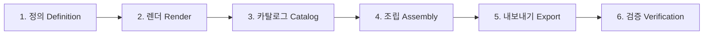

# 디자인 조립 플랫폼 공통 계약 명세서 (CONTRACTS.md)

- 상태: 채택 (Phase 0 전수 감사 및 기준선 수립)
- 버전: 1.0.0
- 적용 대상: Track A ~ Track G 전체 작업 트랙
- 관련 문서: `REQUEST.md`, `AGENTS.md`, `docs/architecture.md`, `docs/governance.md`, `docs/adr/0012-assembly-platform.md`, `docs/platform/wbs.md`

---

## 1. 개요 및 원칙

본 문서는 `winterholic/design-system-static-kit`의 대규모 고도화 작업에 참여하는 모든 작업자(사람 및 AI 에이전트)가 반드시 준수해야 하는 공통 계약이다.
각 트랙(Track A~G)은 독립적으로 병렬 작업을 수행하되, 본 문서에 규정된 ID 명명 규칙, 수명주기 계약, 인덱스 및 캐시 규격, Core 불변 조건을 위배해서는 안 된다.

### 1.1 핵심 불변 조건
1. **결정론적 출력 보장**: 동일 Blueprint, 동일 재료 버전, 동일 입력은 바이트 단위까지 동일한 HTML·CSS·Tokens를 생성해야 한다.
2. **LLM 런타임 배제**: 디자인 선택, 토큰 바인딩, 컴파일 런타임에 LLM을 필수 의존성으로 두지 않는다.
3. **기존 고정 해시 보존**: 카탈로그 2.1.0 ~ 2.6.0 버전의 컴파일 출력, 고정 해시(`docs/evidence/context/legacy-hashes.json` 등), `site/v1/catalog.json`의 바이트를 변경하지 않는다.
4. **신규 플랫폼 opt-in 격리**: 플랫폼 조립 및 신규 재료는 Blueprint 2.7.0 opt-in (`materials` 필드) 뒤에 격리하며, 기본 컴파일 버전(`CATALOG_VERSION = 2.4.0`)을 임의로 승격하지 않는다.
5. **실질적 완성도 원칙**: enum 추가, 이름 변경, 미사용 CSS 변수, 렌더러 미연결 정의는 구현으로 인정하지 않는다.

---

## 2. 재료 ID 및 버전 관리 정책

### 2.1 재료 고유 식별자 (Material ID) 규격
모든 재료는 영문 소문자, 숫자, 하이픈(`-`), 점(`.`) 및 콜론(`:`)으로 구성된 네임스페이스 식별자를 가진다.

```text
<kind>:<name>[.<subname>]
```

| 재료 종류 (`kind`) | 식별자 형식 예시 | 담당 소유 | 비고 |
|---|---|---|---|
| 원색 팔레트 (`palette`) | `palette:slate-neutral` | Track B | 원색 시드만 소유 (배경/글자 역할 미지정) |
| 서브토큰 세트 (`subtoken-set`) | `subtoken-set:brand-tinted` | Track B | 23개 색상 역할 분배 규칙 (RoleRule) |
| 타이포 시스템 (`type-system`) | `type-system:tech-erp` | Track C | 서체 짝 × 역할 스케일의 조합 |
| 기반 컴포넌트 (`base-component`) | `base-component:button-control` | Track D | 동작, 구조, 상태, 기본 렌더러, CSS 조각 |
| 목적 패밀리 (`purpose-family`) | `purpose:card.kpi` | Track D | 특정 목적의 완성형 UI 레시피 |
| 시각 패밀리 (`family`) | `family:soft` | Track E | 모서리·그림자·표면 계층 등 형태 언어 |
| 차트 프리셋 (`chart-preset`) | `chart-preset:kpi-bar-mini` | Track E | SVG 차트 렌더러 및 데이터 스키마 |
| 레이아웃 패턴 (`layout-primitive`) | `layout-primitive:bento` | Track E | 슬롯 및 배치 규칙 |
| 스타일 맥락 (`style-context`) | `style-context:enterprise` | Track E | 구형 테마의 맥락화. 순위/차단만 소유 |
| 표면/배경/모션/상태 | `surface:elevated-card`, `motion:gentle` | Track E | 부가 시각 재료 |

### 2.2 버전 관리 정책
- **플랫폼 계약 버전**: `PLATFORM_CONTRACT_VERSION = 0.7.0`. 내부 모듈 변경 시 minor를 올리고 `docs/adr/0012-assembly-platform.md` 개정 기록에 남긴다.
- **서비스 계약 버전**: `CONTRACT_VERSION = 1.3.0`. 공개 API 변경 시 semver 원칙을 적용한다.
- **재료 버전**: 재료 기록은 semver `version` 필드를 포함한다. 기존 출력 해시를 깨뜨리는 수정은 금지되며, 수정이 필요한 경우 신규 ID 또는 새 재료 버전을 등록한다.

---

## 3. 신규 재료 등록 수명주기 경로 (6단계)

모든 신규 재료는 다음 6단계를 완결해야 정식 재료(Implemented/Verified)로 승격된다. 어느 한 단계라도 누락되면 `MATERIAL-COVERAGE.json`에서 `missing` 또는 `metadata-only`로 분류된다.



### 단계 1: 정의 (Definition)
- 대상 파일: `src/platform/data/<kind>.mjs` 또는 `src/materials/<name>.mjs`
- 공통 필수 필드:
  - `id`: 고유 ID
  - `kind`: 재료 종류
  - `version`: 계약 버전
  - `label`: UI 표시명
  - `contexts`: 허용 맥락 (`any`, `work-dashboard`, `saas-landing`, `commerce`, `editorial-docs` 등)
  - `tags`: 검색 태그
  - `relations`: 관계 선언 (`requires`, `forbids`, `prefers`, `avoids`)
  - `quality`: `{ status: "implemented" | "verified", evidence?: string }`
  - `source`: `{ license: "internal" | "MIT", origin?: string }` (unverified 자료 등록 금지)
  - `reuses`: 재사용하는 구형 재료 ID

### 단계 2: 렌더 (Render)
- 대상 파일: `src/materials/<name>.mjs` 또는 `src/platform/render.mjs`
- 원칙:
  - 순수 함수: `render(props, context) -> string (HTML/SVG)`
  - 전역 오염 금지: `[data-family="<name>"]` 등의 격리 범위 사용
  - 토큰 의존성: CSS 변수는 기존 컴파일 CSS가 소비하는 정규 변수(`--kit-*`)를 사용한다.

### 단계 3: 카탈로그 노출 (Catalog)
- 대상 파일: 경량 카탈로그 인덱스 및 웹 카탈로그 라우트
- 원칙:
  - 수작업 라우트 생성 없이 레지스트리 등록만으로 카탈로그 목록 및 검색 인덱스에 자동 노출되어야 한다.
  - 카테고리 탭 및 상세 페이지에서 변형·상태를 확인할 수 있어야 한다.

### 단계 4: 조립 파이프라인 연결 (Assembly)
- 대상 파일: `src/platform/registry.mjs`, `src/platform/relations.mjs`, `src/platform/page.mjs`
- 원칙:
  - `createPlatformRegistry()`에 등록되고, 관계 그래프에 등록된다.
  - `assemblePlatform` 및 `assemblePage` 파이프라인에서 추천 및 명시적 선택을 통해 정상 조립되어야 한다.

### 단계 5: 내보내기 반영 (Export)
- 대상 파일: `src/service/assemble-design.mjs`
- 원칙:
  - 조립 결과의 HTML, CSS, Tokens, Manifest, Standalone 번들에 선택된 재료가 정확히 반영되어야 한다.
  - 전시용 코드와 실제 내보내기 코드가 불일치해서는 안 된다.

### 단계 6: 품질 검증 (Verification)
- 대상 파일: `tests/platform-<kind>.test.mjs`
- 원칙:
  - RED-GREEN 검증: 결함을 주입했을 때 실패하는 단위 계약 테스트를 반드시 확보한다.
  - 접근성(WCAG 2.1 AA) 및 뷰포트(320px~1440px) 반응형 검증을 통과해야 `quality.status: verified`를 부여한다.

---

## 4. 경량 카탈로그 인덱스 스키마 규격

클라이언트 브라우저가 첫 로딩 시 전체 카탈로그(780KB)를 다운로드하거나 수천 개의 DOM 요소를 생성하는 것을 금지한다.
빌드 시점에 사전 생성되는 경량 카탈로그 인덱스는 다음 스키마를 따른다.

```typescript
interface LightCatalogIndex {
  schemaVersion: "catalog-index/1.0";
  catalogVersion: string;
  generatedAt: string; // ISO 8601
  categories: {
    id: string;
    label: string;
    itemCount: number;
  }[];
  materials: LightMaterialSummary[];
}

interface LightMaterialSummary {
  id: string;
  kind: string;
  category: string;
  label: string;
  contexts: string[];
  tags: string[];
  previewUrl: string; // 정적 대표 미리보기 SVG/WebP 경로
  variantsCount: number;
  statesCount: number;
  qualityStatus: "implemented" | "verified";
  license: "internal" | "MIT";
}
```

- 목록 페이지에서는 `LightMaterialSummary`만 로딩하고, 상세 페이지 진입 시에만 전체 명세(`getComponentSpec` 또는 `getPlatformMaterial`)를 온디맨드로 조회한다.

---

## 5. 미리보기 사전 생성 계약 및 캐시 키 구성

### 5.1 미리보기 iframe 제거 정책
- 일반 카탈로그 목록 및 카드 그리드에서 활성 `iframe` 사용은 전면 금지한다 (목표: iframe 0개).
- 목록 카드는 빌드 시점에 사전 생성된 정적 SVG 또는 컴파일된 경량 HTML 스니펫을 인라인 렌더링한다.
- 인터랙티브 Playground가 포함된 상세 페이지에서만 격리된 iframe을 허용한다.

### 5.2 결정론적 캐시 키 규격
미리보기 생성 및 조립 결과 캐싱은 다음 요소들을 정규화(sortObj, trim)하여 SHA-256 해시로 구성한다.

```text
CacheKey = SHA256(
  compilerVersion + ":" +
  catalogVersion + ":" +
  materialId + "@" + materialVersion + ":" +
  canonicalRequestJSON + ":" +
  mode + ":" +
  (viewportWidth ?? "default")
).slice(0, 32)
```

### 5.3 캐시 계층 및 만료 정책
1. **공개 고정 전시용 미리보기**:
   - 빌드/CI 시점 생성 -> 정적 파일(`site/previews/*.svg`) 저장.
   - HTTP 헤더: `Cache-Control: public, max-age=31536000, immutable`.
2. **동적 요청 (Studio / API)**:
   - 서버 메모리 LRU 캐시 (최대 1,000 엔트리).
   - TTL: 무제한 (버전 해시가 키에 포함되므로 불변).
   - 프로세스 메모리 상한 초과 시 LRU 제거.

---

## 6. 트랙별 파일 소유 영역 및 공통 진입점

충돌 방지를 위해 각 파일은 오직 하나의 트랙만 수정할 수 있다. 소유하지 않은 파일을 수정해야 하는 경우 해당 트랙의 담당자에게 요청한다.

```text
┌────────────────────────────────────────────────────────┐
│                      Track G (통합)                     │
│  scripts/generate-material-coverage.mjs, docs/dev/**   │
└────────────────────────────────────────────────────────┘
     │            │            │            │
     ▼            ▼            ▼            ▼
┌──────────┐ ┌──────────┐ ┌──────────┐ ┌──────────┐
│ Track A  │ │ Track B  │ │ Track C  │ │ Track D  │
│ 성능/엔진│ │   색상   │ │ 타이포   │ │컴포넌트  │
└──────────┘ └──────────┘ └──────────┘ └──────────┘
     │            │            │            │
     ▼            ▼            ▼            ▼
┌──────────┐ ┌────────────────────────────────────┐
│ Track E  │ │             Track F                │
│ 패밀리/기초│ │          웹 제품 경험            │
└──────────┘ └────────────────────────────────────┘
```

| 트랙 | 전담 소유 파일 및 디렉터리 | 역할 |
|---|---|---|
| **Track A** (성능/플랫폼 기반) | `src/platform/{contract,registry,relations,recommend,pipeline,page,page-content,axes,index}.mjs`, `src/service/**`, `apps/web/lib/api/**`, `scripts/platform/**` | 플랫폼 코어 엔진, 단일 서비스 진입점, REST/MCP, 사전 생성 파이프라인 |
| **Track B** (색상) | `src/platform/color.mjs`, `src/platform/data/palettes.mjs`, `src/platform/data/subtoken-sets.mjs`, `src/color-tokens.mjs`, `tests/platform-color*.test.mjs` | 팔레트 200종, 서브토큰 세트 25종, 토큰 매핑 |
| **Track C** (타이포그래피) | `src/platform/type.mjs`, `src/platform/data/type-systems.mjs`, `tests/platform-type*.test.mjs` | 타이포 시스템 40종, 서체 짝 × 역할 스케일 |
| **Track D** (컴포넌트) | `src/platform/family.mjs`, `src/platform/data/base-components.mjs`, `src/platform/families/**`, `src/materials/**` | 필수 컴포넌트 220종 인벤토리, 목적 패밀리 120종, 컨트롤 계약 |
| **Track E** (패밀리/Foundations) | `src/platform/data/families.mjs`, `src/platform/data/{charts,surfaces,motion,backgrounds,media,states,style-contexts}.mjs`, `src/render/chart*.mjs` | 시각 패밀리 12종, 차트 프리셋 29종, 레이아웃 24종, 스타일 재료 |
| **Track F** (웹 제품 경험) | `apps/web/app/**` (api 제외), `apps/web/features/**`, `apps/web/components/**` | 카테고리 탭, 컴포넌트 상세, 통합 색상 페이지, Studio, Explore UI |
| **Track G** (통합/품질) | `scripts/generate-material-coverage.mjs`, `docs/dev/catalog-platform-upgrade/**`, `tests/channel-*.test.mjs` | Material Coverage 관리, 진행 장부 관리, E2E 검증, 릴리스 게이트 |

---

## 7. 권리 미확인 자산 격리 및 대체 정책

1. **Coolors 427 팔레트**:
   - `src/catalog/palette-rows.mjs`의 427개 팔레트는 재배포 권리가 확인되지 않은 외부 자료다.
   - **절대 금지**: 신규 플랫폼 레지스트리(`src/platform/data/palettes.mjs`)에 등록하거나 웹 카탈로그 공개 탐색 목록에 노출해서는 안 된다.
   - **호환 유지**: 기존 카탈로그 2.1~2.6 Blueprint 컴파일 요청 시에만 읽기 전용으로 내부 소비한다.
   - **대체**: Track B가 원색 시드 및 라이선스가 확인된 자체 팔레트 200종을 구축하여 공개 라이브러리를 대체한다.
2. **웹폰트 및 아이콘 라이선스**:
   - 상업적 재배포 및 웹 임베딩이 허용된 오픈 라이선스(OFL, MIT, Apache 2.0)만 채택한다.
   - 전체 폰트 번들의 무차별 로딩을 금지하며 WOFF2 서브셋과 시스템 폰트 fallback을 기본으로 설정한다.
