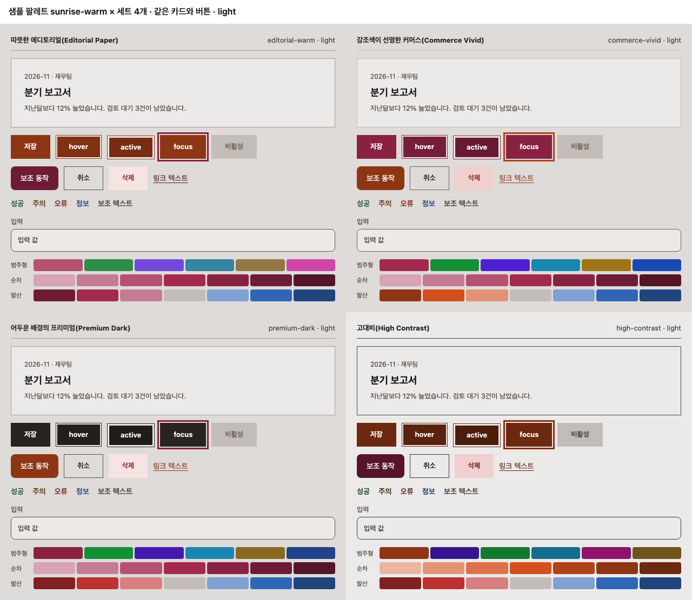
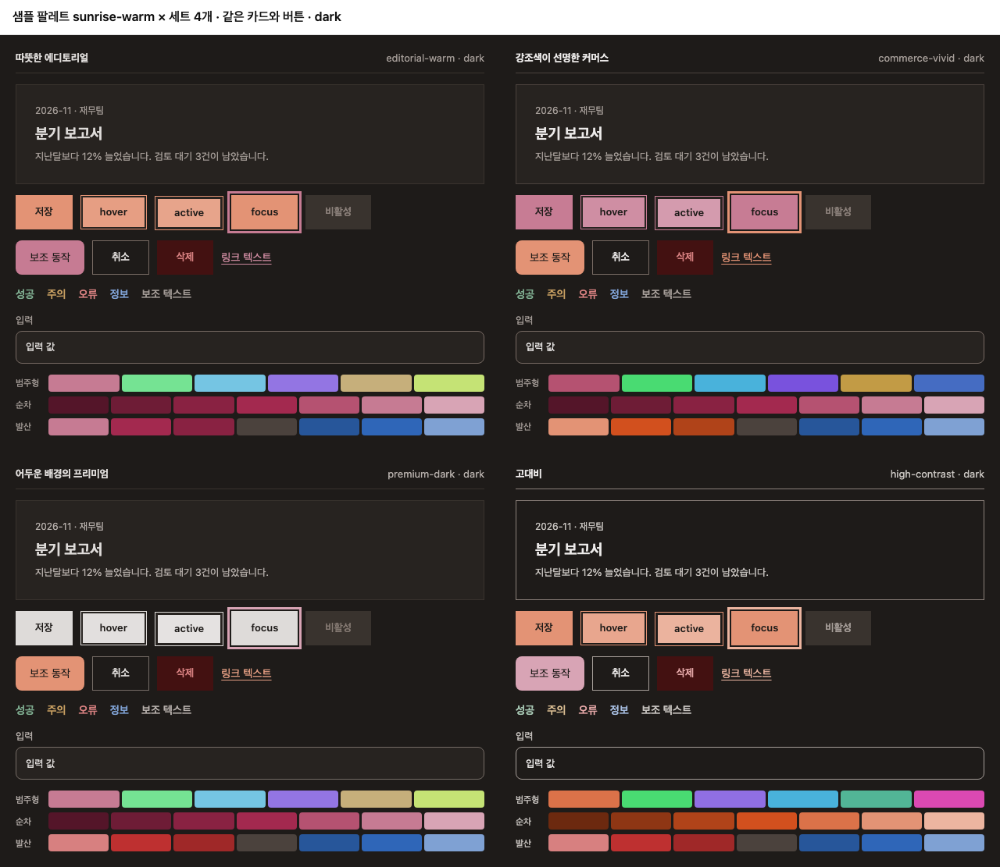

# 색 재료(W1)

기준은 [ADR 0012](../adr/0012-assembly-platform.md) §1.1과 [WBS](wbs.md) W1이다. 팔레트(원색)와 서브토큰 세트(역할 분배)를 다대다로 묶고, 결합 결과를 실제 렌더 변수까지 낸다.

- 팔레트는 `src/platform/data/palettes.mjs`, 세트는 `src/platform/data/subtoken-sets.mjs`, 결합은 `src/platform/color.mjs`의 `bindColor`다.
- 이 표의 수는 성과가 아니다. 각 숫자는 계산 관계 `palette-subtoken`이 라이트와 다크 두 모드에서 대비 게이트를 통과한 쌍이다. 쌍은 원색을 섞어 늘린 것이 아니라, 하나의 세트 설계가 여러 팔레트에서 어떻게 달라지는지 확인하려고 둔 것이다.
- 재생성: `node docs/platform/evidence/color/build.mjs`(표 두 개와 스크린샷). 표를 손으로 고치지 않는다. `tests/platform-color-docs.test.mjs`가 같은지 비교한다.

## 1. 팔레트 210개 (신규 201개 + 기존 9개)

계열은 group 태그로 고정한다. 계열별 수: neutral 21 · blue-cyan 21 · green-teal 21 · warm 21 · earth 21 · purple-pink 21 · pastel 21 · vivid 21 · luxury 21 · multi-color 21. tone은 brand 시드 OKLab L이 0.40 미만이면 dark, 0.56 초과면 bright, 그 사이는 mid다.

| id | 계열 | tone | brand | accent(보조) | neutral | success · warning · danger · info |
|---|---|---|---|---|---|---|
| `static-kit` | multi-color | mid | `#3157D5` | `#087E8B` | `#596579` | `#18714C` `#946000` `#B83543` `#2A63C9` |
| `slate-neutral` | neutral | mid | `#4B5C74` | `#9A5B3E` | `#5D6878` | `#2E7752` `#8E6200` `#B03A44` `#3A64A8` |
| `sunrise-warm` | warm | mid | `#D2501E` | `#A3294F` | `#6F625A` | `#2F7A4B` `#A86500` `#BE3030` `#2F66B8` |
| `ocean-cool` | blue-cyan | mid | `#0D6E8E` | `#6A52C9` | `#576B7E` | `#1F7A5C` `#8F6500` `#B13A4F` `#2B5FB5` |
| `forest-green` | green-teal | mid | `#2E7A52` | `#B07A1F` | `#5A6B5F` | `#2C8340` `#9E6A00` `#B23A3A` `#2D6A9F` |
| `clay-earth` | earth | mid | `#8A6238` | `#56784F` | `#6B6355` | `#3F7A45` `#9A6B08` `#B04032` `#3E6F8C` |
| `graphite-mono` | neutral | dark | `#2B2D33` | `#4D4F57` | `#5E5F63` | `#2F7A4F` `#8D6200` `#B23A40` `#37649F` |
| `dusk-violet` | purple-pink | mid | `#6D49B8` | `#C0507A` | `#645F78` | `#2D7A58` `#946000` `#B8384A` `#3E64B5` |
| `magenta-vivid` | vivid | bright | `#D1228F` | `#00A3AD` | `#6A6373` | `#1F8A4C` `#A66A00` `#C42B3C` `#2E6FD0` |
| `zinc-minimal` | neutral | mid | `#82647A` | `#3C448D` | `#5B645E` | `#40783B` `#9C6900` `#A83634` `#196EA9` |
| `cool-gray-studio` | neutral | mid | `#5E7472` | `#7A3700` | `#5A6369` | `#40783B` `#9C6900` `#A83634` `#196EA9` |
| `charcoal-modern` | neutral | mid | `#6B4A59` | `#065D5A` | `#655F67` | `#40783B` `#9C6900` `#A83634` `#196EA9` |
| `titanium-pure` | neutral | mid | `#315E5B` | `#7F325F` | `#69625B` | `#40783B` `#9C6900` `#A83634` `#196EA9` |
| `ash-architectural` | neutral | mid | `#646D8C` | `#554F00` | `#61635A` | `#40783B` `#9C6900` `#A83634` `#196EA9` |
| `silver-stream` | neutral | mid | `#5A4F6D` | `#005280` | `#596464` | `#40783B` `#9C6900` `#A83634` `#196EA9` |
| `onyx-precision` | neutral | mid | `#507486` | `#7D5500` | `#6B5D60` | `#40783B` `#9C6900` `#A83634` `#196EA9` |
| `fog-quiet` | neutral | mid | `#4B5C64` | `#04697B` | `#666156` | `#40783B` `#9C6900` `#A83634` `#196EA9` |
| `basalt-foundation` | neutral | mid | `#716C7B` | `#8F3C63` | `#59655F` | `#40783B` `#9C6900` `#A83634` `#196EA9` |
| `pebble-neutral` | neutral | mid | `#615560` | `#007C5E` | `#67636E` | `#40783B` `#9C6900` `#A83634` `#196EA9` |
| `smoked-glass` | neutral | mid | `#3A596E` | `#4158A1` | `#665E68` | `#40783B` `#9C6900` `#A83634` `#196EA9` |
| `steel-minimal` | neutral | mid | `#4A787B` | `#863047` | `#696066` | `#40783B` `#9C6900` `#A83634` `#196EA9` |
| `shadow-contrast` | neutral | mid | `#555868` | `#1276AD` | `#546569` | `#40783B` `#9C6900` `#A83634` `#196EA9` |
| `alabaster-pure` | neutral | mid | `#63717D` | `#64458F` | `#5E6863` | `#40783B` `#9C6900` `#A83634` `#196EA9` |
| `ironclad-dark` | neutral | mid | `#786784` | `#5F6B00` | `#66616B` | `#40783B` `#9C6900` `#A83634` `#196EA9` |
| `urban-concrete` | neutral | mid | `#7B6971` | `#2E64A6` | `#6D605E` | `#40783B` `#9C6900` `#A83634` `#196EA9` |
| `mist-ambient` | neutral | mid | `#325D66` | `#426400` | `#5D626A` | `#40783B` `#9C6900` `#A83634` `#196EA9` |
| `flint-crisp` | neutral | mid | `#5E5564` | `#764AA2` | `#6C625F` | `#40783B` `#9C6900` `#A83634` `#196EA9` |
| `obsidian-high` | neutral | mid | `#6E6A8A` | `#902829` | `#71605E` | `#40783B` `#9C6900` `#A83634` `#196EA9` |
| `cobalt-enterprise` | blue-cyan | mid | `#0055A1` | `#005B4F` | `#5E645C` | `#40783B` `#9C6900` `#A83634` `#196EA9` |
| `azure-tech` | blue-cyan | mid | `#0072C1` | `#7A346A` | `#5D646B` | `#40783B` `#9C6900` `#A83634` `#196EA9` |
| `sky-horizon` | blue-cyan | mid | `#4843AA` | `#5C4C00` | `#626069` | `#40783B` `#9C6900` `#A83634` `#196EA9` |
| `electric-cyan` | blue-cyan | mid | `#5C60C9` | `#005475` | `#695E5F` | `#40783B` `#9C6900` `#A83634` `#196EA9` |
| `deep-sapphire` | blue-cyan | mid | `#005C86` | `#812A3D` | `#646259` | `#40783B` `#9C6900` `#A83634` `#196EA9` |
| `arctic-blue` | blue-cyan | mid | `#088075` | `#035E23` | `#5A6461` | `#40783B` `#9C6900` `#A83634` `#196EA9` |
| `pacific-deep` | blue-cyan | mid | `#445282` | `#783D7D` | `#68636B` | `#40783B` `#9C6900` `#A83634` `#196EA9` |
| `neon-cyan` | blue-cyan | mid | `#007D8E` | `#546700` | `#696057` | `#40783B` `#9C6900` `#A83634` `#196EA9` |
| `marine-navy` | blue-cyan | mid | `#3D68CA` | `#545AA6` | `#596762` | `#40783B` `#9C6900` `#A83634` `#196EA9` |
| `cerulean-bright` | blue-cyan | mid | `#0077AC` | `#846D00` | `#665E6A` | `#40783B` `#9C6900` `#A83634` `#196EA9` |
| `glacial-stream` | blue-cyan | mid | `#2B4BAC` | `#33600D` | `#5C656A` | `#40783B` `#9C6900` `#A83634` `#196EA9` |
| `indigo-wave` | blue-cyan | mid | `#49729C` | `#3D4B94` | `#676169` | `#40783B` `#9C6900` `#A83634` `#196EA9` |
| `royal-blue` | blue-cyan | mid | `#006457` | `#843900` | `#6B615E` | `#40783B` `#9C6900` `#A83634` `#196EA9` |
| `polar-frost` | blue-cyan | mid | `#005F74` | `#5E338A` | `#65606E` | `#40783B` `#9C6900` `#A83634` `#196EA9` |
| `blueprint-tech` | blue-cyan | mid | `#65699D` | `#9F5C0E` | `#6C5D63` | `#40783B` `#9C6900` `#A83634` `#196EA9` |
| `aegean-sea` | blue-cyan | mid | `#315880` | `#644800` | `#5B6369` | `#40783B` `#9C6900` `#A83634` `#196EA9` |
| `ultramarine-sharp` | blue-cyan | mid | `#006267` | `#845196` | `#64665B` | `#40783B` `#9C6900` `#A83634` `#196EA9` |
| `twilight-harbor` | blue-cyan | mid | `#586E9E` | `#6E7604` | `#55646B` | `#40783B` `#9C6900` `#A83634` `#196EA9` |
| `cyan-accent` | blue-cyan | mid | `#047E82` | `#543F99` | `#716062` | `#40783B` `#9C6900` `#A83634` `#196EA9` |
| `deep-nordic-blue` | blue-cyan | bright | `#8C5AD3` | `#39458D` | `#596464` | `#40783B` `#9C6900` `#A83634` `#196EA9` |
| `emerald-corporate` | green-teal | mid | `#5A5900` | `#6F519C` | `#6B636C` | `#40783B` `#9C6900` `#A83634` `#196EA9` |
| `pine-deep` | green-teal | mid | `#016807` | `#7E2A49` | `#62646D` | `#40783B` `#9C6900` `#A83634` `#196EA9` |
| `mint-fresh` | green-teal | mid | `#717500` | `#265B0F` | `#6B6165` | `#40783B` `#9C6900` `#A83634` `#196EA9` |
| `dark-teal` | green-teal | mid | `#3C821D` | `#3D448D` | `#69635C` | `#40783B` `#9C6900` `#A83634` `#196EA9` |
| `jade-botanical` | green-teal | mid | `#3A6036` | `#724800` | `#5E6967` | `#40783B` `#9C6900` `#A83634` `#196EA9` |
| `sage-organic` | green-teal | mid | `#5F7845` | `#005E6A` | `#62666E` | `#40783B` `#9C6900` `#A83634` `#196EA9` |
| `spruce-mountain` | green-teal | mid | `#886B00` | `#6F316D` | `#67626A` | `#40783B` `#9C6900` `#A83634` `#196EA9` |
| `moss-calm` | green-teal | mid | `#406100` | `#9A4485` | `#6E615C` | `#40783B` `#9C6900` `#A83634` `#196EA9` |
| `cyber-teal` | green-teal | mid | `#00854A` | `#814A8C` | `#5C686F` | `#40783B` `#9C6900` `#A83634` `#196EA9` |
| `seafoam-light` | green-teal | mid | `#006734` | `#005D34` | `#71625C` | `#40783B` `#9C6900` `#A83634` `#196EA9` |
| `fern-lush` | green-teal | mid | `#777136` | `#5A67B4` | `#696456` | `#40783B` `#9C6900` `#A83634` `#196EA9` |
| `evergreen-stable` | green-teal | mid | `#675317` | `#7F3A73` | `#6F6661` | `#40783B` `#9C6900` `#A83634` `#196EA9` |
| `olive-teal` | green-teal | mid | `#5C7B00` | `#6A4400` | `#6A635C` | `#40783B` `#9C6900` `#A83634` `#196EA9` |
| `alpine-breeze` | green-teal | mid | `#008264` | `#005B7B` | `#5E6965` | `#40783B` `#9C6900` `#A83634` `#196EA9` |
| `basil-crisp` | green-teal | mid | `#006547` | `#007177` | `#5F6A6B` | `#40783B` `#9C6900` `#A83634` `#196EA9` |
| `amazon-deep` | green-teal | mid | `#4E5C26` | `#B14651` | `#6E6268` | `#40783B` `#9C6900` `#A83634` `#196EA9` |
| `spearmint-clean` | green-teal | mid | `#4E7B53` | `#9E4766` | `#5D6B67` | `#40783B` `#9C6900` `#A83634` `#196EA9` |
| `malachite-rich` | green-teal | mid | `#7D7000` | `#80300C` | `#66655C` | `#40783B` `#9C6900` `#A83634` `#196EA9` |
| `cedar-woodland` | green-teal | mid | `#816D34` | `#9C3349` | `#63685F` | `#40783B` `#9C6900` `#A83634` `#196EA9` |
| `agave-vital` | green-teal | mid | `#6B753C` | `#565700` | `#606B60` | `#40783B` `#9C6900` `#A83634` `#196EA9` |
| `crimson-dynamic` | warm | mid | `#A80022` | `#2F488E` | `#5C626A` | `#40783B` `#9C6900` `#A83634` `#196EA9` |
| `coral-radiant` | warm | mid | `#9E0067` | `#803103` | `#675F65` | `#40783B` `#9C6900` `#A83634` `#196EA9` |
| `amber-glow` | warm | mid | `#AF4561` | `#015A50` | `#68605A` | `#40783B` `#9C6900` `#A83634` `#196EA9` |
| `sunset-orange` | warm | mid | `#8E3C00` | `#683376` | `#5E635B` | `#40783B` `#9C6900` `#A83634` `#196EA9` |
| `terracotta-warm` | warm | mid | `#C9212E` | `#5B4C00` | `#596466` | `#40783B` `#9C6900` `#A83634` `#196EA9` |
| `flame-vivid` | warm | mid | `#AE5000` | `#005476` | `#616069` | `#40783B` `#9C6900` `#A83634` `#196EA9` |
| `scarlet-bold` | warm | mid | `#942C4D` | `#8B3F02` | `#6A645C` | `#40783B` `#9C6900` `#A83634` `#196EA9` |
| `tangerine-crisp` | warm | mid | `#C2206A` | `#005E24` | `#656159` | `#40783B` `#9C6900` `#A83634` `#196EA9` |
| `cherry-deep` | warm | mid | `#B1483E` | `#4A3F8A` | `#5A6460` | `#40783B` `#9C6900` `#A83634` `#196EA9` |
| `apricot-soft` | warm | mid | `#972F29` | `#6B4D00` | `#61636B` | `#40783B` `#9C6900` `#A83634` `#196EA9` |
| `paprika-spice` | warm | mid | `#BF3900` | `#325CA0` | `#6A5F58` | `#40783B` `#9C6900` `#A83634` `#196EA9` |
| `persimmon-rich` | warm | mid | `#A4004C` | `#4D5200` | `#5C6470` | `#40783B` `#9C6900` `#A83634` `#196EA9` |
| `rust-heritage` | warm | mid | `#9C5F01` | `#4A5300` | `#60635A` | `#40783B` `#9C6900` `#A83634` `#196EA9` |
| `sienna-clay` | warm | mid | `#7E4A00` | `#74478E` | `#62606B` | `#40783B` `#9C6900` `#A83634` `#196EA9` |
| `ember-warm` | warm | mid | `#C71E4F` | `#822D1F` | `#60616A` | `#40783B` `#9C6900` `#A83634` `#196EA9` |
| `ruby-precision` | warm | mid | `#A8477A` | `#006786` | `#656256` | `#40783B` `#9C6900` `#A83634` `#196EA9` |
| `blood-orange` | warm | mid | `#8E2F63` | `#9F5C0B` | `#5C626F` | `#40783B` `#9C6900` `#A83634` `#196EA9` |
| `copper-metallic` | warm | mid | `#B04C29` | `#2F6E2A` | `#5A626C` | `#40783B` `#9C6900` `#A83634` `#196EA9` |
| `saffron-sun` | warm | mid | `#962D3C` | `#51539F` | `#685E66` | `#40783B` `#9C6900` `#A83634` `#196EA9` |
| `vermilion-bright` | warm | mid | `#B14651` | `#7E2A4B` | `#655F67` | `#40783B` `#9C6900` `#A83634` `#196EA9` |
| `ochre-mineral` | earth | mid | `#724A39` | `#9C433D` | `#696258` | `#40783B` `#9C6900` `#A83634` `#196EA9` |
| `warm-sand` | earth | mid | `#8E6257` | `#007653` | `#5B675F` | `#40783B` `#9C6900` `#A83634` `#196EA9` |
| `dark-walnut` | earth | mid | `#A15930` | `#9C5084` | `#635F6D` | `#40783B` `#9C6900` `#A83634` `#196EA9` |
| `bronze-antique` | earth | mid | `#873B28` | `#245C00` | `#6E6058` | `#40783B` `#9C6900` `#A83634` `#196EA9` |
| `desert-dune` | earth | mid | `#6A502F` | `#646101` | `#6C6457` | `#40783B` `#9C6900` `#A83634` `#196EA9` |
| `leather-vintage` | earth | mid | `#5A572E` | `#147E37` | `#6B5D61` | `#40783B` `#9C6900` `#A83634` `#196EA9` |
| `espresso-deep` | earth | mid | `#A45541` | `#6A5600` | `#62675E` | `#40783B` `#9C6900` `#A83634` `#196EA9` |
| `olive-earth` | earth | mid | `#826A46` | `#136B00` | `#616270` | `#40783B` `#9C6900` `#A83634` `#196EA9` |
| `bark-rich` | earth | mid | `#724D00` | `#8C6900` | `#6C5E56` | `#40783B` `#9C6900` `#A83634` `#196EA9` |
| `tawny-soil` | earth | mid | `#916508` | `#006F4F` | `#6B5E5A` | `#40783B` `#9C6900` `#A83634` `#196EA9` |
| `khaki-field` | earth | mid | `#8A664D` | `#89202C` | `#59656F` | `#40783B` `#9C6900` `#A83634` `#196EA9` |
| `mahogany-warm` | earth | mid | `#6F4D33` | `#53339B` | `#5A6865` | `#40783B` `#9C6900` `#A83634` `#196EA9` |
| `cocoa-pure` | earth | bright | `#797E63` | `#058076` | `#69645C` | `#40783B` `#9C6900` `#A83634` `#196EA9` |
| `silt-river` | earth | mid | `#7B2C37` | `#553B85` | `#5D626A` | `#40783B` `#9C6900` `#A83634` `#196EA9` |
| `chestnut-wood` | earth | mid | `#4A5C48` | `#9E2129` | `#626557` | `#40783B` `#9C6900` `#A83634` `#196EA9` |
| `amber-earth` | earth | mid | `#733800` | `#00489F` | `#6A5E63` | `#40783B` `#9C6900` `#A83634` `#196EA9` |
| `sepia-tone` | earth | bright | `#588A47` | `#7A2C57` | `#5E645C` | `#40783B` `#9C6900` `#A83634` `#196EA9` |
| `mossy-stone` | earth | mid | `#6A4E4C` | `#405CCF` | `#67626F` | `#40783B` `#9C6900` `#A83634` `#196EA9` |
| `canyon-rock` | earth | bright | `#B25E5E` | `#2B488E` | `#626069` | `#40783B` `#9C6900` `#A83634` `#196EA9` |
| `raw-umber` | earth | mid | `#5B5139` | `#A74900` | `#5D646B` | `#40783B` `#9C6900` `#A83634` `#196EA9` |
| `royal-amethyst` | purple-pink | mid | `#7B2A8F` | `#7B2B53` | `#695E5F` | `#40783B` `#9C6900` `#A83634` `#196EA9` |
| `iris-deep` | purple-pink | mid | `#9B44A7` | `#00717C` | `#58666A` | `#40783B` `#9C6900` `#A83634` `#196EA9` |
| `lavender-soft` | purple-pink | mid | `#87599A` | `#914473` | `#64616D` | `#40783B` `#9C6900` `#A83634` `#196EA9` |
| `plum-rich` | purple-pink | mid | `#684182` | `#005A4F` | `#646456` | `#40783B` `#9C6900` `#A83634` `#196EA9` |
| `orchid-vibrant` | purple-pink | mid | `#6635A3` | `#006495` | `#696057` | `#40783B` `#9C6900` `#A83634` `#196EA9` |
| `mulberry-bold` | purple-pink | mid | `#8A2078` | `#953C43` | `#5C645B` | `#40783B` `#9C6900` `#A83634` `#196EA9` |
| `lilac-mist` | purple-pink | mid | `#793B6D` | `#027040` | `#576469` | `#40783B` `#9C6900` `#A83634` `#196EA9` |
| `electric-violet` | purple-pink | mid | `#A93D90` | `#005477` | `#596466` | `#40783B` `#9C6900` `#A83634` `#196EA9` |
| `rose-quartz` | purple-pink | mid | `#54498E` | `#7A6000` | `#6C605A` | `#40783B` `#9C6900` `#A83634` `#196EA9` |
| `berry-velvet` | purple-pink | mid | `#965486` | `#4D6BB4` | `#546664` | `#40783B` `#9C6900` `#A83634` `#196EA9` |
| `fuchsia-glow` | purple-pink | mid | `#7460A7` | `#A34946` | `#5C676E` | `#40783B` `#9C6900` `#A83634` `#196EA9` |
| `wine-vintage` | purple-pink | mid | `#8D4BB7` | `#704000` | `#5B645F` | `#40783B` `#9C6900` `#A83634` `#196EA9` |
| `mauve-studio` | purple-pink | mid | `#A0516E` | `#7A2667` | `#666455` | `#40783B` `#9C6900` `#A83634` `#196EA9` |
| `grape-punch` | purple-pink | mid | `#823859` | `#3146A9` | `#6A5F55` | `#40783B` `#9C6900` `#A83634` `#196EA9` |
| `neon-purple` | purple-pink | mid | `#B53772` | `#0578A5` | `#55646B` | `#40783B` `#9C6900` `#A83634` `#196EA9` |
| `heather-calm` | purple-pink | mid | `#434E92` | `#A5185D` | `#5A655A` | `#40783B` `#9C6900` `#A83634` `#196EA9` |
| `magenta-bloom` | purple-pink | mid | `#713E79` | `#6660BC` | `#5A656D` | `#40783B` `#9C6900` `#A83634` `#196EA9` |
| `deep-byzantine` | purple-pink | bright | `#0078E7` | `#045D60` | `#5F616A` | `#40783B` `#9C6900` `#A83634` `#196EA9` |
| `thistle-light` | purple-pink | mid | `#4E26A8` | `#005B4E` | `#695E62` | `#40783B` `#9C6900` `#A83634` `#196EA9` |
| `blackberry-dark` | purple-pink | mid | `#89004D` | `#634800` | `#666159` | `#40783B` `#9C6900` `#A83634` `#196EA9` |
| `powder-blue` | pastel | bright | `#A26EA4` | `#4B3F8A` | `#6B6165` | `#40783B` `#9C6900` `#A83634` `#196EA9` |
| `soft-peach` | pastel | bright | `#797CBE` | `#435500` | `#69635C` | `#40783B` `#9C6900` `#A83634` `#196EA9` |
| `mint-milk` | pastel | bright | `#AF7442` | `#803200` | `#5F6760` | `#40783B` `#9C6900` `#A83634` `#196EA9` |
| `buttercream-warm` | pastel | bright | `#318FB2` | `#61367D` | `#5D666B` | `#40783B` `#9C6900` `#A83634` `#196EA9` |
| `lavender-cream` | pastel | bright | `#2F9780` | `#614900` | `#67626B` | `#40783B` `#9C6900` `#A83634` `#196EA9` |
| `blush-rose` | pastel | bright | `#918436` | `#46418B` | `#6C6260` | `#40783B` `#9C6900` `#A83634` `#196EA9` |
| `celadon-soft` | pastel | bright | `#A47578` | `#7F2A47` | `#65655C` | `#40783B` `#9C6900` `#A83634` `#196EA9` |
| `muted-sage` | pastel | bright | `#6A85A7` | `#045D60` | `#5C6766` | `#40783B` `#9C6900` `#A83634` `#196EA9` |
| `sky-tint` | pastel | bright | `#558E92` | `#864077` | `#6E6064` | `#40783B` `#9C6900` `#A83634` `#196EA9` |
| `pale-coral` | pastel | bright | `#8B7BA1` | `#714900` | `#6E6363` | `#40783B` `#9C6900` `#A83634` `#196EA9` |
| `linen-quiet` | pastel | bright | `#977F5A` | `#044E8B` | `#6A635C` | `#40783B` `#9C6900` `#A83634` `#196EA9` |
| `soft-lemon` | pastel | bright | `#668E73` | `#953E35` | `#5B666D` | `#40783B` `#9C6900` `#A83634` `#196EA9` |
| `lilac-whisper` | pastel | bright | `#B76C58` | `#295B0B` | `#5C666A` | `#40783B` `#9C6900` `#A83634` `#196EA9` |
| `pale-turquoise` | pastel | bright | `#5287BD` | `#923C59` | `#6E615E` | `#40783B` `#9C6900` `#A83634` `#196EA9` |
| `creamy-almond` | pastel | bright | `#778D47` | `#822B2C` | `#6C6161` | `#40783B` `#9C6900` `#A83634` `#196EA9` |
| `dawn-rose` | pastel | bright | `#15959D` | `#005D3B` | `#66655C` | `#40783B` `#9C6900` `#A83634` `#196EA9` |
| `muted-periwinkle` | pastel | bright | `#51806D` | `#6B5600` | `#61696F` | `#40783B` `#9C6900` `#A83634` `#196EA9` |
| `biscuit-neutral` | pastel | bright | `#8F74B5` | `#006182` | `#6B656D` | `#40783B` `#9C6900` `#A83634` `#196EA9` |
| `frosted-mint` | pastel | bright | `#9C758F` | `#7D6700` | `#646A5F` | `#40783B` `#9C6900` `#A83634` `#196EA9` |
| `hazy-lavender` | pastel | bright | `#A37C35` | `#045D5C` | `#6B625D` | `#40783B` `#9C6900` `#A83634` `#196EA9` |
| `soft-papyrus` | pastel | mid | `#1F7FA2` | `#8E3B1F` | `#5F6A6A` | `#40783B` `#9C6900` `#A83634` `#196EA9` |
| `cyberpunk-neon` | vivid | mid | `#6D40F5` | `#674600` | `#5C6058` | `#40783B` `#9C6900` `#A83634` `#196EA9` |
| `electric-lime` | vivid | mid | `#6F0DD2` | `#005767` | `#566163` | `#40783B` `#9C6900` `#A83634` `#196EA9` |
| `hyper-yellow` | vivid | mid | `#A31ACD` | `#7C2B52` | `#5E5E66` | `#40783B` `#9C6900` `#A83634` `#196EA9` |
| `acid-green` | vivid | mid | `#492CE1` | `#355900` | `#665C5D` | `#40783B` `#9C6900` `#A83634` `#196EA9` |
| `radiant-ultraviolet` | vivid | mid | `#B800A9` | `#32478E` | `#625E56` | `#40783B` `#9C6900` `#A83634` `#196EA9` |
| `signal-orange` | vivid | mid | `#8600B5` | `#7F3200` | `#58615D` | `#40783B` `#9C6900` `#A83634` `#196EA9` |
| `laser-blue` | vivid | mid | `#8B2EE5` | `#005A51` | `#586066` | `#40783B` `#9C6900` `#A83634` `#196EA9` |
| `supernova-pink` | vivid | mid | `#4250FC` | `#6A3374` | `#635C63` | `#40783B` `#9C6900` `#A83634` `#196EA9` |
| `flash-amber` | vivid | mid | `#0041E2` | `#5A4D00` | `#665C58` | `#40783B` `#9C6900` `#A83634` `#196EA9` |
| `solar-flare` | vivid | mid | `#960097` | `#1D5293` | `#5B635D` | `#40783B` `#9C6900` `#A83634` `#196EA9` |
| `atomic-tangerine` | vivid | mid | `#9D0080` | `#006249` | `#676254` | `#40783B` `#9C6900` `#A83634` `#196EA9` |
| `voltage-red` | vivid | mid | `#563EBE` | `#005E2A` | `#5D5E67` | `#40783B` `#9C6900` `#A83634` `#196EA9` |
| `kinetic-cyan` | vivid | mid | `#6855D6` | `#8C3D6B` | `#625F53` | `#40783B` `#9C6900` `#A83634` `#196EA9` |
| `high-vis-green` | vivid | mid | `#A52100` | `#506800` | `#55625D` | `#40783B` `#9C6900` `#A83634` `#196EA9` |
| `hyper-magenta` | vivid | mid | `#078700` | `#045C63` | `#58615C` | `#40783B` `#9C6900` `#A83634` `#196EA9` |
| `turbo-blue` | vivid | bright | `#C204CF` | `#8F363C` | `#636069` | `#40783B` `#9C6900` `#A83634` `#196EA9` |
| `prism-rainbow` | vivid | bright | `#E60100` | `#485400` | `#625C64` | `#40783B` `#9C6900` `#A83634` `#196EA9` |
| `plasma-purple` | vivid | bright | `#A72AF1` | `#6D4200` | `#665C59` | `#40783B` `#9C6900` `#A83634` `#196EA9` |
| `shocking-coral` | vivid | bright | `#DF0066` | `#813C00` | `#5C635C` | `#40783B` `#9C6900` `#A83634` `#196EA9` |
| `vivid-citrus` | vivid | bright | `#546CE9` | `#953C49` | `#5E5D69` | `#40783B` `#9C6900` `#A83634` `#196EA9` |
| `midnight-gold` | luxury | mid | `#884D53` | `#94421F` | `#515F61` | `#40783B` `#9C6900` `#A83634` `#196EA9` |
| `emerald-velvet` | luxury | mid | `#8A3E87` | `#026D5F` | `#5A5B66` | `#40783B` `#9C6900` `#A83634` `#196EA9` |
| `imperial-purple` | luxury | mid | `#795077` | `#9D486C` | `#675D55` | `#40783B` `#9C6900` `#A83634` `#196EA9` |
| `bordeaux-noir` | luxury | mid | `#61588A` | `#812E16` | `#62595D` | `#40783B` `#9C6900` `#A83634` `#196EA9` |
| `champagne-glow` | luxury | mid | `#78459B` | `#A7480F` | `#615B51` | `#40783B` `#9C6900` `#A83634` `#196EA9` |
| `sapphire-sovereign` | luxury | mid | `#743C4A` | `#9F5021` | `#615D68` | `#40783B` `#9C6900` `#A83634` `#196EA9` |
| `obsidian-bronze` | luxury | mid | `#7E2867` | `#544FA9` | `#56605D` | `#40783B` `#9C6900` `#A83634` `#196EA9` |
| `cognac-rich` | luxury | mid | `#584474` | `#57519E` | `#655955` | `#40783B` `#9C6900` `#A83634` `#196EA9` |
| `royal-onyx` | luxury | mid | `#834D66` | `#815C00` | `#576158` | `#40783B` `#9C6900` `#A83634` `#196EA9` |
| `caviar-pearl` | luxury | mid | `#753E35` | `#753A8C` | `#645958` | `#40783B` `#9C6900` `#A83634` `#196EA9` |
| `deep-forest-gold` | luxury | mid | `#923A79` | `#41428C` | `#545F5C` | `#40783B` `#9C6900` `#A83634` `#196EA9` |
| `platinum-slate` | luxury | mid | `#884F43` | `#457121` | `#685A58` | `#40783B` `#9C6900` `#A83634` `#196EA9` |
| `gilded-plum` | luxury | mid | `#275C3B` | `#6A5AA8` | `#5B6258` | `#40783B` `#9C6900` `#A83634` `#196EA9` |
| `truffle-warm` | luxury | mid | `#6E5383` | `#71306A` | `#625A54` | `#40783B` `#9C6900` `#A83634` `#196EA9` |
| `midnight-navy` | luxury | mid | `#63416B` | `#515100` | `#585E56` | `#40783B` `#9C6900` `#A83634` `#196EA9` |
| `vintage-brass` | luxury | mid | `#494A7A` | `#A64D69` | `#675852` | `#40783B` `#9C6900` `#A83634` `#196EA9` |
| `dark-truffle` | luxury | mid | `#3F5928` | `#822B2B` | `#5C5A63` | `#40783B` `#9C6900` `#A83634` `#196EA9` |
| `regalia-crimson` | luxury | mid | `#753C3F` | `#3A68AD` | `#56635E` | `#40783B` `#9C6900` `#A83634` `#196EA9` |
| `silk-ebony` | luxury | mid | `#864C5C` | `#573A84` | `#5E5C53` | `#40783B` `#9C6900` `#A83634` `#196EA9` |
| `burnished-copper` | luxury | dark | `#562A80` | `#684500` | `#545F5B` | `#40783B` `#9C6900` `#A83634` `#196EA9` |
| `palace-noir` | luxury | dark | `#00467E` | `#6554A1` | `#675A5A` | `#40783B` `#9C6900` `#A83634` `#196EA9` |
| `spectrum-dynamic` | multi-color | mid | `#5768B4` | `#6A4400` | `#6A626B` | `#40783B` `#9C6900` `#A83634` `#196EA9` |
| `synthwave-sunset` | multi-color | mid | `#3671B2` | `#9C4247` | `#676358` | `#40783B` `#9C6900` `#A83634` `#196EA9` |
| `carnival-festive` | multi-color | mid | `#624691` | `#00650F` | `#6D5F61` | `#40783B` `#9C6900` `#A83634` `#196EA9` |
| `bauhaus-primary` | multi-color | mid | `#2E6720` | `#0275B3` | `#6D6261` | `#40783B` `#9C6900` `#A83634` `#196EA9` |
| `retro-arcade` | multi-color | bright | `#B840B0` | `#904606` | `#635F6B` | `#40783B` `#9C6900` `#A83634` `#196EA9` |
| `tropical-tropicana` | multi-color | mid | `#3333B7` | `#006C68` | `#6C5E5E` | `#40783B` `#9C6900` `#A83634` `#196EA9` |
| `cosmic-nebula` | multi-color | mid | `#6D119C` | `#34468E` | `#695E60` | `#40783B` `#9C6900` `#A83634` `#196EA9` |
| `metro-transit` | multi-color | bright | `#A649C8` | `#676000` | `#576561` | `#40783B` `#9C6900` `#A83634` `#196EA9` |
| `neon-shibuya` | multi-color | bright | `#A56185` | `#694B96` | `#5B626C` | `#40783B` `#9C6900` `#A83634` `#196EA9` |
| `pop-art-graphic` | multi-color | mid | `#004BC5` | `#097744` | `#6D5F62` | `#40783B` `#9C6900` `#A83634` `#196EA9` |
| `aurora-borealis` | multi-color | bright | `#C14290` | `#205899` | `#6D6261` | `#40783B` `#9C6900` `#A83634` `#196EA9` |
| `carnival-rio` | multi-color | mid | `#940300` | `#634D99` | `#5E6459` | `#40783B` `#9C6900` `#A83634` `#196EA9` |
| `electric-festival` | multi-color | mid | `#2A498E` | `#984B00` | `#64645B` | `#40783B` `#9C6900` `#A83634` `#196EA9` |
| `geometric-pop` | multi-color | mid | `#601CA7` | `#86370E` | `#5B656A` | `#40783B` `#9C6900` `#A83634` `#196EA9` |
| `memphis-modern` | multi-color | mid | `#831D9E` | `#005C3D` | `#5F616A` | `#40783B` `#9C6900` `#A83634` `#196EA9` |
| `horizon-gradient` | multi-color | mid | `#6763B1` | `#00489F` | `#60606C` | `#40783B` `#9C6900` `#A83634` `#196EA9` |
| `cyber-odyssey` | multi-color | bright | `#AC606E` | `#8F3830` | `#61675F` | `#40783B` `#9C6900` `#A83634` `#196EA9` |
| `confection-pop` | multi-color | mid | `#925393` | `#1F4798` | `#6F5E60` | `#40783B` `#9C6900` `#A83634` `#196EA9` |
| `rainbow-bridge` | multi-color | mid | `#920034` | `#006E5D` | `#675E67` | `#40783B` `#9C6900` `#A83634` `#196EA9` |
| `chromatic-pulse` | multi-color | bright | `#3E8C64` | `#1B4C8D` | `#645F68` | `#40783B` `#9C6900` `#A83634` `#196EA9` |

- **권리**: 모든 레지스트리 항목은 팔레트별 source.origin과 license: internal을 가진다. 201개 신규 B1 팔레트는 원본에 자체 제작 출처가 기록되어 있고, 신규 시드 1,407개는 Coolors 레거시 카탈로그와 정확히 겹치지 않았다. 기존 static-kit의 accent 한 개는 레거시 색과 일치하지만, 신규 데이터가 아니며 기존 ID·시드를 유지했다.
- **중복 검사**: 210개 전체 21,945쌍을 OKLab 거리로 검사한다. 순서 치환 최소 집합 거리 0.040, 같은 슬롯 유사도 0.045, brand/accent 쌍 0.035 기준이다. 원시 거리로 비교하고 반올림은 표시값에만 적용한다. 기준을 낮추지 않았다.
- **명도 램프**: 모든 시드는 50~950의 11단계 램프로 펼쳐진다. 램프는 2.6.0 엔진의 colorRamp가 계산한다. 단계가 올라갈수록 흰색 대비가 단조롭게 커지는 것을 테스트가 확인한다.
- **중립 시드의 명도**: neutral은 static-kit과 비슷한 중간 어두움(HSL 명도 0.38~0.42)으로 골랐다. 시드를 더 밝게 두면 라이트 표면이 하얘지지만, 다크에서 본문 7:1을 맞출 수 없는 세트가 생긴다(사용자 팔레트 시연의 두 번째 줄).
## 2. 서브토큰 세트 25개(지시서 §4.4 기준 완비)

세트는 색 역할 23개(배경·표면·글자·경계, 주/보조 액션, 상태색)의 분배 규칙이다. 원색 값을 갖지 않는다.

| id | 설계 의도 | 주 행동 | 보조 행동 | 대비 하한 | contexts |
|---|---|---|---|---|---|
| `standard` | 차분한 제품 UI. 중립 바탕, 브랜드는 액션·링크·초점에만 | brand 700/400 | accent | 글자 7, 나머지 4.5 | general, landing, dashboard |
| `tinted` | 같은 팔레트에서 브랜드색이 도는 바탕과 경계 | brand 600/300 | accent | 글자 7, 나머지 4.5 | general, landing, dashboard |
| `editorial-warm` | 따뜻한 에디토리얼. 종이 같은 바탕, 강조 띠와 링크는 보조색, 진한 규칙선 | brand 700/300 | accent 700/300 | 글자 7 | article, blog, docs, landing, portfolio, community, general |
| `commerce-vivid` | 강조색이 선명한 커머스. 주 행동이 보조색, 브랜드는 링크와 보조 행동으로 내려간다 | accent 600/300 | brand 600/300 | 주 행동 5, 글자 7 | commerce, landing, listing, pricing, portfolio, general |
| `premium-dark` | 어두운 배경의 프리미엄. 다크가 주 모드, 한 단계 밝은 표면, 낮은 대비 경계. 주 행동은 중립 램프의 반전 | neutral 900/100 | brand 700/300 | 주 행동 7, 글자 7 | landing, portfolio, commerce, pricing, article, general |
| `high-contrast` | 고대비. 글자 10, 보조 글자·행동·링크·상태색 7, 경계·초점 4.5 | brand 800/300 | accent 800/200 | 글자 10, 행동 7 | 대시보드를 뺀 모든 페이지 유형 |
| `data-dense` | 표·차트 중심. 면은 중립 단계로만 나누고 경계는 진하게, 상태색은 한 단계 어둡게(다크는 밝게) | brand 700/400 | accent | 글자 7 | dashboard, data, listing, settings |
| `brand-dominant` | 브랜드 지배. 주요 영역을 브랜드 컬러가 주도 | brand 800/300 | accent 700/300 | 글자 7, 행동 4.5 | landing, general, portfolio, commerce |
| `accent-dominant` | 보조색 강조. 보조색 중심의 주요 강조와 다채로운 시각 요소 | accent 600/300 | brand 700/400 | 글자 7, 행동 4.5 | commerce, landing, pricing, general |
| `soft-pastel` | 부드러운 파스텔. 저채도 표면 및 부드러운 경계 구분 | brand 600/300 | accent | 글자 7, 행동 4.5 | general, article, portfolio, docs, landing |
| `minimal-monochrome` | 미니멀 모노크롬. 무채색 중심 표면과 절제된 강조 | neutral 900/100 | neutral 700/300 | 글자 7, 행동 7 | portfolio, article, general, docs |
| `premium-light` | 정제된 라이트 프리미엄. 정제된 밝은 표면과 절제된 강조 | neutral 950/100 | accent 700/300 | 글자 7, 행동 7 | portfolio, landing, commerce, pricing, general |
| `editorial-ink` | 에디토리얼 잉크. 진한 본문 텍스트와 타이포그래피 우선 | brand 700/300 | brand 800/300 | 글자 8, 행동 4.5 | article, docs, general, blog |
| `corporate` | 기업형 UI. 안정적인 중립 표면과 브랜드 컬러의 균형 | brand 800/300 | accent 700/300 | 글자 7, 행동 4.5 | dashboard, general, form, settings |
| `finance-precision` | 금융 정밀. 수치 및 상승·하락 정보의 명확한 상태 전달 | brand 800/300 | accent | 글자 7, 상태 5 | dashboard, data, pricing |
| `analytics` | 분석형 UI. 차트와 데이터 시각화 구분 우선 | brand 700/400 | accent 700/300 | 글자 7, 행동 4.5 | dashboard, data, listing |
| `developer-console` | 개발자 콘솔. 코드·로그·상태 중심의 높은 가독성 | brand 600/300 | brand 600/300 | 글자 7, 행동 4.5 | dashboard, data, settings, docs |
| `commerce-luxury` | 럭셔리 커머스. 절제된 상품 표시 및 세련된 가격 강조 | neutral 950/100 | brand 800/300 | 글자 7, 행동 7 | commerce, portfolio, landing |
| `mobile-soft` | 모바일 친화. 터치 컨트롤과 부드러운 면 구분 | brand 600/300 | brand 600/300 | 글자 7, 행동 4.5 | general, landing, commerce |
| `social-expressive` | 소셜 커뮤니티. 다수의 보조색과 생동감 있는 콘텐츠 강조 | brand 600/400 | accent 700/300 | 글자 7, 행동 4.5 | community, landing, general |
| `wellness-calm` | 웰니스 캄. 차분하고 낮은 시각적 긴장의 휴식감 | brand 500/400 | accent | 글자 7, 행동 4.5 | general, landing, article |
| `education-friendly` | 교육 친화. 학습 단계 및 친근한 상태 표현 | brand 600/300 | accent 700/300 | 글자 7, 행동 4.5 | general, dashboard, landing |
| `glass-compatible` | 글래스모피즘 호환. 투명·반투명 표면에 적합한 대비 확보 | brand 800/300 | accent | 글자 8, 행동 4.5 | landing, general, dashboard |
| `brutalist-contrast` | 브루탈리스트. 강한 경계선 및 선명한 색상 대비 | brand 600/300 | brand 700/300 | 글자 10, 경계 5 | landing, general, portfolio |
| `gradient-compatible` | 그라데이션 호환. 그라데이션 표면과의 분리력 유지 | brand 800/300 | accent 700/300 | 글자 8, 행동 4.5 | landing, general |

- 각 세트는 라이트와 다크 역할을 모두 낸다(`modes: ['light', 'dark']`). 다크는 라이트의 반전이 아니라 세트마다 따로 정한 단계다.
- `contexts`에 `dashboard`가 없는 이유는 §7에 있다.

### 2.1 파생 토큰: 상태·상호작용, 컴포넌트 의미, 차트

역할 23개 위에 `bindColor`가 세 가지를 더 낸다. 설계는 `SUBTOKEN_SET_DESIGNS`에 세트별로 있다. 색값이 아니라 "어느 역할에서 가져오는가"와 "얼마나 움직이는가"만 적는다.

| 층 | 내용 | 변수 이름(기존 2.6.0 컴포넌트 CSS가 읽는 이름 그대로) |
|---|---|---|
| 상호작용 상태 | 주·보조 액션 hover·active(라이트는 검정 쪽, 다크는 흰색 쪽으로 세트마다 다른 비율), hover·active 위 글자, 비활성, 초점 | `--kit-action-hover`, `--kit-action-active`, `--kit-onActionHover`, `--kit-accent-hover`, `--kit-accent-active`, `--kit-control-disabled-bg/-fg`, `--kit-focus` |
| 컴포넌트 의미 | `button.primary·secondary`(default·hover·active·focus·disabled), `control`(default·hover·active·error·focus·disabled), `card`, `table`(default·hover·active·error·focus). 구조화한 값은 `bindColor().components`에 있다 | `--kit-control-bg/-fg/-border/-hover-border/-active-border/-error`, `--kit-card-hover/-active`, `--kit-danger-soft`, `--kit-table-head/-hover/-selected`, `--kit-accentSoft/-accentInk` |
| 차트 색 역할 | 범주형 6, 순차 7, 발산 7, 격자선 | `--kit-chart1~6`, `--kit-seq1~7`, `--kit-div1~7`, `--kit-chart-grid` |

**차트 색 역할**(세트마다 `charts` 설계가 다르다)

- 범주형: 앞자리 팔레트색(`lead`)에서 시작해 그 색상각을 60° 간격으로 돌린 후보에서 CIE76 색차가 가장 멀어지는 색을 골라 6개를 만든다. 세트의 `tone`이 램프 단계를 정한다(standard 600/300, vivid 500/400, soft 400/300, deep 700/400, 라이트/다크). 색차 하한과 면 대비 하한이 게이트다. 앞자리 색이 모두 무채색이면(모노 팔레트) 상태색의 색상각을 앵커로 쓴다.
- 순차: 세트가 정한 램프 자리(brand 또는 accent)의 단계 7개. 라이트는 연한 색에서 진한 색으로, 다크는 어두운 색에서 밝은 색으로 올라간다. 이웃 단계 색차와 최고 단계의 면 대비가 게이트다. 시드가 무채색이면 neutral 램프를 쓴다.
- 발산: 색상각이 60° 이상 벌어진 두 자리(세트가 후보 순서를 정한다)와 neutral 중간값. 양 끝의 면 대비, 중간값과 면의 색차, 이웃 단계 색차가 게이트다.
- 범주형과 발산에는 상태색(success·danger)이 섞일 수 있다. 상태 의미로 읽히면 안 되는 차트는 호출자가 `lead`가 다른 세트를 고른다.

## 3. 통과·실패 쌍

<!-- color-matrix:begin -->
팔레트 210개 × 세트 25개 = 5250쌍 중 통과 5061쌍, 실패 189쌍. 판정은 계산 관계 `palette-subtoken`(`bindColor`의 라이트·다크 두 모드 모두)이다.

| 팔레트 \ 세트 | standard | tinted | editorial-warm | commerce-vivid | premium-dark | high-contrast | data-dense | brand-dominant | accent-dominant | soft-pastel | minimal-monochrome | premium-light | editorial-ink | corporate | finance-precision | analytics | developer-console | commerce-luxury | mobile-soft | social-expressive | wellness-calm | education-friendly | glass-compatible | brutalist-contrast | gradient-compatible | 통과한 세트 수 |
|---|---|---|---|---|---|---|---|---|---|---|---|---|---|---|---|---|---|---|---|---|---|---|---|---|---|---|
| static-kit | 통과 | 통과 | 통과 | 통과 | 통과 | 통과 | 통과 | 통과 | 통과 | 통과 | 통과 | 통과 | 통과 | 통과 | 통과 | 통과 | 통과 | 통과 | 통과 | 통과 | 통과 | 통과 | 통과 | 통과 | 통과 | 25 |
| slate-neutral | 통과 | 통과 | 통과 | 통과 | 통과 | 통과 | 통과 | 통과 | 통과 | 통과 | 통과 | 통과 | 통과 | 통과 | 통과 | 통과 | 통과 | 통과 | 통과 | 통과 | 통과 | 통과 | 통과 | 통과 | 통과 | 25 |
| sunrise-warm | 통과 | 통과 | 통과 | 통과 | 통과 | 통과 | 통과 | 통과 | 통과 | 통과 | 통과 | 통과 | 통과 | 통과 | 통과 | 통과 | 통과 | 통과 | 통과 | 통과 | 통과 | 통과 | 통과 | 통과 | 통과 | 25 |
| ocean-cool | 통과 | 통과 | 통과 | 통과 | 통과 | 통과 | 통과 | 통과 | 통과 | 통과 | 통과 | 통과 | 통과 | 통과 | 통과 | 통과 | 통과 | 통과 | 통과 | 통과 | 통과 | 통과 | 통과 | 통과 | 통과 | 25 |
| forest-green | 통과 | 통과 | 통과 | 통과 | 통과 | 통과 | 통과 | 통과 | 통과 | 통과 | 통과 | 통과 | 통과 | 통과 | 통과 | 통과 | 통과 | 통과 | 통과 | 통과 | 통과 | 통과 | 통과 | 통과 | 통과 | 25 |
| clay-earth | 통과 | 통과 | 통과 | 통과 | 통과 | 통과 | 통과 | 통과 | 통과 | 통과 | 통과 | 통과 | 통과 | 통과 | 통과 | 통과 | 통과 | 통과 | 통과 | 통과 | 통과 | 통과 | 통과 | 통과 | 통과 | 25 |
| graphite-mono | 통과 | 통과 | 통과 | **실패** | 통과 | 통과 | 통과 | **실패** | 통과 | 통과 | 통과 | 통과 | 통과 | 통과 | 통과 | 통과 | 통과 | 통과 | 통과 | 통과 | 통과 | 통과 | **실패** | 통과 | **실패** | 21 |
| dusk-violet | 통과 | 통과 | 통과 | 통과 | 통과 | 통과 | 통과 | 통과 | 통과 | 통과 | 통과 | 통과 | 통과 | 통과 | 통과 | 통과 | 통과 | 통과 | 통과 | 통과 | 통과 | 통과 | 통과 | 통과 | 통과 | 25 |
| magenta-vivid | 통과 | 통과 | 통과 | 통과 | 통과 | 통과 | 통과 | 통과 | 통과 | 통과 | 통과 | 통과 | 통과 | 통과 | 통과 | **실패** | 통과 | 통과 | 통과 | 통과 | 통과 | 통과 | 통과 | 통과 | 통과 | 24 |
| zinc-minimal | 통과 | 통과 | 통과 | 통과 | 통과 | 통과 | 통과 | 통과 | 통과 | 통과 | 통과 | 통과 | 통과 | 통과 | 통과 | 통과 | 통과 | 통과 | 통과 | 통과 | 통과 | 통과 | 통과 | 통과 | 통과 | 25 |
| cool-gray-studio | 통과 | 통과 | 통과 | 통과 | 통과 | 통과 | 통과 | **실패** | 통과 | 통과 | 통과 | 통과 | 통과 | 통과 | 통과 | 통과 | 통과 | 통과 | 통과 | 통과 | 통과 | 통과 | 통과 | **실패** | 통과 | 23 |
| charcoal-modern | 통과 | 통과 | 통과 | 통과 | 통과 | 통과 | 통과 | 통과 | 통과 | 통과 | 통과 | 통과 | 통과 | 통과 | 통과 | 통과 | 통과 | 통과 | 통과 | 통과 | 통과 | 통과 | 통과 | 통과 | 통과 | 25 |
| titanium-pure | 통과 | 통과 | 통과 | 통과 | 통과 | 통과 | 통과 | 통과 | 통과 | 통과 | 통과 | 통과 | 통과 | 통과 | 통과 | 통과 | 통과 | 통과 | 통과 | 통과 | 통과 | 통과 | 통과 | 통과 | 통과 | 25 |
| ash-architectural | 통과 | 통과 | 통과 | 통과 | 통과 | 통과 | 통과 | 통과 | 통과 | 통과 | 통과 | 통과 | 통과 | 통과 | 통과 | 통과 | 통과 | 통과 | 통과 | 통과 | 통과 | 통과 | 통과 | 통과 | 통과 | 25 |
| silver-stream | 통과 | 통과 | 통과 | 통과 | 통과 | 통과 | 통과 | 통과 | 통과 | 통과 | 통과 | 통과 | 통과 | 통과 | 통과 | 통과 | 통과 | 통과 | 통과 | 통과 | 통과 | 통과 | 통과 | **실패** | 통과 | 24 |
| onyx-precision | 통과 | 통과 | 통과 | 통과 | 통과 | 통과 | 통과 | 통과 | 통과 | 통과 | 통과 | 통과 | 통과 | 통과 | 통과 | 통과 | 통과 | 통과 | 통과 | 통과 | 통과 | 통과 | 통과 | 통과 | 통과 | 25 |
| fog-quiet | 통과 | 통과 | 통과 | 통과 | 통과 | 통과 | 통과 | 통과 | 통과 | 통과 | 통과 | 통과 | 통과 | 통과 | 통과 | 통과 | 통과 | 통과 | 통과 | 통과 | 통과 | 통과 | 통과 | 통과 | 통과 | 25 |
| basalt-foundation | 통과 | 통과 | 통과 | 통과 | 통과 | 통과 | 통과 | 통과 | 통과 | 통과 | 통과 | 통과 | 통과 | 통과 | 통과 | 통과 | 통과 | 통과 | 통과 | 통과 | 통과 | 통과 | 통과 | 통과 | 통과 | 25 |
| pebble-neutral | 통과 | 통과 | 통과 | 통과 | 통과 | 통과 | 통과 | 통과 | 통과 | 통과 | 통과 | 통과 | 통과 | 통과 | 통과 | 통과 | 통과 | 통과 | 통과 | 통과 | 통과 | 통과 | 통과 | 통과 | 통과 | 25 |
| smoked-glass | 통과 | 통과 | 통과 | 통과 | 통과 | 통과 | 통과 | 통과 | 통과 | 통과 | 통과 | 통과 | 통과 | 통과 | 통과 | 통과 | 통과 | 통과 | 통과 | 통과 | 통과 | 통과 | 통과 | 통과 | 통과 | 25 |
| steel-minimal | 통과 | 통과 | 통과 | 통과 | 통과 | 통과 | 통과 | 통과 | 통과 | 통과 | 통과 | 통과 | 통과 | 통과 | 통과 | 통과 | 통과 | 통과 | 통과 | 통과 | 통과 | 통과 | 통과 | 통과 | 통과 | 25 |
| shadow-contrast | 통과 | 통과 | 통과 | 통과 | 통과 | 통과 | 통과 | 통과 | 통과 | 통과 | 통과 | 통과 | 통과 | 통과 | 통과 | 통과 | 통과 | 통과 | 통과 | 통과 | 통과 | 통과 | 통과 | 통과 | 통과 | 25 |
| alabaster-pure | 통과 | 통과 | 통과 | 통과 | 통과 | 통과 | 통과 | 통과 | 통과 | 통과 | 통과 | 통과 | 통과 | 통과 | 통과 | 통과 | 통과 | 통과 | 통과 | 통과 | 통과 | 통과 | 통과 | 통과 | 통과 | 25 |
| ironclad-dark | 통과 | 통과 | 통과 | 통과 | 통과 | 통과 | 통과 | 통과 | 통과 | 통과 | 통과 | 통과 | 통과 | 통과 | 통과 | 통과 | 통과 | 통과 | 통과 | 통과 | 통과 | 통과 | 통과 | 통과 | 통과 | 25 |
| urban-concrete | 통과 | 통과 | 통과 | 통과 | 통과 | 통과 | 통과 | 통과 | 통과 | 통과 | 통과 | 통과 | 통과 | 통과 | 통과 | 통과 | 통과 | 통과 | 통과 | 통과 | 통과 | 통과 | 통과 | 통과 | 통과 | 25 |
| mist-ambient | 통과 | 통과 | 통과 | 통과 | 통과 | 통과 | 통과 | 통과 | 통과 | 통과 | 통과 | 통과 | 통과 | 통과 | 통과 | 통과 | 통과 | 통과 | 통과 | 통과 | 통과 | 통과 | 통과 | 통과 | 통과 | 25 |
| flint-crisp | 통과 | 통과 | 통과 | 통과 | 통과 | 통과 | 통과 | 통과 | 통과 | 통과 | 통과 | 통과 | 통과 | 통과 | 통과 | 통과 | 통과 | 통과 | 통과 | 통과 | 통과 | 통과 | 통과 | 통과 | 통과 | 25 |
| obsidian-high | 통과 | 통과 | 통과 | 통과 | 통과 | 통과 | 통과 | 통과 | 통과 | 통과 | 통과 | 통과 | 통과 | 통과 | 통과 | 통과 | 통과 | 통과 | 통과 | 통과 | 통과 | 통과 | 통과 | 통과 | 통과 | 25 |
| cobalt-enterprise | 통과 | 통과 | 통과 | 통과 | 통과 | 통과 | 통과 | 통과 | 통과 | 통과 | 통과 | 통과 | 통과 | 통과 | 통과 | 통과 | 통과 | 통과 | 통과 | 통과 | 통과 | 통과 | 통과 | 통과 | 통과 | 25 |
| azure-tech | 통과 | 통과 | 통과 | 통과 | 통과 | 통과 | 통과 | 통과 | 통과 | 통과 | 통과 | 통과 | 통과 | 통과 | 통과 | 통과 | 통과 | 통과 | 통과 | 통과 | 통과 | 통과 | 통과 | 통과 | 통과 | 25 |
| sky-horizon | 통과 | 통과 | 통과 | 통과 | 통과 | 통과 | 통과 | 통과 | 통과 | 통과 | 통과 | 통과 | 통과 | 통과 | 통과 | 통과 | 통과 | 통과 | 통과 | 통과 | 통과 | 통과 | 통과 | 통과 | 통과 | 25 |
| electric-cyan | 통과 | 통과 | 통과 | 통과 | 통과 | 통과 | 통과 | 통과 | 통과 | 통과 | 통과 | 통과 | 통과 | 통과 | 통과 | 통과 | 통과 | 통과 | 통과 | 통과 | 통과 | 통과 | 통과 | 통과 | 통과 | 25 |
| deep-sapphire | 통과 | 통과 | 통과 | 통과 | 통과 | 통과 | 통과 | 통과 | 통과 | 통과 | 통과 | 통과 | 통과 | 통과 | 통과 | 통과 | 통과 | 통과 | 통과 | 통과 | 통과 | 통과 | 통과 | 통과 | 통과 | 25 |
| arctic-blue | 통과 | 통과 | 통과 | 통과 | 통과 | 통과 | 통과 | 통과 | 통과 | 통과 | 통과 | 통과 | 통과 | 통과 | 통과 | 통과 | 통과 | 통과 | 통과 | 통과 | 통과 | 통과 | 통과 | 통과 | 통과 | 25 |
| pacific-deep | 통과 | 통과 | 통과 | 통과 | 통과 | 통과 | 통과 | 통과 | 통과 | 통과 | 통과 | 통과 | 통과 | 통과 | 통과 | 통과 | 통과 | 통과 | 통과 | 통과 | 통과 | 통과 | 통과 | 통과 | 통과 | 25 |
| neon-cyan | 통과 | 통과 | 통과 | 통과 | 통과 | 통과 | 통과 | 통과 | 통과 | 통과 | 통과 | 통과 | 통과 | 통과 | 통과 | 통과 | 통과 | 통과 | 통과 | 통과 | 통과 | 통과 | 통과 | 통과 | 통과 | 25 |
| marine-navy | 통과 | 통과 | 통과 | 통과 | 통과 | 통과 | 통과 | 통과 | 통과 | 통과 | 통과 | 통과 | 통과 | 통과 | 통과 | 통과 | 통과 | 통과 | 통과 | 통과 | 통과 | 통과 | 통과 | 통과 | 통과 | 25 |
| cerulean-bright | 통과 | 통과 | 통과 | 통과 | 통과 | 통과 | 통과 | 통과 | 통과 | 통과 | 통과 | 통과 | 통과 | 통과 | 통과 | 통과 | 통과 | 통과 | 통과 | 통과 | 통과 | 통과 | 통과 | 통과 | 통과 | 25 |
| glacial-stream | 통과 | 통과 | 통과 | 통과 | 통과 | 통과 | 통과 | 통과 | 통과 | 통과 | 통과 | 통과 | 통과 | 통과 | 통과 | 통과 | 통과 | 통과 | 통과 | 통과 | 통과 | 통과 | 통과 | 통과 | 통과 | 25 |
| indigo-wave | 통과 | 통과 | 통과 | 통과 | 통과 | 통과 | 통과 | 통과 | 통과 | 통과 | 통과 | 통과 | 통과 | 통과 | 통과 | 통과 | 통과 | 통과 | 통과 | 통과 | 통과 | 통과 | 통과 | 통과 | 통과 | 25 |
| royal-blue | 통과 | 통과 | 통과 | 통과 | 통과 | 통과 | 통과 | 통과 | 통과 | 통과 | 통과 | 통과 | 통과 | 통과 | 통과 | 통과 | 통과 | 통과 | 통과 | 통과 | 통과 | 통과 | 통과 | 통과 | 통과 | 25 |
| polar-frost | 통과 | 통과 | 통과 | 통과 | 통과 | 통과 | 통과 | 통과 | **실패** | 통과 | 통과 | 통과 | 통과 | 통과 | 통과 | 통과 | 통과 | 통과 | 통과 | 통과 | 통과 | 통과 | 통과 | 통과 | 통과 | 24 |
| blueprint-tech | 통과 | 통과 | 통과 | 통과 | 통과 | 통과 | 통과 | 통과 | 통과 | 통과 | 통과 | 통과 | 통과 | 통과 | 통과 | 통과 | 통과 | 통과 | 통과 | 통과 | 통과 | 통과 | 통과 | 통과 | 통과 | 25 |
| aegean-sea | 통과 | 통과 | 통과 | 통과 | 통과 | 통과 | 통과 | 통과 | 통과 | 통과 | 통과 | 통과 | 통과 | 통과 | 통과 | 통과 | 통과 | 통과 | 통과 | 통과 | 통과 | 통과 | 통과 | 통과 | 통과 | 25 |
| ultramarine-sharp | 통과 | 통과 | 통과 | 통과 | 통과 | 통과 | 통과 | 통과 | 통과 | 통과 | 통과 | 통과 | 통과 | 통과 | 통과 | 통과 | 통과 | 통과 | 통과 | 통과 | 통과 | 통과 | 통과 | 통과 | 통과 | 25 |
| twilight-harbor | 통과 | 통과 | 통과 | 통과 | 통과 | 통과 | 통과 | 통과 | 통과 | 통과 | 통과 | 통과 | 통과 | 통과 | 통과 | 통과 | 통과 | 통과 | 통과 | 통과 | 통과 | 통과 | 통과 | 통과 | 통과 | 25 |
| cyan-accent | 통과 | 통과 | 통과 | 통과 | 통과 | 통과 | 통과 | 통과 | 통과 | 통과 | 통과 | 통과 | 통과 | 통과 | 통과 | 통과 | 통과 | 통과 | 통과 | 통과 | 통과 | 통과 | 통과 | 통과 | 통과 | 25 |
| deep-nordic-blue | 통과 | 통과 | 통과 | 통과 | 통과 | 통과 | 통과 | 통과 | 통과 | 통과 | 통과 | 통과 | 통과 | 통과 | 통과 | 통과 | 통과 | 통과 | 통과 | 통과 | 통과 | 통과 | 통과 | 통과 | 통과 | 25 |
| emerald-corporate | 통과 | 통과 | 통과 | 통과 | 통과 | 통과 | 통과 | 통과 | 통과 | 통과 | 통과 | 통과 | 통과 | 통과 | 통과 | 통과 | 통과 | 통과 | 통과 | 통과 | 통과 | 통과 | 통과 | 통과 | 통과 | 25 |
| pine-deep | 통과 | 통과 | 통과 | 통과 | 통과 | 통과 | 통과 | 통과 | **실패** | 통과 | 통과 | 통과 | 통과 | 통과 | 통과 | 통과 | 통과 | 통과 | 통과 | 통과 | 통과 | 통과 | 통과 | 통과 | 통과 | 24 |
| mint-fresh | 통과 | 통과 | 통과 | 통과 | 통과 | 통과 | 통과 | 통과 | 통과 | 통과 | 통과 | 통과 | 통과 | 통과 | 통과 | 통과 | 통과 | 통과 | 통과 | 통과 | 통과 | 통과 | 통과 | 통과 | 통과 | 25 |
| dark-teal | 통과 | 통과 | 통과 | 통과 | 통과 | 통과 | 통과 | 통과 | 통과 | 통과 | 통과 | 통과 | 통과 | 통과 | 통과 | 통과 | 통과 | 통과 | 통과 | 통과 | 통과 | 통과 | 통과 | 통과 | 통과 | 25 |
| jade-botanical | 통과 | 통과 | 통과 | 통과 | 통과 | 통과 | 통과 | 통과 | 통과 | 통과 | 통과 | 통과 | 통과 | 통과 | 통과 | 통과 | 통과 | 통과 | 통과 | 통과 | 통과 | 통과 | 통과 | 통과 | 통과 | 25 |
| sage-organic | 통과 | 통과 | 통과 | 통과 | 통과 | 통과 | 통과 | 통과 | 통과 | 통과 | 통과 | 통과 | 통과 | 통과 | 통과 | 통과 | 통과 | 통과 | 통과 | 통과 | 통과 | 통과 | 통과 | 통과 | 통과 | 25 |
| spruce-mountain | 통과 | 통과 | 통과 | 통과 | 통과 | 통과 | 통과 | 통과 | 통과 | 통과 | 통과 | 통과 | 통과 | 통과 | 통과 | 통과 | 통과 | 통과 | 통과 | 통과 | 통과 | 통과 | 통과 | 통과 | 통과 | 25 |
| moss-calm | 통과 | 통과 | 통과 | 통과 | 통과 | 통과 | 통과 | 통과 | 통과 | 통과 | 통과 | 통과 | 통과 | 통과 | 통과 | 통과 | 통과 | 통과 | 통과 | 통과 | 통과 | 통과 | 통과 | 통과 | 통과 | 25 |
| cyber-teal | 통과 | 통과 | 통과 | 통과 | 통과 | 통과 | 통과 | 통과 | 통과 | 통과 | 통과 | 통과 | 통과 | 통과 | 통과 | 통과 | 통과 | 통과 | 통과 | 통과 | 통과 | 통과 | 통과 | 통과 | 통과 | 25 |
| seafoam-light | 통과 | 통과 | 통과 | 통과 | 통과 | 통과 | 통과 | 통과 | 통과 | 통과 | 통과 | 통과 | 통과 | 통과 | 통과 | 통과 | 통과 | 통과 | 통과 | 통과 | 통과 | 통과 | 통과 | 통과 | 통과 | 25 |
| fern-lush | 통과 | 통과 | 통과 | 통과 | 통과 | 통과 | 통과 | 통과 | 통과 | 통과 | 통과 | 통과 | 통과 | 통과 | 통과 | 통과 | 통과 | 통과 | 통과 | 통과 | 통과 | 통과 | 통과 | 통과 | 통과 | 25 |
| evergreen-stable | 통과 | 통과 | 통과 | 통과 | 통과 | 통과 | 통과 | 통과 | 통과 | 통과 | 통과 | 통과 | 통과 | 통과 | 통과 | 통과 | 통과 | 통과 | 통과 | 통과 | 통과 | 통과 | 통과 | 통과 | 통과 | 25 |
| olive-teal | 통과 | 통과 | 통과 | 통과 | 통과 | 통과 | 통과 | 통과 | 통과 | 통과 | 통과 | 통과 | 통과 | 통과 | 통과 | 통과 | 통과 | 통과 | 통과 | 통과 | 통과 | 통과 | 통과 | 통과 | 통과 | 25 |
| alpine-breeze | 통과 | 통과 | 통과 | 통과 | 통과 | 통과 | 통과 | 통과 | 통과 | 통과 | 통과 | 통과 | 통과 | 통과 | 통과 | 통과 | 통과 | 통과 | 통과 | 통과 | 통과 | 통과 | 통과 | 통과 | 통과 | 25 |
| basil-crisp | 통과 | 통과 | 통과 | 통과 | 통과 | 통과 | 통과 | 통과 | 통과 | 통과 | 통과 | 통과 | 통과 | 통과 | 통과 | 통과 | 통과 | 통과 | 통과 | 통과 | 통과 | 통과 | 통과 | 통과 | 통과 | 25 |
| amazon-deep | 통과 | 통과 | 통과 | 통과 | 통과 | 통과 | 통과 | 통과 | 통과 | 통과 | **실패** | 통과 | 통과 | 통과 | 통과 | 통과 | 통과 | 통과 | 통과 | 통과 | 통과 | 통과 | 통과 | 통과 | 통과 | 24 |
| spearmint-clean | 통과 | 통과 | 통과 | 통과 | 통과 | 통과 | 통과 | 통과 | 통과 | 통과 | 통과 | 통과 | 통과 | 통과 | 통과 | 통과 | 통과 | 통과 | 통과 | 통과 | 통과 | 통과 | 통과 | 통과 | 통과 | 25 |
| malachite-rich | 통과 | 통과 | 통과 | 통과 | 통과 | 통과 | 통과 | 통과 | 통과 | 통과 | 통과 | 통과 | 통과 | 통과 | 통과 | 통과 | 통과 | 통과 | 통과 | 통과 | 통과 | 통과 | 통과 | 통과 | 통과 | 25 |
| cedar-woodland | 통과 | 통과 | 통과 | 통과 | 통과 | 통과 | 통과 | 통과 | 통과 | 통과 | 통과 | 통과 | 통과 | 통과 | 통과 | 통과 | 통과 | 통과 | 통과 | 통과 | 통과 | 통과 | 통과 | 통과 | 통과 | 25 |
| agave-vital | 통과 | 통과 | 통과 | 통과 | 통과 | 통과 | 통과 | 통과 | 통과 | 통과 | 통과 | 통과 | 통과 | 통과 | 통과 | 통과 | 통과 | 통과 | 통과 | 통과 | 통과 | 통과 | 통과 | 통과 | 통과 | 25 |
| crimson-dynamic | 통과 | 통과 | 통과 | 통과 | 통과 | 통과 | 통과 | 통과 | 통과 | 통과 | 통과 | 통과 | 통과 | 통과 | 통과 | 통과 | 통과 | 통과 | 통과 | 통과 | 통과 | 통과 | **실패** | 통과 | **실패** | 23 |
| coral-radiant | 통과 | 통과 | 통과 | 통과 | 통과 | 통과 | 통과 | 통과 | **실패** | 통과 | 통과 | 통과 | 통과 | 통과 | 통과 | 통과 | 통과 | 통과 | 통과 | 통과 | 통과 | 통과 | **실패** | **실패** | **실패** | 21 |
| amber-glow | 통과 | 통과 | 통과 | 통과 | 통과 | 통과 | 통과 | 통과 | 통과 | 통과 | 통과 | 통과 | 통과 | 통과 | 통과 | 통과 | 통과 | 통과 | 통과 | 통과 | 통과 | 통과 | 통과 | 통과 | 통과 | 25 |
| sunset-orange | 통과 | 통과 | 통과 | 통과 | 통과 | 통과 | 통과 | 통과 | **실패** | 통과 | 통과 | 통과 | 통과 | 통과 | 통과 | 통과 | 통과 | 통과 | 통과 | 통과 | 통과 | 통과 | 통과 | 통과 | 통과 | 24 |
| terracotta-warm | 통과 | 통과 | 통과 | 통과 | 통과 | 통과 | 통과 | 통과 | 통과 | 통과 | 통과 | 통과 | 통과 | 통과 | 통과 | 통과 | 통과 | 통과 | 통과 | 통과 | 통과 | 통과 | 통과 | 통과 | 통과 | 25 |
| flame-vivid | 통과 | 통과 | 통과 | 통과 | 통과 | 통과 | 통과 | 통과 | 통과 | 통과 | 통과 | 통과 | 통과 | 통과 | 통과 | 통과 | 통과 | 통과 | 통과 | 통과 | 통과 | 통과 | 통과 | 통과 | 통과 | 25 |
| scarlet-bold | 통과 | 통과 | 통과 | 통과 | 통과 | 통과 | 통과 | 통과 | 통과 | 통과 | 통과 | 통과 | 통과 | 통과 | 통과 | 통과 | 통과 | 통과 | 통과 | 통과 | 통과 | 통과 | **실패** | 통과 | **실패** | 23 |
| tangerine-crisp | 통과 | 통과 | 통과 | 통과 | 통과 | 통과 | 통과 | 통과 | 통과 | 통과 | 통과 | 통과 | 통과 | 통과 | 통과 | 통과 | 통과 | 통과 | 통과 | 통과 | 통과 | 통과 | 통과 | 통과 | 통과 | 25 |
| cherry-deep | 통과 | 통과 | 통과 | 통과 | 통과 | 통과 | 통과 | 통과 | 통과 | 통과 | 통과 | 통과 | 통과 | 통과 | 통과 | 통과 | 통과 | 통과 | 통과 | 통과 | 통과 | 통과 | 통과 | 통과 | 통과 | 25 |
| apricot-soft | 통과 | 통과 | 통과 | 통과 | 통과 | 통과 | 통과 | 통과 | 통과 | 통과 | 통과 | 통과 | 통과 | 통과 | 통과 | 통과 | 통과 | 통과 | 통과 | 통과 | 통과 | 통과 | 통과 | 통과 | 통과 | 25 |
| paprika-spice | 통과 | 통과 | 통과 | 통과 | 통과 | 통과 | 통과 | 통과 | 통과 | 통과 | 통과 | 통과 | 통과 | 통과 | 통과 | 통과 | 통과 | 통과 | 통과 | 통과 | 통과 | 통과 | 통과 | 통과 | 통과 | 25 |
| persimmon-rich | 통과 | 통과 | 통과 | 통과 | 통과 | 통과 | 통과 | 통과 | 통과 | 통과 | 통과 | 통과 | 통과 | 통과 | 통과 | 통과 | 통과 | 통과 | 통과 | 통과 | 통과 | 통과 | **실패** | 통과 | **실패** | 23 |
| rust-heritage | 통과 | 통과 | 통과 | 통과 | 통과 | 통과 | 통과 | 통과 | 통과 | 통과 | 통과 | 통과 | 통과 | 통과 | 통과 | 통과 | 통과 | 통과 | 통과 | 통과 | 통과 | 통과 | 통과 | 통과 | 통과 | 25 |
| sienna-clay | 통과 | 통과 | 통과 | 통과 | 통과 | 통과 | 통과 | 통과 | 통과 | 통과 | 통과 | 통과 | 통과 | 통과 | 통과 | 통과 | 통과 | 통과 | 통과 | 통과 | 통과 | 통과 | 통과 | 통과 | 통과 | 25 |
| ember-warm | 통과 | 통과 | 통과 | 통과 | 통과 | 통과 | 통과 | 통과 | **실패** | 통과 | 통과 | 통과 | 통과 | 통과 | 통과 | 통과 | 통과 | 통과 | 통과 | 통과 | 통과 | 통과 | 통과 | 통과 | 통과 | 24 |
| ruby-precision | 통과 | 통과 | 통과 | 통과 | 통과 | 통과 | 통과 | 통과 | 통과 | 통과 | 통과 | 통과 | 통과 | 통과 | 통과 | 통과 | 통과 | 통과 | 통과 | 통과 | 통과 | 통과 | 통과 | 통과 | 통과 | 25 |
| blood-orange | 통과 | 통과 | 통과 | 통과 | 통과 | 통과 | 통과 | 통과 | 통과 | 통과 | 통과 | 통과 | 통과 | 통과 | 통과 | 통과 | 통과 | 통과 | 통과 | 통과 | 통과 | 통과 | 통과 | 통과 | 통과 | 25 |
| copper-metallic | 통과 | 통과 | 통과 | 통과 | 통과 | 통과 | 통과 | 통과 | 통과 | 통과 | 통과 | 통과 | 통과 | 통과 | 통과 | 통과 | 통과 | 통과 | 통과 | 통과 | 통과 | 통과 | 통과 | 통과 | 통과 | 25 |
| saffron-sun | 통과 | 통과 | 통과 | 통과 | 통과 | 통과 | 통과 | 통과 | 통과 | 통과 | 통과 | 통과 | 통과 | 통과 | 통과 | 통과 | 통과 | 통과 | 통과 | 통과 | 통과 | 통과 | 통과 | 통과 | 통과 | 25 |
| vermilion-bright | 통과 | 통과 | 통과 | 통과 | 통과 | 통과 | 통과 | 통과 | 통과 | 통과 | 통과 | 통과 | 통과 | 통과 | 통과 | 통과 | 통과 | 통과 | 통과 | 통과 | 통과 | 통과 | 통과 | 통과 | 통과 | 25 |
| ochre-mineral | 통과 | 통과 | 통과 | 통과 | 통과 | 통과 | 통과 | 통과 | 통과 | 통과 | 통과 | 통과 | 통과 | 통과 | 통과 | 통과 | 통과 | 통과 | 통과 | 통과 | 통과 | 통과 | 통과 | 통과 | 통과 | 25 |
| warm-sand | 통과 | 통과 | 통과 | 통과 | 통과 | 통과 | 통과 | 통과 | 통과 | 통과 | 통과 | 통과 | 통과 | 통과 | 통과 | 통과 | 통과 | 통과 | 통과 | 통과 | 통과 | 통과 | 통과 | 통과 | 통과 | 25 |
| dark-walnut | 통과 | 통과 | 통과 | 통과 | 통과 | 통과 | 통과 | 통과 | 통과 | 통과 | 통과 | 통과 | 통과 | 통과 | 통과 | 통과 | 통과 | 통과 | 통과 | 통과 | 통과 | 통과 | 통과 | 통과 | 통과 | 25 |
| bronze-antique | 통과 | 통과 | 통과 | 통과 | 통과 | 통과 | 통과 | 통과 | 통과 | 통과 | 통과 | 통과 | 통과 | 통과 | 통과 | 통과 | 통과 | 통과 | 통과 | 통과 | 통과 | 통과 | 통과 | 통과 | 통과 | 25 |
| desert-dune | 통과 | 통과 | 통과 | 통과 | 통과 | 통과 | 통과 | 통과 | 통과 | 통과 | 통과 | 통과 | 통과 | 통과 | 통과 | 통과 | 통과 | 통과 | 통과 | 통과 | 통과 | 통과 | 통과 | 통과 | 통과 | 25 |
| leather-vintage | 통과 | 통과 | 통과 | 통과 | 통과 | 통과 | 통과 | 통과 | 통과 | 통과 | 통과 | 통과 | 통과 | 통과 | 통과 | 통과 | 통과 | 통과 | 통과 | 통과 | 통과 | 통과 | 통과 | 통과 | 통과 | 25 |
| espresso-deep | 통과 | 통과 | 통과 | 통과 | 통과 | 통과 | 통과 | 통과 | 통과 | 통과 | 통과 | 통과 | 통과 | 통과 | 통과 | 통과 | 통과 | 통과 | 통과 | 통과 | 통과 | 통과 | 통과 | 통과 | 통과 | 25 |
| olive-earth | 통과 | 통과 | 통과 | 통과 | 통과 | 통과 | 통과 | 통과 | 통과 | 통과 | 통과 | 통과 | 통과 | 통과 | 통과 | 통과 | 통과 | 통과 | 통과 | 통과 | 통과 | 통과 | 통과 | 통과 | 통과 | 25 |
| bark-rich | 통과 | 통과 | 통과 | 통과 | 통과 | 통과 | 통과 | 통과 | 통과 | 통과 | 통과 | 통과 | 통과 | 통과 | 통과 | 통과 | 통과 | 통과 | 통과 | 통과 | 통과 | 통과 | 통과 | 통과 | 통과 | 25 |
| tawny-soil | 통과 | 통과 | 통과 | 통과 | 통과 | 통과 | 통과 | 통과 | 통과 | 통과 | 통과 | 통과 | 통과 | 통과 | 통과 | 통과 | 통과 | 통과 | 통과 | 통과 | 통과 | 통과 | 통과 | 통과 | 통과 | 25 |
| khaki-field | 통과 | 통과 | 통과 | 통과 | 통과 | 통과 | 통과 | 통과 | 통과 | 통과 | 통과 | 통과 | 통과 | 통과 | 통과 | **실패** | 통과 | 통과 | 통과 | 통과 | 통과 | 통과 | 통과 | 통과 | 통과 | 24 |
| mahogany-warm | 통과 | 통과 | 통과 | 통과 | 통과 | 통과 | 통과 | 통과 | **실패** | 통과 | 통과 | 통과 | 통과 | 통과 | 통과 | 통과 | 통과 | 통과 | 통과 | 통과 | 통과 | 통과 | 통과 | 통과 | 통과 | 24 |
| cocoa-pure | 통과 | 통과 | 통과 | 통과 | 통과 | 통과 | 통과 | **실패** | 통과 | 통과 | 통과 | 통과 | 통과 | 통과 | 통과 | 통과 | 통과 | 통과 | 통과 | 통과 | 통과 | 통과 | 통과 | 통과 | 통과 | 24 |
| silt-river | 통과 | 통과 | 통과 | 통과 | 통과 | 통과 | 통과 | 통과 | **실패** | 통과 | 통과 | 통과 | 통과 | 통과 | 통과 | 통과 | 통과 | 통과 | 통과 | 통과 | 통과 | 통과 | **실패** | 통과 | **실패** | 22 |
| chestnut-wood | 통과 | 통과 | 통과 | 통과 | 통과 | 통과 | 통과 | 통과 | 통과 | 통과 | 통과 | 통과 | 통과 | 통과 | 통과 | 통과 | 통과 | 통과 | 통과 | 통과 | 통과 | 통과 | 통과 | 통과 | 통과 | 25 |
| amber-earth | 통과 | 통과 | 통과 | 통과 | 통과 | 통과 | 통과 | 통과 | 통과 | 통과 | 통과 | 통과 | 통과 | 통과 | 통과 | 통과 | 통과 | 통과 | 통과 | 통과 | 통과 | 통과 | **실패** | 통과 | **실패** | 23 |
| sepia-tone | **실패** | 통과 | 통과 | 통과 | 통과 | 통과 | **실패** | 통과 | 통과 | 통과 | 통과 | 통과 | 통과 | 통과 | 통과 | **실패** | 통과 | 통과 | 통과 | 통과 | 통과 | 통과 | **실패** | 통과 | 통과 | 21 |
| mossy-stone | 통과 | 통과 | 통과 | 통과 | 통과 | 통과 | 통과 | 통과 | 통과 | 통과 | 통과 | 통과 | 통과 | 통과 | 통과 | 통과 | 통과 | 통과 | 통과 | 통과 | 통과 | 통과 | 통과 | 통과 | 통과 | 25 |
| canyon-rock | 통과 | 통과 | 통과 | 통과 | 통과 | 통과 | 통과 | 통과 | 통과 | 통과 | 통과 | 통과 | 통과 | 통과 | 통과 | 통과 | 통과 | 통과 | 통과 | 통과 | 통과 | 통과 | 통과 | 통과 | 통과 | 25 |
| raw-umber | 통과 | 통과 | 통과 | 통과 | 통과 | 통과 | 통과 | 통과 | 통과 | 통과 | 통과 | 통과 | 통과 | 통과 | 통과 | 통과 | 통과 | 통과 | 통과 | 통과 | 통과 | 통과 | 통과 | **실패** | 통과 | 24 |
| royal-amethyst | 통과 | 통과 | 통과 | 통과 | 통과 | 통과 | 통과 | 통과 | **실패** | 통과 | 통과 | 통과 | 통과 | 통과 | 통과 | 통과 | 통과 | 통과 | 통과 | 통과 | 통과 | 통과 | 통과 | 통과 | 통과 | 24 |
| iris-deep | 통과 | 통과 | 통과 | 통과 | 통과 | 통과 | 통과 | 통과 | 통과 | 통과 | 통과 | 통과 | 통과 | 통과 | 통과 | 통과 | 통과 | 통과 | 통과 | 통과 | 통과 | 통과 | 통과 | 통과 | 통과 | 25 |
| lavender-soft | 통과 | 통과 | 통과 | 통과 | 통과 | 통과 | 통과 | 통과 | 통과 | 통과 | 통과 | 통과 | 통과 | 통과 | 통과 | 통과 | 통과 | 통과 | 통과 | 통과 | 통과 | 통과 | 통과 | 통과 | 통과 | 25 |
| plum-rich | 통과 | 통과 | 통과 | 통과 | 통과 | 통과 | 통과 | 통과 | 통과 | 통과 | 통과 | 통과 | 통과 | 통과 | 통과 | 통과 | 통과 | 통과 | 통과 | 통과 | 통과 | 통과 | 통과 | 통과 | 통과 | 25 |
| orchid-vibrant | 통과 | 통과 | 통과 | 통과 | 통과 | 통과 | 통과 | 통과 | 통과 | 통과 | 통과 | 통과 | 통과 | 통과 | 통과 | 통과 | 통과 | 통과 | 통과 | 통과 | 통과 | 통과 | 통과 | 통과 | 통과 | 25 |
| mulberry-bold | 통과 | 통과 | 통과 | 통과 | 통과 | 통과 | 통과 | 통과 | 통과 | 통과 | 통과 | 통과 | 통과 | 통과 | 통과 | 통과 | 통과 | 통과 | 통과 | 통과 | 통과 | 통과 | **실패** | 통과 | **실패** | 23 |
| lilac-mist | 통과 | 통과 | 통과 | 통과 | 통과 | 통과 | 통과 | 통과 | 통과 | 통과 | 통과 | 통과 | 통과 | 통과 | 통과 | 통과 | 통과 | 통과 | 통과 | 통과 | 통과 | 통과 | 통과 | 통과 | 통과 | 25 |
| electric-violet | 통과 | 통과 | 통과 | 통과 | 통과 | 통과 | 통과 | 통과 | 통과 | 통과 | 통과 | 통과 | 통과 | 통과 | 통과 | 통과 | 통과 | 통과 | 통과 | 통과 | 통과 | 통과 | 통과 | 통과 | 통과 | 25 |
| rose-quartz | 통과 | 통과 | 통과 | 통과 | 통과 | 통과 | 통과 | 통과 | 통과 | 통과 | 통과 | 통과 | 통과 | 통과 | 통과 | 통과 | 통과 | 통과 | 통과 | 통과 | 통과 | 통과 | 통과 | 통과 | 통과 | 25 |
| berry-velvet | 통과 | 통과 | 통과 | 통과 | 통과 | 통과 | 통과 | 통과 | 통과 | 통과 | 통과 | 통과 | 통과 | 통과 | 통과 | 통과 | 통과 | 통과 | 통과 | 통과 | 통과 | 통과 | 통과 | 통과 | 통과 | 25 |
| fuchsia-glow | 통과 | 통과 | 통과 | 통과 | 통과 | 통과 | 통과 | 통과 | 통과 | 통과 | 통과 | 통과 | 통과 | 통과 | 통과 | 통과 | 통과 | 통과 | 통과 | 통과 | 통과 | 통과 | 통과 | 통과 | 통과 | 25 |
| wine-vintage | 통과 | 통과 | 통과 | 통과 | 통과 | 통과 | 통과 | 통과 | 통과 | 통과 | 통과 | 통과 | 통과 | 통과 | 통과 | 통과 | 통과 | 통과 | 통과 | 통과 | 통과 | 통과 | 통과 | 통과 | 통과 | 25 |
| mauve-studio | 통과 | 통과 | 통과 | 통과 | 통과 | 통과 | 통과 | 통과 | 통과 | 통과 | 통과 | 통과 | 통과 | 통과 | 통과 | 통과 | 통과 | 통과 | 통과 | 통과 | 통과 | 통과 | 통과 | 통과 | 통과 | 25 |
| grape-punch | 통과 | 통과 | 통과 | 통과 | 통과 | 통과 | 통과 | 통과 | 통과 | 통과 | 통과 | 통과 | 통과 | 통과 | 통과 | 통과 | 통과 | 통과 | 통과 | 통과 | 통과 | 통과 | 통과 | 통과 | 통과 | 25 |
| neon-purple | 통과 | 통과 | 통과 | 통과 | 통과 | 통과 | 통과 | 통과 | 통과 | 통과 | 통과 | 통과 | 통과 | 통과 | 통과 | 통과 | 통과 | 통과 | 통과 | 통과 | 통과 | 통과 | 통과 | 통과 | 통과 | 25 |
| heather-calm | 통과 | 통과 | 통과 | 통과 | 통과 | 통과 | 통과 | 통과 | 통과 | 통과 | 통과 | 통과 | 통과 | 통과 | 통과 | 통과 | 통과 | 통과 | 통과 | 통과 | 통과 | 통과 | 통과 | 통과 | 통과 | 25 |
| magenta-bloom | 통과 | 통과 | 통과 | 통과 | 통과 | 통과 | 통과 | 통과 | 통과 | 통과 | 통과 | 통과 | 통과 | 통과 | 통과 | 통과 | 통과 | 통과 | 통과 | 통과 | 통과 | 통과 | 통과 | 통과 | 통과 | 25 |
| deep-byzantine | 통과 | 통과 | 통과 | 통과 | 통과 | 통과 | 통과 | 통과 | 통과 | 통과 | 통과 | 통과 | 통과 | 통과 | 통과 | 통과 | 통과 | 통과 | 통과 | 통과 | 통과 | 통과 | 통과 | 통과 | 통과 | 25 |
| thistle-light | 통과 | 통과 | 통과 | 통과 | 통과 | 통과 | 통과 | 통과 | 통과 | 통과 | 통과 | 통과 | 통과 | 통과 | 통과 | 통과 | 통과 | 통과 | 통과 | 통과 | 통과 | 통과 | **실패** | 통과 | **실패** | 23 |
| blackberry-dark | 통과 | 통과 | 통과 | **실패** | 통과 | 통과 | 통과 | **실패** | 통과 | 통과 | 통과 | 통과 | 통과 | 통과 | 통과 | 통과 | 통과 | 통과 | 통과 | 통과 | 통과 | 통과 | **실패** | 통과 | **실패** | 21 |
| powder-blue | **실패** | 통과 | 통과 | 통과 | 통과 | 통과 | **실패** | 통과 | 통과 | 통과 | 통과 | 통과 | 통과 | 통과 | 통과 | **실패** | 통과 | 통과 | 통과 | 통과 | 통과 | 통과 | **실패** | 통과 | 통과 | 21 |
| soft-peach | **실패** | 통과 | 통과 | 통과 | 통과 | 통과 | **실패** | 통과 | 통과 | 통과 | 통과 | 통과 | 통과 | 통과 | 통과 | **실패** | 통과 | 통과 | 통과 | 통과 | 통과 | 통과 | **실패** | **실패** | 통과 | 20 |
| mint-milk | **실패** | 통과 | 통과 | 통과 | 통과 | 통과 | **실패** | 통과 | 통과 | 통과 | 통과 | 통과 | 통과 | 통과 | 통과 | **실패** | 통과 | 통과 | 통과 | 통과 | 통과 | 통과 | **실패** | **실패** | 통과 | 20 |
| buttercream-warm | **실패** | **실패** | 통과 | 통과 | 통과 | 통과 | **실패** | **실패** | 통과 | 통과 | 통과 | 통과 | 통과 | 통과 | 통과 | **실패** | 통과 | 통과 | 통과 | 통과 | 통과 | 통과 | **실패** | **실패** | 통과 | 18 |
| lavender-cream | **실패** | **실패** | 통과 | 통과 | 통과 | 통과 | **실패** | **실패** | 통과 | 통과 | 통과 | 통과 | 통과 | 통과 | 통과 | **실패** | 통과 | 통과 | 통과 | 통과 | 통과 | 통과 | **실패** | **실패** | 통과 | 18 |
| blush-rose | **실패** | 통과 | 통과 | 통과 | 통과 | 통과 | **실패** | 통과 | 통과 | 통과 | 통과 | 통과 | 통과 | 통과 | 통과 | **실패** | 통과 | 통과 | 통과 | 통과 | 통과 | 통과 | **실패** | **실패** | 통과 | 20 |
| celadon-soft | **실패** | 통과 | 통과 | 통과 | 통과 | 통과 | **실패** | 통과 | 통과 | 통과 | 통과 | 통과 | 통과 | 통과 | 통과 | **실패** | 통과 | 통과 | 통과 | 통과 | 통과 | 통과 | **실패** | **실패** | 통과 | 20 |
| muted-sage | **실패** | 통과 | 통과 | 통과 | 통과 | 통과 | **실패** | 통과 | 통과 | 통과 | 통과 | 통과 | 통과 | 통과 | 통과 | **실패** | 통과 | 통과 | 통과 | 통과 | 통과 | 통과 | **실패** | **실패** | 통과 | 20 |
| sky-tint | **실패** | **실패** | 통과 | 통과 | 통과 | 통과 | **실패** | **실패** | 통과 | 통과 | 통과 | 통과 | 통과 | 통과 | 통과 | **실패** | 통과 | 통과 | 통과 | 통과 | 통과 | 통과 | **실패** | **실패** | 통과 | 18 |
| pale-coral | **실패** | 통과 | 통과 | 통과 | 통과 | 통과 | **실패** | 통과 | 통과 | 통과 | 통과 | 통과 | 통과 | 통과 | 통과 | **실패** | 통과 | 통과 | 통과 | 통과 | 통과 | 통과 | **실패** | **실패** | 통과 | 20 |
| linen-quiet | **실패** | 통과 | 통과 | 통과 | 통과 | 통과 | **실패** | 통과 | 통과 | 통과 | 통과 | 통과 | 통과 | 통과 | 통과 | **실패** | 통과 | 통과 | 통과 | 통과 | 통과 | 통과 | **실패** | **실패** | 통과 | 20 |
| soft-lemon | **실패** | **실패** | 통과 | 통과 | 통과 | 통과 | **실패** | **실패** | 통과 | 통과 | 통과 | 통과 | 통과 | 통과 | 통과 | **실패** | 통과 | 통과 | 통과 | 통과 | 통과 | 통과 | **실패** | **실패** | 통과 | 18 |
| lilac-whisper | **실패** | 통과 | 통과 | 통과 | 통과 | 통과 | **실패** | 통과 | 통과 | 통과 | 통과 | 통과 | 통과 | 통과 | 통과 | **실패** | 통과 | 통과 | 통과 | 통과 | 통과 | 통과 | **실패** | 통과 | 통과 | 21 |
| pale-turquoise | **실패** | 통과 | 통과 | 통과 | 통과 | 통과 | **실패** | 통과 | 통과 | 통과 | 통과 | 통과 | 통과 | 통과 | 통과 | **실패** | 통과 | 통과 | 통과 | 통과 | 통과 | 통과 | **실패** | **실패** | 통과 | 20 |
| creamy-almond | **실패** | **실패** | 통과 | 통과 | 통과 | 통과 | **실패** | **실패** | 통과 | 통과 | 통과 | 통과 | 통과 | 통과 | 통과 | **실패** | 통과 | 통과 | 통과 | 통과 | 통과 | 통과 | **실패** | **실패** | 통과 | 18 |
| dawn-rose | **실패** | **실패** | 통과 | 통과 | 통과 | 통과 | **실패** | **실패** | 통과 | 통과 | 통과 | 통과 | 통과 | 통과 | 통과 | **실패** | 통과 | 통과 | 통과 | 통과 | 통과 | 통과 | **실패** | **실패** | 통과 | 18 |
| muted-periwinkle | 통과 | 통과 | 통과 | 통과 | 통과 | 통과 | 통과 | 통과 | 통과 | 통과 | 통과 | 통과 | 통과 | 통과 | 통과 | 통과 | 통과 | 통과 | 통과 | 통과 | 통과 | 통과 | 통과 | 통과 | 통과 | 25 |
| biscuit-neutral | **실패** | 통과 | 통과 | 통과 | 통과 | 통과 | **실패** | 통과 | 통과 | 통과 | 통과 | 통과 | 통과 | 통과 | 통과 | **실패** | 통과 | 통과 | 통과 | 통과 | 통과 | 통과 | **실패** | 통과 | 통과 | 21 |
| frosted-mint | **실패** | 통과 | 통과 | 통과 | 통과 | 통과 | **실패** | 통과 | 통과 | 통과 | 통과 | 통과 | 통과 | 통과 | 통과 | **실패** | 통과 | 통과 | 통과 | 통과 | 통과 | 통과 | **실패** | 통과 | 통과 | 21 |
| hazy-lavender | **실패** | 통과 | 통과 | 통과 | 통과 | 통과 | **실패** | 통과 | 통과 | 통과 | 통과 | 통과 | 통과 | 통과 | 통과 | **실패** | 통과 | 통과 | 통과 | 통과 | 통과 | 통과 | **실패** | **실패** | 통과 | 20 |
| soft-papyrus | 통과 | 통과 | 통과 | 통과 | 통과 | 통과 | 통과 | 통과 | 통과 | 통과 | 통과 | 통과 | 통과 | 통과 | 통과 | 통과 | 통과 | 통과 | 통과 | 통과 | 통과 | 통과 | 통과 | 통과 | 통과 | 25 |
| cyberpunk-neon | 통과 | 통과 | 통과 | 통과 | 통과 | 통과 | 통과 | 통과 | 통과 | 통과 | 통과 | 통과 | 통과 | 통과 | 통과 | 통과 | 통과 | 통과 | 통과 | 통과 | 통과 | 통과 | 통과 | 통과 | 통과 | 25 |
| electric-lime | 통과 | 통과 | 통과 | 통과 | 통과 | 통과 | 통과 | 통과 | 통과 | 통과 | 통과 | 통과 | 통과 | 통과 | 통과 | 통과 | 통과 | 통과 | 통과 | 통과 | 통과 | 통과 | **실패** | 통과 | **실패** | 23 |
| hyper-yellow | 통과 | 통과 | 통과 | 통과 | 통과 | 통과 | 통과 | 통과 | **실패** | 통과 | 통과 | 통과 | 통과 | 통과 | 통과 | 통과 | 통과 | 통과 | 통과 | 통과 | 통과 | 통과 | 통과 | 통과 | 통과 | 24 |
| acid-green | 통과 | 통과 | 통과 | 통과 | 통과 | 통과 | 통과 | 통과 | 통과 | 통과 | 통과 | 통과 | 통과 | 통과 | 통과 | 통과 | 통과 | 통과 | 통과 | 통과 | 통과 | 통과 | 통과 | 통과 | 통과 | 25 |
| radiant-ultraviolet | 통과 | 통과 | 통과 | 통과 | 통과 | 통과 | 통과 | 통과 | 통과 | 통과 | 통과 | 통과 | 통과 | 통과 | 통과 | 통과 | 통과 | 통과 | 통과 | 통과 | 통과 | 통과 | 통과 | 통과 | 통과 | 25 |
| signal-orange | 통과 | 통과 | 통과 | 통과 | 통과 | 통과 | 통과 | 통과 | **실패** | 통과 | 통과 | 통과 | 통과 | 통과 | 통과 | 통과 | 통과 | 통과 | 통과 | 통과 | 통과 | 통과 | **실패** | 통과 | **실패** | 22 |
| laser-blue | 통과 | 통과 | 통과 | 통과 | 통과 | 통과 | 통과 | 통과 | 통과 | 통과 | 통과 | 통과 | 통과 | 통과 | 통과 | 통과 | 통과 | 통과 | 통과 | 통과 | 통과 | 통과 | 통과 | 통과 | 통과 | 25 |
| supernova-pink | 통과 | 통과 | 통과 | 통과 | 통과 | 통과 | 통과 | 통과 | 통과 | 통과 | 통과 | 통과 | 통과 | 통과 | 통과 | 통과 | 통과 | 통과 | 통과 | 통과 | 통과 | 통과 | 통과 | 통과 | 통과 | 25 |
| flash-amber | 통과 | 통과 | 통과 | 통과 | 통과 | 통과 | 통과 | 통과 | 통과 | 통과 | 통과 | 통과 | 통과 | 통과 | 통과 | 통과 | 통과 | 통과 | 통과 | 통과 | 통과 | 통과 | 통과 | 통과 | 통과 | 25 |
| solar-flare | 통과 | 통과 | 통과 | 통과 | 통과 | 통과 | 통과 | 통과 | 통과 | 통과 | 통과 | 통과 | 통과 | 통과 | 통과 | 통과 | 통과 | 통과 | 통과 | 통과 | 통과 | 통과 | **실패** | 통과 | **실패** | 23 |
| atomic-tangerine | 통과 | 통과 | 통과 | 통과 | 통과 | 통과 | 통과 | 통과 | 통과 | 통과 | 통과 | 통과 | 통과 | 통과 | 통과 | 통과 | 통과 | 통과 | 통과 | 통과 | 통과 | 통과 | **실패** | 통과 | **실패** | 23 |
| voltage-red | 통과 | 통과 | 통과 | 통과 | 통과 | 통과 | 통과 | 통과 | 통과 | 통과 | 통과 | 통과 | 통과 | 통과 | 통과 | 통과 | 통과 | 통과 | 통과 | 통과 | 통과 | 통과 | 통과 | 통과 | 통과 | 25 |
| kinetic-cyan | 통과 | 통과 | 통과 | 통과 | 통과 | 통과 | 통과 | 통과 | 통과 | 통과 | 통과 | 통과 | 통과 | 통과 | 통과 | 통과 | 통과 | 통과 | 통과 | 통과 | 통과 | 통과 | 통과 | 통과 | 통과 | 25 |
| high-vis-green | 통과 | 통과 | 통과 | 통과 | 통과 | 통과 | 통과 | 통과 | 통과 | 통과 | 통과 | 통과 | 통과 | 통과 | 통과 | 통과 | 통과 | 통과 | 통과 | 통과 | 통과 | 통과 | 통과 | 통과 | 통과 | 25 |
| hyper-magenta | 통과 | 통과 | 통과 | 통과 | 통과 | 통과 | 통과 | 통과 | 통과 | 통과 | 통과 | 통과 | 통과 | 통과 | 통과 | 통과 | 통과 | 통과 | 통과 | 통과 | 통과 | 통과 | 통과 | 통과 | 통과 | 25 |
| turbo-blue | 통과 | **실패** | 통과 | 통과 | 통과 | 통과 | 통과 | 통과 | 통과 | 통과 | 통과 | 통과 | 통과 | 통과 | 통과 | 통과 | 통과 | 통과 | 통과 | 통과 | 통과 | 통과 | 통과 | 통과 | 통과 | 24 |
| prism-rainbow | 통과 | **실패** | 통과 | 통과 | 통과 | 통과 | 통과 | 통과 | 통과 | 통과 | 통과 | 통과 | 통과 | 통과 | 통과 | 통과 | 통과 | 통과 | 통과 | 통과 | 통과 | 통과 | 통과 | 통과 | 통과 | 24 |
| plasma-purple | 통과 | 통과 | 통과 | 통과 | 통과 | 통과 | 통과 | 통과 | 통과 | 통과 | 통과 | 통과 | 통과 | 통과 | 통과 | 통과 | 통과 | 통과 | 통과 | 통과 | 통과 | 통과 | 통과 | 통과 | 통과 | 25 |
| shocking-coral | 통과 | **실패** | 통과 | 통과 | 통과 | 통과 | 통과 | 통과 | 통과 | 통과 | 통과 | 통과 | 통과 | 통과 | 통과 | 통과 | 통과 | 통과 | 통과 | 통과 | 통과 | 통과 | 통과 | 통과 | 통과 | 24 |
| vivid-citrus | 통과 | 통과 | 통과 | 통과 | 통과 | 통과 | 통과 | 통과 | 통과 | 통과 | 통과 | 통과 | 통과 | 통과 | 통과 | 통과 | 통과 | 통과 | 통과 | 통과 | 통과 | 통과 | 통과 | 통과 | 통과 | 25 |
| midnight-gold | 통과 | 통과 | 통과 | 통과 | 통과 | 통과 | 통과 | 통과 | 통과 | 통과 | 통과 | 통과 | 통과 | 통과 | 통과 | 통과 | 통과 | 통과 | 통과 | 통과 | 통과 | 통과 | 통과 | 통과 | 통과 | 25 |
| emerald-velvet | 통과 | 통과 | 통과 | 통과 | 통과 | 통과 | 통과 | 통과 | 통과 | 통과 | 통과 | 통과 | 통과 | 통과 | 통과 | 통과 | 통과 | 통과 | 통과 | 통과 | 통과 | 통과 | 통과 | 통과 | 통과 | 25 |
| imperial-purple | 통과 | 통과 | 통과 | 통과 | 통과 | 통과 | 통과 | 통과 | 통과 | 통과 | 통과 | 통과 | 통과 | 통과 | 통과 | 통과 | 통과 | 통과 | 통과 | 통과 | 통과 | 통과 | 통과 | 통과 | 통과 | 25 |
| bordeaux-noir | 통과 | 통과 | 통과 | 통과 | 통과 | 통과 | 통과 | 통과 | 통과 | 통과 | 통과 | 통과 | 통과 | 통과 | 통과 | 통과 | 통과 | 통과 | 통과 | 통과 | 통과 | 통과 | 통과 | 통과 | 통과 | 25 |
| champagne-glow | 통과 | 통과 | 통과 | 통과 | 통과 | 통과 | 통과 | 통과 | 통과 | 통과 | 통과 | 통과 | 통과 | 통과 | 통과 | 통과 | 통과 | 통과 | 통과 | 통과 | 통과 | 통과 | 통과 | 통과 | 통과 | 25 |
| sapphire-sovereign | 통과 | 통과 | 통과 | 통과 | 통과 | 통과 | 통과 | 통과 | 통과 | 통과 | 통과 | 통과 | 통과 | 통과 | 통과 | 통과 | 통과 | 통과 | 통과 | 통과 | 통과 | 통과 | 통과 | 통과 | 통과 | 25 |
| obsidian-bronze | 통과 | 통과 | 통과 | 통과 | 통과 | 통과 | 통과 | 통과 | 통과 | 통과 | 통과 | 통과 | 통과 | 통과 | 통과 | 통과 | 통과 | 통과 | 통과 | 통과 | 통과 | 통과 | 통과 | 통과 | 통과 | 25 |
| cognac-rich | 통과 | 통과 | 통과 | 통과 | 통과 | 통과 | 통과 | 통과 | 통과 | 통과 | 통과 | 통과 | 통과 | 통과 | 통과 | 통과 | 통과 | 통과 | 통과 | 통과 | 통과 | 통과 | 통과 | 통과 | 통과 | 25 |
| royal-onyx | 통과 | 통과 | 통과 | 통과 | 통과 | 통과 | 통과 | 통과 | 통과 | 통과 | 통과 | 통과 | 통과 | 통과 | 통과 | 통과 | 통과 | 통과 | 통과 | 통과 | 통과 | 통과 | 통과 | 통과 | 통과 | 25 |
| caviar-pearl | 통과 | 통과 | 통과 | 통과 | 통과 | 통과 | 통과 | 통과 | 통과 | 통과 | 통과 | 통과 | 통과 | 통과 | 통과 | 통과 | 통과 | 통과 | 통과 | 통과 | 통과 | 통과 | 통과 | 통과 | 통과 | 25 |
| deep-forest-gold | 통과 | 통과 | 통과 | 통과 | 통과 | 통과 | 통과 | 통과 | 통과 | 통과 | 통과 | 통과 | 통과 | 통과 | 통과 | 통과 | 통과 | 통과 | 통과 | 통과 | 통과 | 통과 | 통과 | 통과 | 통과 | 25 |
| platinum-slate | 통과 | 통과 | 통과 | 통과 | 통과 | 통과 | 통과 | 통과 | 통과 | 통과 | 통과 | 통과 | 통과 | 통과 | 통과 | 통과 | 통과 | 통과 | 통과 | 통과 | 통과 | 통과 | 통과 | 통과 | 통과 | 25 |
| gilded-plum | 통과 | 통과 | 통과 | 통과 | 통과 | 통과 | 통과 | 통과 | 통과 | 통과 | **실패** | 통과 | 통과 | 통과 | 통과 | 통과 | 통과 | 통과 | 통과 | 통과 | 통과 | 통과 | 통과 | 통과 | 통과 | 24 |
| truffle-warm | 통과 | 통과 | 통과 | 통과 | 통과 | 통과 | 통과 | 통과 | 통과 | 통과 | 통과 | 통과 | 통과 | 통과 | 통과 | 통과 | 통과 | 통과 | 통과 | 통과 | 통과 | 통과 | 통과 | 통과 | 통과 | 25 |
| midnight-navy | 통과 | 통과 | 통과 | 통과 | 통과 | 통과 | 통과 | 통과 | 통과 | 통과 | **실패** | 통과 | 통과 | 통과 | 통과 | 통과 | 통과 | 통과 | 통과 | 통과 | 통과 | 통과 | 통과 | 통과 | 통과 | 24 |
| vintage-brass | 통과 | 통과 | 통과 | 통과 | 통과 | 통과 | 통과 | 통과 | 통과 | 통과 | 통과 | 통과 | 통과 | 통과 | 통과 | 통과 | 통과 | 통과 | 통과 | 통과 | 통과 | 통과 | 통과 | 통과 | 통과 | 25 |
| dark-truffle | 통과 | 통과 | 통과 | 통과 | 통과 | 통과 | 통과 | 통과 | 통과 | 통과 | **실패** | 통과 | 통과 | 통과 | 통과 | 통과 | 통과 | 통과 | 통과 | 통과 | 통과 | 통과 | 통과 | 통과 | 통과 | 24 |
| regalia-crimson | 통과 | 통과 | 통과 | 통과 | 통과 | 통과 | 통과 | 통과 | 통과 | 통과 | 통과 | 통과 | 통과 | 통과 | 통과 | 통과 | 통과 | 통과 | 통과 | 통과 | 통과 | 통과 | 통과 | 통과 | 통과 | 25 |
| silk-ebony | 통과 | 통과 | 통과 | 통과 | 통과 | 통과 | 통과 | 통과 | 통과 | 통과 | 통과 | 통과 | 통과 | 통과 | 통과 | 통과 | 통과 | 통과 | 통과 | 통과 | 통과 | 통과 | 통과 | 통과 | 통과 | 25 |
| burnished-copper | 통과 | 통과 | 통과 | 통과 | 통과 | 통과 | 통과 | 통과 | 통과 | 통과 | 통과 | 통과 | 통과 | 통과 | 통과 | 통과 | 통과 | 통과 | 통과 | 통과 | 통과 | 통과 | **실패** | 통과 | **실패** | 23 |
| palace-noir | 통과 | 통과 | 통과 | 통과 | 통과 | 통과 | 통과 | 통과 | 통과 | 통과 | 통과 | 통과 | 통과 | 통과 | 통과 | 통과 | 통과 | 통과 | 통과 | 통과 | 통과 | 통과 | **실패** | 통과 | **실패** | 23 |
| spectrum-dynamic | 통과 | 통과 | 통과 | 통과 | 통과 | 통과 | 통과 | 통과 | 통과 | 통과 | 통과 | 통과 | 통과 | 통과 | 통과 | 통과 | 통과 | 통과 | 통과 | 통과 | 통과 | 통과 | 통과 | 통과 | 통과 | 25 |
| synthwave-sunset | 통과 | 통과 | 통과 | 통과 | 통과 | 통과 | 통과 | 통과 | 통과 | 통과 | 통과 | 통과 | 통과 | 통과 | 통과 | 통과 | 통과 | 통과 | 통과 | 통과 | 통과 | 통과 | 통과 | 통과 | 통과 | 25 |
| carnival-festive | 통과 | 통과 | 통과 | 통과 | 통과 | 통과 | 통과 | 통과 | 통과 | 통과 | 통과 | 통과 | 통과 | 통과 | 통과 | 통과 | 통과 | 통과 | 통과 | 통과 | 통과 | 통과 | 통과 | 통과 | 통과 | 25 |
| bauhaus-primary | 통과 | 통과 | 통과 | 통과 | 통과 | 통과 | 통과 | 통과 | 통과 | 통과 | 통과 | 통과 | 통과 | 통과 | 통과 | 통과 | 통과 | 통과 | 통과 | 통과 | 통과 | 통과 | 통과 | 통과 | 통과 | 25 |
| retro-arcade | 통과 | 통과 | 통과 | 통과 | 통과 | 통과 | 통과 | 통과 | 통과 | 통과 | 통과 | 통과 | 통과 | 통과 | 통과 | 통과 | 통과 | 통과 | 통과 | 통과 | 통과 | 통과 | 통과 | 통과 | 통과 | 25 |
| tropical-tropicana | 통과 | 통과 | 통과 | 통과 | 통과 | 통과 | 통과 | 통과 | 통과 | 통과 | 통과 | 통과 | 통과 | 통과 | 통과 | 통과 | 통과 | 통과 | 통과 | 통과 | 통과 | 통과 | **실패** | 통과 | **실패** | 23 |
| cosmic-nebula | 통과 | 통과 | 통과 | 통과 | 통과 | 통과 | 통과 | 통과 | **실패** | 통과 | 통과 | 통과 | 통과 | 통과 | 통과 | 통과 | 통과 | 통과 | 통과 | 통과 | 통과 | 통과 | **실패** | 통과 | **실패** | 22 |
| metro-transit | 통과 | 통과 | 통과 | 통과 | 통과 | 통과 | 통과 | 통과 | 통과 | 통과 | 통과 | 통과 | 통과 | 통과 | 통과 | 통과 | 통과 | 통과 | 통과 | 통과 | 통과 | 통과 | 통과 | 통과 | 통과 | 25 |
| neon-shibuya | 통과 | 통과 | 통과 | 통과 | 통과 | 통과 | 통과 | 통과 | 통과 | 통과 | 통과 | 통과 | 통과 | 통과 | 통과 | 통과 | 통과 | 통과 | 통과 | 통과 | 통과 | 통과 | 통과 | 통과 | 통과 | 25 |
| pop-art-graphic | 통과 | 통과 | 통과 | 통과 | 통과 | 통과 | 통과 | 통과 | 통과 | 통과 | 통과 | 통과 | 통과 | 통과 | 통과 | 통과 | 통과 | 통과 | 통과 | 통과 | 통과 | 통과 | 통과 | 통과 | 통과 | 25 |
| aurora-borealis | 통과 | 통과 | 통과 | 통과 | 통과 | 통과 | 통과 | 통과 | 통과 | 통과 | 통과 | 통과 | 통과 | 통과 | 통과 | 통과 | 통과 | 통과 | 통과 | 통과 | 통과 | 통과 | 통과 | 통과 | 통과 | 25 |
| carnival-rio | 통과 | 통과 | 통과 | **실패** | 통과 | 통과 | 통과 | **실패** | 통과 | 통과 | 통과 | 통과 | 통과 | 통과 | 통과 | 통과 | 통과 | 통과 | 통과 | 통과 | 통과 | 통과 | **실패** | 통과 | **실패** | 21 |
| electric-festival | 통과 | 통과 | 통과 | 통과 | 통과 | 통과 | 통과 | 통과 | 통과 | 통과 | 통과 | 통과 | 통과 | 통과 | 통과 | 통과 | 통과 | 통과 | 통과 | 통과 | 통과 | 통과 | 통과 | 통과 | 통과 | 25 |
| geometric-pop | 통과 | 통과 | 통과 | 통과 | 통과 | 통과 | 통과 | 통과 | 통과 | 통과 | 통과 | 통과 | 통과 | 통과 | 통과 | 통과 | 통과 | 통과 | 통과 | 통과 | 통과 | 통과 | **실패** | 통과 | **실패** | 23 |
| memphis-modern | 통과 | 통과 | 통과 | 통과 | 통과 | 통과 | 통과 | 통과 | 통과 | 통과 | 통과 | 통과 | 통과 | 통과 | 통과 | 통과 | 통과 | 통과 | 통과 | 통과 | 통과 | 통과 | **실패** | 통과 | **실패** | 23 |
| horizon-gradient | 통과 | 통과 | 통과 | 통과 | 통과 | 통과 | 통과 | 통과 | 통과 | 통과 | 통과 | 통과 | 통과 | 통과 | 통과 | 통과 | 통과 | 통과 | 통과 | 통과 | 통과 | 통과 | 통과 | 통과 | 통과 | 25 |
| cyber-odyssey | 통과 | 통과 | 통과 | 통과 | 통과 | 통과 | 통과 | 통과 | 통과 | 통과 | 통과 | 통과 | 통과 | 통과 | 통과 | 통과 | 통과 | 통과 | 통과 | 통과 | 통과 | 통과 | 통과 | 통과 | 통과 | 25 |
| confection-pop | 통과 | 통과 | 통과 | 통과 | 통과 | 통과 | 통과 | 통과 | 통과 | 통과 | 통과 | 통과 | 통과 | 통과 | 통과 | 통과 | 통과 | 통과 | 통과 | 통과 | 통과 | 통과 | 통과 | 통과 | 통과 | 25 |
| rainbow-bridge | 통과 | 통과 | 통과 | **실패** | 통과 | 통과 | 통과 | **실패** | 통과 | 통과 | 통과 | 통과 | 통과 | 통과 | 통과 | 통과 | 통과 | 통과 | 통과 | 통과 | 통과 | 통과 | **실패** | 통과 | **실패** | 21 |
| chromatic-pulse | **실패** | 통과 | 통과 | 통과 | 통과 | 통과 | **실패** | 통과 | 통과 | 통과 | 통과 | 통과 | 통과 | 통과 | 통과 | **실패** | 통과 | 통과 | 통과 | 통과 | 통과 | 통과 | **실패** | 통과 | 통과 | 21 |
| **통과한 팔레트 수** | 189 | 201 | 210 | 206 | 210 | 210 | 189 | 198 | 199 | 210 | 206 | 210 | 210 | 210 | 210 | 187 | 210 | 210 | 210 | 210 | 210 | 210 | 167 | 191 | 188 | |

### 실패한 쌍과 이유

| 팔레트 | 세트 | 모드 | 이유 |
|---|---|---|---|
| graphite-mono | commerce-vivid | dark | `P_COLOR_CONTRAST` no text color reaches 4.5:1 on accent |
| graphite-mono | brand-dominant | dark | `P_COLOR_CONTRAST` no text color reaches 4.5:1 on action |
| graphite-mono | glass-compatible | dark | `P_COLOR_CONTRAST` focus vs tableSelected 2.5454:1 < 3:1 |
| graphite-mono | gradient-compatible | dark | `P_COLOR_CONTRAST` focus vs tableSelected 2.5454:1 < 3:1 |
| magenta-vivid | analytics | light | `P_COLOR_CONTRAST` accentInk vs accentSoft 4.3795:1 < 4.5:1 |
| cool-gray-studio | brand-dominant | dark | `P_COLOR_CHART` chart-diverging-mid vs surface ΔE76 5.9876:1 < 6:1 |
| cool-gray-studio | brutalist-contrast | light | `P_COLOR_CHART` chart-categorical vs pairwise ΔE76 21.6503:1 < 22:1 |
| silver-stream | brutalist-contrast | light | `P_COLOR_CHART` chart-categorical vs pairwise ΔE76 20.3909:1 < 22:1 |
| polar-frost | accent-dominant | dark | `P_COLOR_CONTRAST` no text color reaches 4.5:1 on accent |
| pine-deep | accent-dominant | dark | `P_COLOR_CONTRAST` no text color reaches 4.5:1 on accent |
| amazon-deep | minimal-monochrome | dark | `P_COLOR_CHART` chart-categorical vs pairwise ΔE76 15.576:1 < 16:1 |
| crimson-dynamic | glass-compatible | dark | `P_COLOR_CONTRAST` focus vs tableSelected 2.6457:1 < 3:1 |
| crimson-dynamic | gradient-compatible | dark | `P_COLOR_CONTRAST` focus vs tableSelected 2.6457:1 < 3:1 |
| coral-radiant | accent-dominant | dark | `P_COLOR_CONTRAST` no text color reaches 4.5:1 on accent |
| coral-radiant | glass-compatible | dark | `P_COLOR_CONTRAST` focus vs tableSelected 2.6872:1 < 3:1 |
| coral-radiant | brutalist-contrast | light | `P_COLOR_CHART` chart-categorical vs pairwise ΔE76 21.0999:1 < 22:1 |
| coral-radiant | gradient-compatible | dark | `P_COLOR_CONTRAST` focus vs tableSelected 2.6872:1 < 3:1 |
| sunset-orange | accent-dominant | dark | `P_COLOR_CONTRAST` no text color reaches 4.5:1 on accent |
| scarlet-bold | glass-compatible | dark | `P_COLOR_CONTRAST` focus vs tableSelected 2.9954:1 < 3:1 |
| scarlet-bold | gradient-compatible | dark | `P_COLOR_CONTRAST` focus vs tableSelected 2.9954:1 < 3:1 |
| persimmon-rich | glass-compatible | dark | `P_COLOR_CONTRAST` focus vs tableSelected 2.6143:1 < 3:1 |
| persimmon-rich | gradient-compatible | dark | `P_COLOR_CONTRAST` focus vs tableSelected 2.6143:1 < 3:1 |
| ember-warm | accent-dominant | dark | `P_COLOR_CONTRAST` no text color reaches 4.5:1 on accent |
| khaki-field | analytics | dark | `P_COLOR_CONTRAST` accentInk vs accentSoft 4.3754:1 < 4.5:1 |
| mahogany-warm | accent-dominant | dark | `P_COLOR_CONTRAST` no text color reaches 4.5:1 on accent |
| cocoa-pure | brand-dominant | dark | `P_COLOR_CHART` chart-diverging-mid vs surface ΔE76 5.4832:1 < 6:1 |
| silt-river | accent-dominant | dark | `P_COLOR_CONTRAST` no text color reaches 4.5:1 on accent |
| silt-river | glass-compatible | dark | `P_COLOR_CONTRAST` focus vs tableSelected 2.9106:1 < 3:1 |
| silt-river | gradient-compatible | dark | `P_COLOR_CONTRAST` focus vs tableSelected 2.9106:1 < 3:1 |
| amber-earth | glass-compatible | dark | `P_COLOR_CONTRAST` focus vs tableSelected 2.9753:1 < 3:1 |
| amber-earth | gradient-compatible | dark | `P_COLOR_CONTRAST` focus vs tableSelected 2.9753:1 < 3:1 |
| sepia-tone | standard | light | `P_COLOR_CONTRAST` focus vs tableHead 2.8799:1 < 3:1 |
| sepia-tone | data-dense | light | `P_COLOR_CONTRAST` focus vs tableSelected 2.8799:1 < 3:1 |
| sepia-tone | analytics | light | `P_COLOR_CONTRAST` focus vs tableHead 2.8799:1 < 3:1 |
| sepia-tone | glass-compatible | light | `P_COLOR_CONTRAST` focus vs tableSelected 2.8799:1 < 3:1 |
| raw-umber | brutalist-contrast | light | `P_COLOR_CHART` chart-categorical vs pairwise ΔE76 21.866:1 < 22:1 |
| royal-amethyst | accent-dominant | dark | `P_COLOR_CONTRAST` no text color reaches 4.5:1 on accent |
| mulberry-bold | glass-compatible | dark | `P_COLOR_CONTRAST` focus vs tableSelected 2.9509:1 < 3:1 |
| mulberry-bold | gradient-compatible | dark | `P_COLOR_CONTRAST` focus vs tableSelected 2.9509:1 < 3:1 |
| thistle-light | glass-compatible | dark | `P_COLOR_CONTRAST` focus vs tableSelected 2.7888:1 < 3:1 |
| thistle-light | gradient-compatible | dark | `P_COLOR_CONTRAST` focus vs tableSelected 2.7888:1 < 3:1 |
| blackberry-dark | commerce-vivid | dark | `P_COLOR_CONTRAST` no text color reaches 4.5:1 on accent |
| blackberry-dark | brand-dominant | dark | `P_COLOR_CONTRAST` no text color reaches 4.5:1 on action |
| blackberry-dark | glass-compatible | dark | `P_COLOR_CONTRAST` focus vs tableSelected 2.4528:1 < 3:1 |
| blackberry-dark | gradient-compatible | dark | `P_COLOR_CONTRAST` focus vs tableSelected 2.4528:1 < 3:1 |
| powder-blue | standard | light | `P_COLOR_CONTRAST` focus vs tableHead 2.8337:1 < 3:1 |
| powder-blue | data-dense | light | `P_COLOR_CONTRAST` focus vs tableSelected 2.8337:1 < 3:1 |
| powder-blue | analytics | light | `P_COLOR_CONTRAST` focus vs tableHead 2.8337:1 < 3:1 |
| powder-blue | glass-compatible | light | `P_COLOR_CONTRAST` focus vs tableSelected 2.8337:1 < 3:1 |
| soft-peach | standard | light | `P_COLOR_CONTRAST` focus vs tableHead 2.7836:1 < 3:1 |
| soft-peach | data-dense | light | `P_COLOR_CONTRAST` focus vs tableSelected 2.7836:1 < 3:1 |
| soft-peach | analytics | light | `P_COLOR_CONTRAST` focus vs tableHead 2.7836:1 < 3:1 |
| soft-peach | glass-compatible | light | `P_COLOR_CONTRAST` focus vs tableSelected 2.7836:1 < 3:1 |
| soft-peach | brutalist-contrast | dark | `P_COLOR_CONTRAST` text는 canvas·surface·soft·cardHover·cardActive 위에서 10:1을 동시에 맞출 수 없습니다(neutral 램프를 밝게·어둡게 모두 보정해도 불가) |
| mint-milk | standard | light | `P_COLOR_CONTRAST` focus vs tableHead 2.8188:1 < 3:1 |
| mint-milk | data-dense | light | `P_COLOR_CONTRAST` focus vs tableSelected 2.8188:1 < 3:1 |
| mint-milk | analytics | light | `P_COLOR_CONTRAST` focus vs tableHead 2.8188:1 < 3:1 |
| mint-milk | glass-compatible | light | `P_COLOR_CONTRAST` focus vs tableSelected 2.8188:1 < 3:1 |
| mint-milk | brutalist-contrast | light | `P_COLOR_CHART` chart-categorical vs pairwise ΔE76 20.7468:1 < 22:1 |
| mint-milk | brutalist-contrast | dark | `P_COLOR_CONTRAST` text는 canvas·surface·soft·cardHover·cardActive 위에서 10:1을 동시에 맞출 수 없습니다(neutral 램프를 밝게·어둡게 모두 보정해도 불가) |
| buttercream-warm | standard | light | `P_COLOR_CONTRAST` focus vs tableHead 2.6606:1 < 3:1 |
| buttercream-warm | tinted | dark | `P_COLOR_CONTRAST` text는 canvas·surface·soft·cardHover·cardActive 위에서 7:1을 동시에 맞출 수 없습니다(neutral 램프를 밝게·어둡게 모두 보정해도 불가) |
| buttercream-warm | data-dense | light | `P_COLOR_CONTRAST` focus vs tableSelected 2.6606:1 < 3:1 |
| buttercream-warm | brand-dominant | dark | `P_COLOR_CONTRAST` text는 canvas·surface·soft·cardHover·cardActive 위에서 7:1을 동시에 맞출 수 없습니다(neutral 램프를 밝게·어둡게 모두 보정해도 불가) |
| buttercream-warm | analytics | light | `P_COLOR_CONTRAST` focus vs tableHead 2.6606:1 < 3:1 |
| buttercream-warm | glass-compatible | light | `P_COLOR_CONTRAST` focus vs tableSelected 2.6606:1 < 3:1 |
| buttercream-warm | brutalist-contrast | dark | `P_COLOR_CONTRAST` text는 canvas·surface·soft·cardHover·cardActive 위에서 10:1을 동시에 맞출 수 없습니다(neutral 램프를 밝게·어둡게 모두 보정해도 불가) |
| lavender-cream | standard | light | `P_COLOR_CONTRAST` focus vs tableHead 2.5968:1 < 3:1 |
| lavender-cream | tinted | dark | `P_COLOR_CONTRAST` text는 canvas·surface·soft·cardHover·cardActive 위에서 7:1을 동시에 맞출 수 없습니다(neutral 램프를 밝게·어둡게 모두 보정해도 불가) |
| lavender-cream | data-dense | light | `P_COLOR_CONTRAST` focus vs tableSelected 2.5968:1 < 3:1 |
| lavender-cream | brand-dominant | dark | `P_COLOR_CONTRAST` text는 canvas·surface·soft·cardHover·cardActive 위에서 7:1을 동시에 맞출 수 없습니다(neutral 램프를 밝게·어둡게 모두 보정해도 불가) |
| lavender-cream | analytics | light | `P_COLOR_CONTRAST` focus vs tableHead 2.5968:1 < 3:1 |
| lavender-cream | glass-compatible | light | `P_COLOR_CONTRAST` focus vs tableSelected 2.5968:1 < 3:1 |
| lavender-cream | brutalist-contrast | dark | `P_COLOR_CONTRAST` text는 canvas·surface·soft·cardHover·cardActive 위에서 10:1을 동시에 맞출 수 없습니다(neutral 램프를 밝게·어둡게 모두 보정해도 불가) |
| blush-rose | standard | light | `P_COLOR_CONTRAST` focus vs tableHead 2.7234:1 < 3:1 |
| blush-rose | data-dense | light | `P_COLOR_CONTRAST` focus vs tableSelected 2.7234:1 < 3:1 |
| blush-rose | analytics | light | `P_COLOR_CONTRAST` focus vs tableHead 2.7234:1 < 3:1 |
| blush-rose | glass-compatible | light | `P_COLOR_CONTRAST` focus vs tableSelected 2.7234:1 < 3:1 |
| blush-rose | brutalist-contrast | dark | `P_COLOR_CONTRAST` text는 canvas·surface·soft·cardHover·cardActive 위에서 10:1을 동시에 맞출 수 없습니다(neutral 램프를 밝게·어둡게 모두 보정해도 불가) |
| celadon-soft | standard | light | `P_COLOR_CONTRAST` focus vs tableHead 2.8049:1 < 3:1 |
| celadon-soft | data-dense | light | `P_COLOR_CONTRAST` focus vs tableSelected 2.8049:1 < 3:1 |
| celadon-soft | analytics | light | `P_COLOR_CONTRAST` focus vs tableHead 2.8049:1 < 3:1 |
| celadon-soft | glass-compatible | light | `P_COLOR_CONTRAST` focus vs tableSelected 2.8049:1 < 3:1 |
| celadon-soft | brutalist-contrast | dark | `P_COLOR_CONTRAST` text는 canvas·surface·soft·cardHover·cardActive 위에서 10:1을 동시에 맞출 수 없습니다(neutral 램프를 밝게·어둡게 모두 보정해도 불가) |
| muted-sage | standard | light | `P_COLOR_CONTRAST` focus vs tableHead 2.738:1 < 3:1 |
| muted-sage | data-dense | light | `P_COLOR_CONTRAST` focus vs tableSelected 2.738:1 < 3:1 |
| muted-sage | analytics | light | `P_COLOR_CONTRAST` focus vs tableHead 2.738:1 < 3:1 |
| muted-sage | glass-compatible | light | `P_COLOR_CONTRAST` focus vs tableSelected 2.738:1 < 3:1 |
| muted-sage | brutalist-contrast | dark | `P_COLOR_CONTRAST` text는 canvas·surface·soft·cardHover·cardActive 위에서 10:1을 동시에 맞출 수 없습니다(neutral 램프를 밝게·어둡게 모두 보정해도 불가) |
| sky-tint | standard | light | `P_COLOR_CONTRAST` focus vs tableHead 2.6797:1 < 3:1 |
| sky-tint | tinted | dark | `P_COLOR_CONTRAST` text는 canvas·surface·soft·cardHover·cardActive 위에서 7:1을 동시에 맞출 수 없습니다(neutral 램프를 밝게·어둡게 모두 보정해도 불가) |
| sky-tint | data-dense | light | `P_COLOR_CONTRAST` focus vs tableSelected 2.6797:1 < 3:1 |
| sky-tint | brand-dominant | dark | `P_COLOR_CONTRAST` text는 canvas·surface·soft·cardHover·cardActive 위에서 7:1을 동시에 맞출 수 없습니다(neutral 램프를 밝게·어둡게 모두 보정해도 불가) |
| sky-tint | analytics | light | `P_COLOR_CONTRAST` focus vs tableHead 2.6797:1 < 3:1 |
| sky-tint | glass-compatible | light | `P_COLOR_CONTRAST` focus vs tableSelected 2.6797:1 < 3:1 |
| sky-tint | brutalist-contrast | dark | `P_COLOR_CONTRAST` text는 canvas·surface·soft·cardHover·cardActive 위에서 10:1을 동시에 맞출 수 없습니다(neutral 램프를 밝게·어둡게 모두 보정해도 불가) |
| pale-coral | standard | light | `P_COLOR_CONTRAST` focus vs tableHead 2.7945:1 < 3:1 |
| pale-coral | data-dense | light | `P_COLOR_CONTRAST` focus vs tableSelected 2.7945:1 < 3:1 |
| pale-coral | analytics | light | `P_COLOR_CONTRAST` focus vs tableHead 2.7945:1 < 3:1 |
| pale-coral | glass-compatible | light | `P_COLOR_CONTRAST` focus vs tableSelected 2.7945:1 < 3:1 |
| pale-coral | brutalist-contrast | dark | `P_COLOR_CONTRAST` text는 canvas·surface·soft·cardHover·cardActive 위에서 10:1을 동시에 맞출 수 없습니다(neutral 램프를 밝게·어둡게 모두 보정해도 불가) |
| linen-quiet | standard | light | `P_COLOR_CONTRAST` focus vs tableHead 2.7341:1 < 3:1 |
| linen-quiet | data-dense | light | `P_COLOR_CONTRAST` focus vs tableSelected 2.7341:1 < 3:1 |
| linen-quiet | analytics | light | `P_COLOR_CONTRAST` focus vs tableHead 2.7341:1 < 3:1 |
| linen-quiet | glass-compatible | light | `P_COLOR_CONTRAST` focus vs tableSelected 2.7341:1 < 3:1 |
| linen-quiet | brutalist-contrast | dark | `P_COLOR_CONTRAST` text는 canvas·surface·soft·cardHover·cardActive 위에서 10:1을 동시에 맞출 수 없습니다(neutral 램프를 밝게·어둡게 모두 보정해도 불가) |
| soft-lemon | standard | light | `P_COLOR_CONTRAST` focus vs tableHead 2.67:1 < 3:1 |
| soft-lemon | tinted | dark | `P_COLOR_CONTRAST` text는 canvas·surface·soft·cardHover·cardActive 위에서 7:1을 동시에 맞출 수 없습니다(neutral 램프를 밝게·어둡게 모두 보정해도 불가) |
| soft-lemon | data-dense | light | `P_COLOR_CONTRAST` focus vs tableSelected 2.67:1 < 3:1 |
| soft-lemon | brand-dominant | dark | `P_COLOR_CONTRAST` text는 canvas·surface·soft·cardHover·cardActive 위에서 7:1을 동시에 맞출 수 없습니다(neutral 램프를 밝게·어둡게 모두 보정해도 불가) |
| soft-lemon | analytics | light | `P_COLOR_CONTRAST` focus vs tableHead 2.67:1 < 3:1 |
| soft-lemon | glass-compatible | light | `P_COLOR_CONTRAST` focus vs tableSelected 2.67:1 < 3:1 |
| soft-lemon | brutalist-contrast | dark | `P_COLOR_CONTRAST` text는 canvas·surface·soft·cardHover·cardActive 위에서 10:1을 동시에 맞출 수 없습니다(neutral 램프를 밝게·어둡게 모두 보정해도 불가) |
| lilac-whisper | standard | light | `P_COLOR_CONTRAST` focus vs tableHead 2.8392:1 < 3:1 |
| lilac-whisper | data-dense | light | `P_COLOR_CONTRAST` focus vs tableSelected 2.8392:1 < 3:1 |
| lilac-whisper | analytics | light | `P_COLOR_CONTRAST` focus vs tableHead 2.8392:1 < 3:1 |
| lilac-whisper | glass-compatible | light | `P_COLOR_CONTRAST` focus vs tableSelected 2.8392:1 < 3:1 |
| pale-turquoise | standard | light | `P_COLOR_CONTRAST` focus vs tableHead 2.7224:1 < 3:1 |
| pale-turquoise | data-dense | light | `P_COLOR_CONTRAST` focus vs tableSelected 2.7224:1 < 3:1 |
| pale-turquoise | analytics | light | `P_COLOR_CONTRAST` focus vs tableHead 2.7224:1 < 3:1 |
| pale-turquoise | glass-compatible | light | `P_COLOR_CONTRAST` focus vs tableSelected 2.7224:1 < 3:1 |
| pale-turquoise | brutalist-contrast | dark | `P_COLOR_CONTRAST` text는 canvas·surface·soft·cardHover·cardActive 위에서 10:1을 동시에 맞출 수 없습니다(neutral 램프를 밝게·어둡게 모두 보정해도 불가) |
| creamy-almond | standard | light | `P_COLOR_CONTRAST` focus vs tableHead 2.6645:1 < 3:1 |
| creamy-almond | tinted | dark | `P_COLOR_CONTRAST` text는 canvas·surface·soft·cardHover·cardActive 위에서 7:1을 동시에 맞출 수 없습니다(neutral 램프를 밝게·어둡게 모두 보정해도 불가) |
| creamy-almond | data-dense | light | `P_COLOR_CONTRAST` focus vs tableSelected 2.6645:1 < 3:1 |
| creamy-almond | brand-dominant | dark | `P_COLOR_CONTRAST` text는 canvas·surface·soft·cardHover·cardActive 위에서 7:1을 동시에 맞출 수 없습니다(neutral 램프를 밝게·어둡게 모두 보정해도 불가) |
| creamy-almond | analytics | light | `P_COLOR_CONTRAST` focus vs tableHead 2.6645:1 < 3:1 |
| creamy-almond | glass-compatible | light | `P_COLOR_CONTRAST` focus vs tableSelected 2.6645:1 < 3:1 |
| creamy-almond | brutalist-contrast | dark | `P_COLOR_CONTRAST` text는 canvas·surface·soft·cardHover·cardActive 위에서 10:1을 동시에 맞출 수 없습니다(neutral 램프를 밝게·어둡게 모두 보정해도 불가) |
| dawn-rose | standard | light | `P_COLOR_CONTRAST` focus vs tableHead 2.6241:1 < 3:1 |
| dawn-rose | tinted | dark | `P_COLOR_CONTRAST` text는 canvas·surface·soft·cardHover·cardActive 위에서 7:1을 동시에 맞출 수 없습니다(neutral 램프를 밝게·어둡게 모두 보정해도 불가) |
| dawn-rose | data-dense | light | `P_COLOR_CONTRAST` focus vs tableSelected 2.6241:1 < 3:1 |
| dawn-rose | brand-dominant | dark | `P_COLOR_CONTRAST` text는 canvas·surface·soft·cardHover·cardActive 위에서 7:1을 동시에 맞출 수 없습니다(neutral 램프를 밝게·어둡게 모두 보정해도 불가) |
| dawn-rose | analytics | light | `P_COLOR_CONTRAST` focus vs tableHead 2.6241:1 < 3:1 |
| dawn-rose | glass-compatible | light | `P_COLOR_CONTRAST` focus vs tableSelected 2.6241:1 < 3:1 |
| dawn-rose | brutalist-contrast | dark | `P_COLOR_CONTRAST` text는 canvas·surface·soft·cardHover·cardActive 위에서 10:1을 동시에 맞출 수 없습니다(neutral 램프를 밝게·어둡게 모두 보정해도 불가) |
| biscuit-neutral | standard | light | `P_COLOR_CONTRAST` focus vs tableHead 2.8715:1 < 3:1 |
| biscuit-neutral | data-dense | light | `P_COLOR_CONTRAST` focus vs tableSelected 2.8715:1 < 3:1 |
| biscuit-neutral | analytics | light | `P_COLOR_CONTRAST` focus vs tableHead 2.8715:1 < 3:1 |
| biscuit-neutral | glass-compatible | light | `P_COLOR_CONTRAST` focus vs tableSelected 2.8715:1 < 3:1 |
| frosted-mint | standard | light | `P_COLOR_CONTRAST` focus vs tableHead 2.8672:1 < 3:1 |
| frosted-mint | data-dense | light | `P_COLOR_CONTRAST` focus vs tableSelected 2.8672:1 < 3:1 |
| frosted-mint | analytics | light | `P_COLOR_CONTRAST` focus vs tableHead 2.8672:1 < 3:1 |
| frosted-mint | glass-compatible | light | `P_COLOR_CONTRAST` focus vs tableSelected 2.8672:1 < 3:1 |
| hazy-lavender | standard | light | `P_COLOR_CONTRAST` focus vs tableHead 2.7521:1 < 3:1 |
| hazy-lavender | data-dense | light | `P_COLOR_CONTRAST` focus vs tableSelected 2.7521:1 < 3:1 |
| hazy-lavender | analytics | light | `P_COLOR_CONTRAST` focus vs tableHead 2.7521:1 < 3:1 |
| hazy-lavender | glass-compatible | light | `P_COLOR_CONTRAST` focus vs tableSelected 2.7521:1 < 3:1 |
| hazy-lavender | brutalist-contrast | dark | `P_COLOR_CONTRAST` text는 canvas·surface·soft·cardHover·cardActive 위에서 10:1을 동시에 맞출 수 없습니다(neutral 램프를 밝게·어둡게 모두 보정해도 불가) |
| electric-lime | glass-compatible | dark | `P_COLOR_CONTRAST` focus vs tableSelected 2.8389:1 < 3:1 |
| electric-lime | gradient-compatible | dark | `P_COLOR_CONTRAST` focus vs tableSelected 2.8389:1 < 3:1 |
| hyper-yellow | accent-dominant | dark | `P_COLOR_CONTRAST` no text color reaches 4.5:1 on accent |
| signal-orange | accent-dominant | dark | `P_COLOR_CONTRAST` no text color reaches 4.5:1 on accent |
| signal-orange | glass-compatible | dark | `P_COLOR_CONTRAST` focus vs tableSelected 2.7567:1 < 3:1 |
| signal-orange | gradient-compatible | dark | `P_COLOR_CONTRAST` focus vs tableSelected 2.7567:1 < 3:1 |
| solar-flare | glass-compatible | dark | `P_COLOR_CONTRAST` focus vs tableSelected 2.7357:1 < 3:1 |
| solar-flare | gradient-compatible | dark | `P_COLOR_CONTRAST` focus vs tableSelected 2.7357:1 < 3:1 |
| atomic-tangerine | glass-compatible | dark | `P_COLOR_CONTRAST` focus vs tableSelected 2.7169:1 < 3:1 |
| atomic-tangerine | gradient-compatible | dark | `P_COLOR_CONTRAST` focus vs tableSelected 2.7169:1 < 3:1 |
| turbo-blue | tinted | dark | `P_COLOR_CONTRAST` focus vs tableSelected 2.9273:1 < 3:1 |
| prism-rainbow | tinted | dark | `P_COLOR_CONTRAST` focus vs tableSelected 2.7569:1 < 3:1 |
| shocking-coral | tinted | dark | `P_COLOR_CONTRAST` focus vs tableSelected 2.8287:1 < 3:1 |
| gilded-plum | minimal-monochrome | dark | `P_COLOR_CHART` chart-categorical vs pairwise ΔE76 15.7657:1 < 16:1 |
| midnight-navy | minimal-monochrome | dark | `P_COLOR_CHART` chart-categorical vs pairwise ΔE76 15.3056:1 < 16:1 |
| dark-truffle | minimal-monochrome | light | `P_COLOR_CHART` chart-categorical vs pairwise ΔE76 14.7267:1 < 16:1 |
| dark-truffle | minimal-monochrome | dark | `P_COLOR_CHART` chart-categorical vs pairwise ΔE76 15.4753:1 < 16:1 |
| burnished-copper | glass-compatible | dark | `P_COLOR_CONTRAST` focus vs tableSelected 2.9509:1 < 3:1 |
| burnished-copper | gradient-compatible | dark | `P_COLOR_CONTRAST` focus vs tableSelected 2.9509:1 < 3:1 |
| palace-noir | glass-compatible | dark | `P_COLOR_CONTRAST` focus vs tableSelected 2.9851:1 < 3:1 |
| palace-noir | gradient-compatible | dark | `P_COLOR_CONTRAST` focus vs tableSelected 2.9851:1 < 3:1 |
| tropical-tropicana | glass-compatible | dark | `P_COLOR_CONTRAST` focus vs tableSelected 2.8766:1 < 3:1 |
| tropical-tropicana | gradient-compatible | dark | `P_COLOR_CONTRAST` focus vs tableSelected 2.8766:1 < 3:1 |
| cosmic-nebula | accent-dominant | dark | `P_COLOR_CONTRAST` no text color reaches 4.5:1 on accent |
| cosmic-nebula | glass-compatible | dark | `P_COLOR_CONTRAST` focus vs tableSelected 2.6792:1 < 3:1 |
| cosmic-nebula | gradient-compatible | dark | `P_COLOR_CONTRAST` focus vs tableSelected 2.6792:1 < 3:1 |
| carnival-rio | commerce-vivid | dark | `P_COLOR_CONTRAST` no text color reaches 4.5:1 on accent |
| carnival-rio | brand-dominant | dark | `P_COLOR_CONTRAST` no text color reaches 4.5:1 on action |
| carnival-rio | glass-compatible | dark | `P_COLOR_CONTRAST` focus vs tableSelected 2.4468:1 < 3:1 |
| carnival-rio | gradient-compatible | dark | `P_COLOR_CONTRAST` focus vs tableSelected 2.4468:1 < 3:1 |
| geometric-pop | glass-compatible | dark | `P_COLOR_CONTRAST` focus vs tableSelected 2.6958:1 < 3:1 |
| geometric-pop | gradient-compatible | dark | `P_COLOR_CONTRAST` focus vs tableSelected 2.6958:1 < 3:1 |
| memphis-modern | glass-compatible | dark | `P_COLOR_CONTRAST` focus vs tableSelected 2.9666:1 < 3:1 |
| memphis-modern | gradient-compatible | dark | `P_COLOR_CONTRAST` focus vs tableSelected 2.9666:1 < 3:1 |
| rainbow-bridge | commerce-vivid | dark | `P_COLOR_CONTRAST` no text color reaches 4.5:1 on accent |
| rainbow-bridge | brand-dominant | dark | `P_COLOR_CONTRAST` no text color reaches 4.5:1 on action |
| rainbow-bridge | glass-compatible | dark | `P_COLOR_CONTRAST` focus vs tableSelected 2.501:1 < 3:1 |
| rainbow-bridge | gradient-compatible | dark | `P_COLOR_CONTRAST` focus vs tableSelected 2.501:1 < 3:1 |
| chromatic-pulse | standard | light | `P_COLOR_CONTRAST` focus vs tableHead 2.887:1 < 3:1 |
| chromatic-pulse | data-dense | light | `P_COLOR_CONTRAST` focus vs tableSelected 2.887:1 < 3:1 |
| chromatic-pulse | analytics | light | `P_COLOR_CONTRAST` focus vs tableHead 2.887:1 < 3:1 |
| chromatic-pulse | glass-compatible | light | `P_COLOR_CONTRAST` focus vs tableSelected 2.887:1 < 3:1 |

### 사용자 팔레트 시연(`proposeSubtokenSets`)

| 입력 | 후보 | 거부(이유 첫 줄) |
|---|---|---|
| 선명한 3색(주황·청록) `#D2501E #6F625A #0D6E8E` | editorial-warm, commerce-luxury, accent-dominant, commerce-vivid, social-expressive, education-friendly, data-dense, wellness-calm, mobile-soft, brand-dominant, tinted, analytics, brutalist-contrast, high-contrast, corporate, developer-console, editorial-ink, finance-precision, glass-compatible, gradient-compatible, minimal-monochrome, premium-dark, premium-light, soft-pastel, standard | 없음 |
| 밝은 중립 시드를 낀 6색 `#0D6E8E #8A8F99 #E8A100 #2E8B57 #C0392B #3B6FD6` | brutalist-contrast, tinted, wellness-calm, brand-dominant, mobile-soft, data-dense | standard: text는 canvas·surface·soft·cardHover·cardActive 위에서 7:1을 동시에 맞출 수 없습니다(neutral 램프를 밝게·어둡게 모두 보정해도 불가)<br>editorial-warm: text는 canvas·surface·soft·cardHover·cardActive 위에서 7:1을 동시에 맞출 수 없습니다(neutral 램프를 밝게·어둡게 모두 보정해도 불가)<br>commerce-vivid: text는 canvas·surface·soft·cardHover·cardActive 위에서 7:1을 동시에 맞출 수 없습니다(neutral 램프를 밝게·어둡게 모두 보정해도 불가)<br>외 16개 |
| 거의 검정인 3색 `#101010 #181818 #202020` | 없음 | standard: chart-sequential-step vs adjacent ΔE76 0.6125:1 < 6:1<br>tinted: chart-sequential-step vs adjacent ΔE76 0.6125:1 < 6:1<br>editorial-warm: chart-sequential-step vs adjacent ΔE76 0.6125:1 < 6:1<br>외 22개 |
| 연한 파스텔 3색 `#F7F0B0 #F4F4F4 #E9F5C0` | 없음 | standard: chart-diverging-mid vs surface ΔE76 1.3828:1 < 6:1<br>tinted: chart-diverging-mid vs surface ΔE76 1.3828:1 < 6:1<br>editorial-warm: chart-sequential-step vs adjacent ΔE76 5.2533:1 < 6:1, chart-diverging-end vs surface 2.5298:1 < 3:1, chart-diverging-mid vs surface ΔE76 1.3828:1 < 6:1<br>외 22개 |
<!-- color-matrix:end -->

### 3.1 실패 이유 해설

- **graphite-mono × commerce-vivid(다크)**: 이 세트는 보조 행동을 brand 램프 300단계로 칠한다. mono의 brand(`#2B2D33`) 300단계는 `#7D7E81`이다. 이 회색 위에서 흰 글자는 4.06:1, 어두운 글자(`#1A1A1B`)는 4.28:1이라 둘 다 4.5:1에 못 미친다. 중간 명도 대역에는 읽을 글자색이 없다는 뜻이다. 또 이 세트의 의도가 "선명한 강조색"인데 mono 팔레트에는 선명한 색이 없다. 그래서 팔레트가 `avoids` 관계(우선순위 40)로 이 세트를 밀어낸다.
- 사용자 팔레트 시연의 거부 이유는 같은 게이트에서 나온 것이다. 밝은 중립 시드는 다크에서 본문 7:1을 맞출 수 없고, 거의 검정인 시드는 순차 램프의 이웃 단계가 구분되지 않으며, 연한 파스텔은 발산 차트의 중간값이 면과 구분되지 않는다(3.3의 accent 보정 뒤로 보조 행동 채움 쪽 실패는 사라졌다).

### 3.2 처음 설계에서 고친 것(정직한 기록)

첫 계산에서는 63쌍 중 다수가 실패했다. 원인은 팔레트가 아니라 설계였다. 아래를 고쳤고, 임계값을 쌍이 통과하도록 낮춘 것이 아니라 설계 결함을 고친 것이다.

- 중립 시드가 너무 밝아서 다크 `text` 7:1을 `cardActive`(neutral 700) 위에서 맞출 수 없었다. 중립 시드를 static-kit 수준의 명도로 내렸다.
- 에디토리얼·커머스의 다크에서 `cardActive`를 보조색 700단계로 칠했더니 보조색이 밝은 팔레트(황토, 청록)에서 글자 7:1이 불가능했다. 800단계로 내렸다.
- 고대비의 `text` 12:1은 `cardActive`(neutral 300) 위에서 불가능했다. 활성 면을 한 단계 어둡게 하고 하한을 10으로 정했다.
- 발산 차트의 중간값이 바탕과 거의 같은 명도라 이웃 단계 명암비가 1.0에 가까웠다. 명암비 대신 색차로 재고, 중간값을 neutral 200(라이트)·700(다크)로 올렸다.
- 표 셀 초점 고리는 안쪽에 그려지므로(`outline-offset:-2px`) 초점색을 카드 면이 아니라 표 머리글·hover·선택 면 위에서 검사한다.

### 3.3 accentInk × accentSoft 대비(페이지 품질 검사가 막던 4쌍)

`accentInk`(= `accent`, 보조색 글자)는 `accentSoft`(= `soft`, 강조 띠) 위에 놓인다. 이전 게이트는 이 쌍을 재지 않았고, 세트가 `accent`를 `surface` 위에서만 보정하거나 아예 보정하지 않았다. 그래서 `bindColor`는 통과하는데 페이지 단계에서 4.5:1 미만으로 막히는 쌍이 4개 있었다. 임계값은 그대로 4.5:1이고, 세트 설계를 고쳤다.

| 쌍 | 고치기 전 | 원인 | 고친 설계 |
|---|---|---|---|
| magenta-vivid × data-dense (라이트) | 4.38 | accent가 `surface`만 보정하고 `soft`(neutral 100)는 안 봄 | `accent`를 `soft`에서도 4.5:1로 보정 |
| magenta-vivid × tinted (라이트) | 4.19 | accent에 보정 없음, `soft`는 brand 100 | 같음 |
| sunrise-warm × tinted (다크) | 3.39 | accent 300단계가 `soft`(brand 800) 위에서 어두움 | 같음 |
| sunrise-warm × commerce-vivid (라이트) | 3.90 | accent가 brand 600이고 `soft`가 보조색 100 | 라이트 단계를 brand 700으로(다크 300 유지) |

- `bindColor`가 `accentInk vs accentSoft`를 4.5:1 게이트로 보고한다(`deriveStates`). 같은 결함이 다시 생기면 `palette-subtoken`이 그 쌍을 거부한다. `tests/platform-color-sets.test.mjs`가 고치기 전 설계로 같은 4쌍이 실패하는 것을 확인한다.
- 고대비 세트는 `accent`를 `soft` 위에서도 7:1로 맞춘다. 이 세트의 하한이 7이라 magenta-vivid × high-contrast(라이트)의 보조색이 조금 어두워졌다. 통과하던 쌍이고 실패로 바뀐 쌍은 없다.
- commerce-vivid는 다크를 건드리지 않는다. 다크에 `soft` 보정을 걸면 graphite-mono × commerce-vivid(다크)의 보조 행동 채움이 밝아져 이 쌍의 실패 이유(3.1)가 사라진다. 이 쌍의 거부는 설계 의도(`avoids`)이므로 유지한다. 라이트 단계 변경은 이 세트를 쓰는 모든 팔레트의 라이트 보조 행동 채움을 한 단계 어둡게 한다(brand 600 → 700).
- 새로 실패한 쌍은 없다. 통과·실패 표는 `build.mjs`가 다시 만들었고 실패 쌍 목록은 그대로다.

## 4. 사용자 팔레트(`proposeSubtokenSets`)

```js
import {proposeSubtokenSets} from './src/platform/color.mjs'; // 내부 모듈. 공개는 W5가 서비스 함수로 감싼 뒤다.
const r = proposeSubtokenSets(['#D2501E', '#6F625A', '#0D6E8E']); // hex 3~6개
// r.candidates: [{set, label, tags, margin, modes: {light: {vars, charts}, dark: {...}}}]
// r.rejected:   [{set, label, reasons: [{mode, code, message}]}]
// r.assignments: [{slot, seed, source: 'user' | 'derived'}], r.ignored: [못 쓴 시드]
```

- 시드 배정 규칙(결정적): 채도가 가장 낮은 시드가 neutral, 남은 시드의 입력 순서로 brand, accent. 세 번째부터는 색상각이 40° 안인 가장 가까운 상태 자리(success·warning·danger·info)에 한 번씩 놓는다. 못 맞춘 상태 자리는 기본값으로 채우고 `source: 'derived'`로 표시한다. 어디에도 못 놓은 시드는 `ignored`로 돌려준다.
- 후보와 거부는 `bindColor`와 같은 경로에서 나온다. 기본 7개 세트 모두에 대해 라이트·다크를 본다.
- 저장·등록·재배포는 하지 않는다. 입력 팔레트에는 권리 정보가 없으므로 레지스트리 등록 대상이 아니고(`license`가 없다), 반환값 `palette`는 얼려 있으며, `color.mjs`에는 파일·네트워크·저장소 접근이 없다(`tests/platform-color-user.test.mjs`가 소스를 검사한다).
- 입력 오류(개수, 형식, 중복)는 던지지 않고 `errors`로 돌려준다: `P_SEEDS_COUNT`, `P_SEEDS_HEX`, `P_SEEDS_DUPLICATE`.

## 5. 대표 조합: sunrise-warm × 세트 4개

같은 카드와 버튼(기존 2.6.0 컨트롤의 렌더러와 CSS)을 팔레트 `sunrise-warm`의 세트 4개로 칠했다. 색은 모두 `bindColor`가 낸 렌더 변수 그대로다. 보조 버튼과 차트 띠만 미리보기용 마크업이다.

- 라이트: [sunrise-warm-4sets-light.png](evidence/color/sunrise-warm-4sets-light.png) · [html](evidence/color/sunrise-warm-4sets-light.html)
- 다크: [sunrise-warm-4sets-dark.png](evidence/color/sunrise-warm-4sets-dark.png) · [html](evidence/color/sunrise-warm-4sets-dark.html)





<!-- color-metrics:begin -->
| 세트 · 모드 | canvas | surface | 주 행동 | 보조 행동 | 글자/surface | 주 행동 글자 | 가장 빠듯한 게이트 |
|---|---|---|---|---|---|---|---|
| editorial-warm · light | `#DEDBD9` | `#ECEAE9` | `#8E3614` | `#6E1C36` | 14.3 | 7.8 | disabledFg vs disabledBg 3.1572/3 |
| editorial-warm · dark | `#1E1B19` | `#272320` | `#E39375` | `#C67B93` | 11.3 | 7.1 | rule vs surface 3.0319/3 |
| commerce-vivid · light | `#DEDBD9` | `#ECEAE9` | `#892242` | `#8E3614` | 14.3 | 8.9 | disabledFg vs disabledBg 3.1572/3 |
| commerce-vivid · dark | `#1E1B19` | `#272320` | `#C77C94` | `#E39375` | 13.0 | 5.5 | action vs surface 5.001/5 |
| premium-dark · light | `#DEDBD9` | `#ECEAE9` | `#272320` | `#8E3614` | 14.3 | 15.6 | link vs cardActive 4.5453/4.5 |
| premium-dark · dark | `#1E1B19` | `#272320` | `#DEDBD9` | `#E39375` | 11.3 | 12.4 | link vs cardActive 4.5003/4.5 |
| high-contrast · light | `#ECEAE9` | `#ECEAE9` | `#6C290F` | `#541529` | 15.6 | 10.7 | text vs cardActive 10.0265/10 |
| high-contrast · dark | `#1E1B19` | `#1E1B19` | `#E39375` | `#D8A4B5` | 14.3 | 7.1 | border vs canvas 4.5196/4.5 |
<!-- color-metrics:end -->

### 5.1 색 역할 분배의 정성 평가

보인 것과 못 한 것을 나눠 적는다. 화면은 Chromium으로 만든 정지 이미지이고, 실제 사용자 평가나 색약 시뮬레이션은 하지 않았다(미실행).

**잘 된 점**

- 같은 팔레트에서 세트가 서로 다른 완성형으로 읽힌다. 에디토리얼은 주황 행동과 베리 보조 행동, 커머스는 주·보조가 뒤집혀 베리 크림슨이 주 행동이고 주황이 보조 행동, 프리미엄은 먹색(다크는 밝은 알약) 행동에 브랜드색이 링크와 보조에만 남고, 고대비는 가장 어두운 행동과 진한 경계다.
- 에디토리얼·커머스·프리미엄의 라이트는 바탕(neutral 100)과 표면(neutral 50)이 갈려 카드가 바탕에서 뜬다. 고대비와 데이터 밀집은 의도적으로 바탕과 표면이 같고 경계로만 나눈다. 처음 설계는 모든 새 세트가 같은 단계라 카드가 평평했고, 스크린샷으로 확인해 고쳤다.
- hover·active·focus·disabled가 네 세트 모두에서 구분된다. 비활성은 처음에 바탕과 같은 단계라 모양이 사라졌고 고쳤다.
- 순차와 발산 띠는 세트마다 램프 출처(brand 또는 accent)와 양 끝 색상각이 다르다. 발산의 중간값이 면에서 보인다.
- 모든 쌍이 대비 게이트 안에서 가장 빠듯한 값도 하한 이상이다(위 표 마지막 열).

**아쉬운 점**

- 라이트 면이 순백이 아니다. `RoleRule`에 고정값이 없어 표면이 neutral 50(약 `#ECEAE9`)이고 바탕은 그보다 회색이다. 따뜻한 팔레트에서는 베이지 회색 느낌이 강하다. §7의 `fixed` 요청이 풀어야 한다.
- 다크에서는 에디토리얼·커머스·고대비의 바탕과 표면이 거의 같은 중립 어둠이고 차이는 행동색과 경계뿐이다. 라이트보다 세트 간 인상 차이가 작다.
- 범주형 차트의 다크 6색은 세트 셋(에디토리얼, 커머스, 프리미엄)이 거의 같은 파스텔이다. 세트 차이가 `tone`과 앞자리 색 정도라 작다. 라이트의 에디토리얼은 분홍 계열 두 개(로즈와 마젠타)가 가까워, 색약이거나 작은 범례에서는 구분이 약하다. 색차 게이트(CIE76 14 이상)는 통과하지만 색각 이상 시뮬레이션은 하지 않았다.
- 프리미엄의 라이트 모드는 에디토리얼과 표면·경계가 거의 같다. 이 세트의 정체성은 다크 모드에 있다.
- 에디토리얼의 보조 행동(베리 700)이 주 행동(주황 700)과 시각 무게가 비슷하다. 보조 행동을 한 단계 약하게 하는 설계는 부품이 보조 행동을 읽기 시작한 뒤(W3)에 다시 본다.

## 6. 결정: `resolveTokens`를 `subtoken-set:derived`로 옮기지 않는다(WBS ⑤)

- 구형 `resolveTokens`(`src/tokens.mjs`)는 Coolors 레거시 팔레트의 5색 배열에서 역할을 자동 분배한다. 입력이 권리 미확인 자료이고, 플랫폼 레지스트리는 `internal`·`MIT`만 받는다.
- 자동 분배 결과는 팔레트마다 달라 "하나의 세트 설계를 여러 팔레트에 재사용한다"는 원칙과 맞지 않는다. 지금은 설계가 분명한 세트 7개가 있다.
- 자체 팔레트에만 쓴다는 조건을 맞추려면 입력을 자체 시드 7자리로 바꿔야 하고, 그러면 `standard`와 같은 분배가 된다. 옮겨서 얻는 것이 없어 옮기지 않았다. 필요해지면 `variant()`로 세트를 하나 더하면 된다.

## 7. 제약과 W5에 요청

> 1~4는 계약 0.4.0(조립 엔진 작업)에서 처리했다. 결과는 [ADR 0012 §9.4](../adr/0012-assembly-platform.md). `fixed`는 계산까지 되지만 세트의 `surface`·`canvas`는 그대로다.

1. **`fixed` 규칙**(WBS ③): 흰 표면 같은 고정값이 없어 라이트 표면이 neutral 50이다. `RoleRule`에 `{fixed: '#FFFFFF' | 램프 자리 + 혼합비}` 같은 규칙을 더해 달라. 더하면 각 세트의 `surface`·`canvas`를 갱신하고 계약 버전을 올린다.
2. **세트 기록 필드**: 상태·상호작용, 컴포넌트 의미, 차트 설계(`SUBTOKEN_SET_DESIGNS`)를 `subtoken-set` 기록의 필드로 올려 달라(`KIND_SPECS`에 `states`, `charts` 등). 지금은 `bindColor`가 세트 id로 같은 파일의 설계를 찾는다. 시험용으로 등록한 세트는 `DEFAULT_DESIGN`을 쓴다.
3. **`dashboard` 컨텍스트**: 새 세트의 `contexts`에는 `dashboard`가 없다. `tests/platform-minimal.test.mjs`(W5 소유)가 dashboard·light·static-kit에서 세트 추천 순위를 `[standard, tinted]`로, no-accent 팔레트에서 후보 0개로 고정하기 때문이다. 시험을 갱신한 뒤 `high-contrast`와 `data-dense`에 `dashboard`를 더하면 된다(`subtoken-sets.mjs` 주석).
4. **`src/platform/index.mjs` 내보내기**: `colorMatrix`, `proposeSubtokenSets`, `assignSeeds`, `paletteRamps`와 `SUBTOKEN_SET_DESIGNS`를 내보내 달라. 지금은 `src/platform/color.mjs`에서 직접 가져온다.
5. **기본 팔레트 추천**: 팔레트가 여럿이 되면 앵커가 없을 때 추천이 id 순이 된다(`clay-earth`가 1순위). 최소 예시 시험이 static-kit을 기대해 `palette:static-kit`에 `style-context:workspace`로 가는 `prefers`(우선순위 15)를 더했다. 스타일 맥락 쪽 관계는 W4가 팔레트·세트 id로 정한다.
6. **차트·보조 행동을 읽는 부품**: `--kit-seq*`, `--kit-div*`, `--kit-accent-hover` 등을 읽는 부품은 아직 없다. 미리보기에서는 미리보기용 마크업으로 보였다. W3·W4가 부품에서 읽을 때 변수 이름을 그대로 쓰면 된다.

## 8. 검증

```sh
node --test tests/platform-color*.test.mjs tests/color-tokens.test.mjs
npm test
node scripts/platform/baseline.mjs --check
node docs/platform/evidence/color/build.mjs   # 표와 스크린샷 재생성
```

기존 `src/color-tokens.mjs`는 내보내기 한 줄(`colorMix`)만 더했다. static-kit의 해석 결과(light·dark·auto), CSS, 재료 목록, 2.6.0 컴파일 출력은 작업 전 main(`f1bcc2582`)과 해시가 같다(`tests/color-tokens.test.mjs` 마지막 테스트, `tests/platform-color-compat.test.mjs`).
